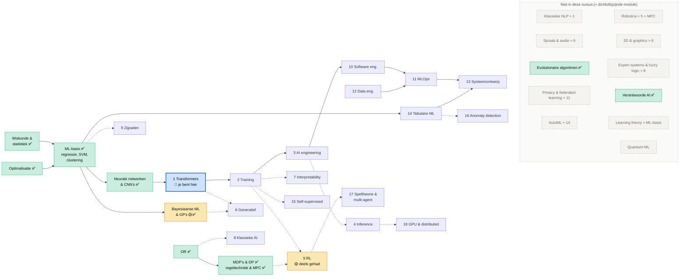

# Zelf AI aanleren
### Van ML-basis naar hoe moderne AI (zoals Claude) écht werkt, en hoe je het als ML engineer bouwt
*Zelfstudie-cursus voor Jeroen — editie 2026-2027*

---

## Cursusdoelen

Je kent machine learning al: regressie en classificatie, neurale netwerken en CNN's, Bayesiaanse ML, optimalisatie en OR, MDP's, regeltechniek en MPC (het groene deel van het [routediagram](#aanbevolen-route)). Deze cursus bouwt daarop verder, op drie terreinen waar de meeste ML-opleidingen stoppen:

1. ⚪ **De technologie achter huidige AI-systemen** (modules 1–4): hoe een model als Claude werkt, getraind wordt en efficiënt draait.
2. 🟢🔵 **De bredere AI-wereld** (modules 5–9 en 15–17): RL, generatieve modellen, interpretability, klassieke AI, self-supervised learning, anomaly detection en multi-agent systemen.
3. 🟠 **Het vak van ML engineer** (modules 10–14 en 18): van een model in een notebook naar een systeem dat in productie draait, tot en met trainen op GPU-clusters.

Na deze cursus kun je:
- uitleggen, tot op matrixniveau, wat er gebeurt als een taalmodel een woord voorspelt;
- beschrijven hoe een model als Claude wordt getraind: pretraining, post-training en RL;
- zelf LLM-systemen bouwen en evalueren (RAG, agents, tools);
- de belangrijkste AI-deelgebieden buiten LLM's plaatsen en de kernmethode van elk zelf implementeren;
- een ML-systeem ontwerpen, bouwen, uitrollen en bewaken zoals in het bedrijfsleven, inclusief data-pipelines en tabeldata;
- begrijpen hoe modellen op één GPU en over duizenden GPU's worden getraind;
- een ML-systeemontwerp-case doen zoals in sollicitaties bij consultancies en tech-bedrijven.

**Uitgangspunt:** de ML-basis wordt **niet** opnieuw uitgelegd. Waar een module erop voortbouwt, staat een korte "🔁 Weet je nog?"-verwijzing in plaats van een herhaling. Elke module vermeldt bovenaan welke voorkennis wordt overgeslagen.

**Filosofie:** zelf bouwen gaat boven lezen. Elke module krijgt uitleg in verhaalvorm, figuren met echte data, speeltuinen en opdrachten waarin je dingen vanaf nul implementeert, plus een voorbeeld uit de praktijk (🌍) dat laat zien waarom het ertoe doet. Een module is een hoofdstuk, geen collegeblok. Werk in je eigen tempo.

---

## Modules

**Status:** module 1 is volledig uitgewerkt (notes, figuren, speeltuinen, opdrachten, zelftoets). Modules 2–18 hebben al een overzichtspagina met motivatie, praktijkvoorbeeld, hoofdstukken, opdrachten en bronnen; de volledige uitwerking volgt module voor module.

| # | Module | Status | Wat je leert | 🌍 Bekend van |
|---|--------|--------|--------------|---|
| ⚪ 1 | [**Transformers van binnen**](modules/01-transformers/README.md) | ✅ beschikbaar | tokens, embeddings, attention, het transformer-block, generatie, KV-cache | Google Search (2019), ChatGPT (2022) |
| ⚪ 2 | [Van tekstvoorspeller naar assistent](modules/02-training/README.md) | 🔜 | pretraining, scaling laws, fine-tuning, RLHF, Constitutional AI, reasoning-modellen | ChatGPT: van GPT-3 naar assistent |
| ⚪ 3 | [AI engineering: LLM's in systemen](modules/03-ai-engineering/README.md) | 🔜 | prompting, embeddings en vector search, RAG, tool use en agents, evals | Morgan Stanley AI-assistent (2023) |
| ⚪ 4 | [Inference en efficiëntie](modules/04-inference/README.md) | 🔜 | quantization, LoRA, distillation, serving, lokaal draaien | LLaMA op een MacBook (2023) |
| 🟢 5 | [Reinforcement learning](modules/05-reinforcement-learning/README.md) | 🔜 (deels gehad) | Q-learning, DQN, policy gradients, PPO, MCTS | AlphaGo verslaat Lee Sedol (2016) |
| 🟢 6 | [Generatieve modellen: beeld en multimodaal](modules/06-generatieve-modellen/README.md) | 🔜 | diffusion, flow matching, CLIP, vision transformers | Stable Diffusion (2022) |
| 🟢 7 | [Interpretability en alignment](modules/07-interpretability/README.md) | 🔜 | circuits, superposition, sparse autoencoders, alignment-problemen | Golden Gate Claude (2024) |
| 🔵 8 | [Klassieke en symbolische AI](modules/08-klassieke-ai/README.md) | 🔜 | zoeken, planning, logica, neuro-symbolisch | Deep Blue verslaat Kasparov (1997) |
| 🔵 9 | [Zijpaden: causal inference, GNN's, time series](modules/09-zijpaden/README.md) | 🔜 | causaliteit, graph neural networks, tijdreeksen met deep learning | Google Maps-aankomsttijden (2020) |
| 🟠 10 | [Software engineering voor ML](modules/10-software-engineering/README.md) | 🔜 | professionele Python, testen, git, FastAPI, Docker | Knight Capital: $440M in 45 min (2012) |
| 🟠 11 | [Van notebook naar productie: MLOps en LLMOps](modules/11-mlops/README.md) | 🔜 | experiment tracking, CI/CD, deployment, monitoring, LLMOps | Zillow Offers: $408M afgeschreven (2021) |
| 🟠 12 | [Data engineering](modules/12-data-engineering/README.md) | 🔜 | gevorderde SQL, pipelines, dbt, grote data, datakwaliteit | Uber Michelangelo (2017) |
| 🟠 13 | [ML-systeemontwerp en evaluatie](modules/13-systeemontwerp/README.md) | 🔜 | systemen ontwerpen, A/B-testen, sollicitatiecases | Bing: +12% omzet door één A/B-test (2012) |
| 🟠 14 | [Klassieke ML in de praktijk](modules/14-tabulaire-ml/README.md) | 🔜 | gradient boosting, feature engineering, data leakage, SHAP | XGBoost wint de Higgs Challenge (2014) |
| 🟢 15 | [Self-supervised en representatie-leren](modules/15-self-supervised/README.md) | 🔜 | contrastive learning, masked modelling, DINO, CLIP | CLIP leert zien zonder labels (2021) |
| 🔵 16 | [Anomaly detection](modules/16-anomaly-detection/README.md) | 🔜 | Isolation Forest, autoencoders, tijdreeksen, evaluatie bij scheve klassen | Visa: ~$25 mld fraude per jaar voorkomen |
| 🟢 17 | [Speltheorie en multi-agent systemen](modules/17-speltheorie-multi-agent/README.md) | 🔜 | Nash-evenwicht, CFR, multi-agent RL, self-play, mechanism design | Pluribus verslaat pokerprofs (2019) |
| 🟠 18 | [GPU-programmering en distributed training](modules/18-gpu-distributed/README.md) | 🔜 | Triton/CUDA, mixed precision, DDP/FSDP/ZeRO, pipeline-parallelisme | DeepSeek-V3 getraind voor ~$5,6 mln (2024) |

⚪ = kern (hoe moderne AI werkt) · 🟢 = verbreding · 🔵 = verdieping/zijpad · 🟠 = engineering (van model naar product)

### Aanbevolen route



- 🟩 **Groen** = al gehad (vak, stage of thesis) · 🟨 **geel** = nu bezig · 🟦 **blauw omlijnd** = waar je nu bent · paars = modules in deze cursus · ⬜ **grijs gestippeld** = niet in deze cursus (met de module waar het het dichtst bij ligt).
- **Hoofdroute (doorgetrokken pijlen):** 1 → 2 → 3 geeft je de AI-kennis waarmee je opvalt. Daarna 10 → 11, waarin je het project uit module 3 in productie zet: samen je sterkste portfolioproject. Rond af met 13 voor sollicitaties.
- **12 en 14** kun je parallel doen. 14 is vooral belangrijk voor consulting, waar veel klantdata tabeldata is.
- **4–9 en 15–18** naar interesse. De stippellijnen tonen welke voorkennis handig is: RL (5) bouwt bijvoorbeeld voort op je MDP-kennis uit Stochastic Decision Theory.

### Wat bewust buiten deze cursus valt

De grijze vakjes rechts in het diagram, met uitleg:

| Onderwerp | Wat het is | Waarom niet (nu) |
|---|---|---|
| Klassieke NLP | n-grams, HMM's, parsers: taalverwerking van vóór de transformer | grotendeels vervangen door LLM's; historisch interessant |
| Spraak & audio | spraakherkenning, tekst-naar-spraak, audiomodellen | eigen vakgebied; de principes (transformers, diffusion) zie je in M1 en M6 |
| 3D & graphics | NeRF, 3D-reconstructie, gaussian splatting | niche, ver van je doelen |
| Learning theory | PAC-learning, VC-dimensie, generalisatiebewijzen | voor onderzoekers, niet nodig als engineer |
| AutoML & recommender systems | automatisch modellen en hyperparameters kiezen; aanbevelingen | AutoML is vooral een tool (komt kort langs in M14); recommenders als ontwerpcase in M13 |
| Evolutionaire algoritmen ✅ | genetische algoritmen, optimalisatie via "natuurlijke selectie" | al gehad |
| Expert systems & fuzzy logic | regelgebaseerde AI uit de jaren '80–'90 | vooral historisch |
| Robotica & embodied AI | AI in fysieke systemen | je regeltechniek-achtergrond is hier de basis; eigen vakgebied |
| Verantwoorde AI & regelgeving ✅ | EU AI Act, fairness, bias | al gehad |
| Privacy & federated learning | trainen zonder data te centraliseren, differential privacy | niche |
| Quantum-ML & neuromorphic | ML op quantumcomputers en hersen-geïnspireerde chips | experimenteel, ver van de praktijk |

---

## Mini's

Korte deep-dives over één concept dat steeds terugkomt. De notes verwijzen ernaar op het moment dat je ze nodig hebt; een opfrisser is voor stof die je in principe al kent.

| Mini | Onderwerp |
|------|-----------|
| M1 | [Softmax en temperatuur](minis/M1-softmax-en-temperatuur.md) |
| M2 | [Waarom delen door √d_k?](minis/M2-waarom-wortel-dk.md) |
| M3 | [Het inproduct als "hoeveel lijken deze op elkaar?"](minis/M3-inproduct-en-matrices.md) (voorkennis-opfrisser) |
| M4 | [Cross-entropy, of "hoe verrast was het model?"](minis/M4-cross-entropy.md) (voorkennis-opfrisser) |

---

## ▶ Speeltuinen (interactief)

Bij de notes horen interactieve pagina's die in je browser draaien, met echte GPT-2-data:

| Speeltuin | Wat je doet | Hoort bij |
|---|---|---|
| [🔤 Tokenizer](https://jeroenderuijter2002.github.io/Self-learning-AI/interactief/tokenizer.html) | zelf tekst typen en zien hoe GPT-2/4/4o hem opknippen; BPE stap voor stap | 1.1, O1 |
| [👀 Attention](https://jeroenderuijter2002.github.io/Self-learning-AI/interactief/attention.html) | de formule met de hand, en alle 144 heads van GPT-2 verkennen | 1.2, O2, O4 |
| [🔭 Logit lens](https://jeroenderuijter2002.github.io/Self-learning-AI/interactief/logitlens.html) | zien wat GPT-2 "denkt" na elke laag | 1.3 |
| [🎲 Sampling](https://jeroenderuijter2002.github.io/Self-learning-AI/interactief/sampling.html) | temperatuur, top-k en top-p op echte voorspellingen | 1.4, M1 |

Alle speeltuinen staan ook op het [overzicht](https://jeroenderuijter2002.github.io/Self-learning-AI/interactief/). Offline werken ze ook: open de bestanden in `interactief/` met een dubbelklik. Nieuwe modules krijgen hier hun eigen speeltuinen.

---

## Materiaal

**Software:** zie [SOFTWARE.md](SOFTWARE.md). Python + NumPy + PyTorch is genoeg. Google Colab werkt ook.

**Kernbronnen** (allemaal gratis):
- Andrej Karpathy, *[Neural Networks: Zero to Hero](https://karpathy.ai/zero-to-hero.html)*: de beste "bouw het zelf"-serie die er is
- 3Blue1Brown, *[Deep Learning-serie](https://www.3blue1brown.com/topics/neural-networks)*: visuele intuïtie
- Stanford CS336, *[Language Modeling from Scratch](https://stanford-cs336.github.io/)*: universitair niveau, voor als je dieper wilt
- Lilian Weng, *[Lil'Log](https://lilianweng.github.io/)*: heldere overzichtsposts over vrijwel elk onderwerp
- Chip Huyen, *Designing Machine Learning Systems* (O'Reilly, 2022): het standaardboek voor de engineering-modules 10–14

Elke module noemt daarnaast zijn eigen papers, boeken en tools onder *Belangrijkste bronnen*.

---

## Repostructuur

```
README.md               ← je bent hier
SOFTWARE.md             ← installatie
minis/                  ← korte deep-dives (+ figures/)
modules/
  01-transformers/
    README.md           ← leerdoelen, leespad, planning
    notes/              ← uitleg (lees deze in volgorde)
    figures/            ← alle figuren uit de notes
    opdrachten/         ← opdrachten + Python-skeletons
    oplossingen/        ← pas kijken als je vastzit
    zelftoets.md        ← check of je het echt snapt
  02-training/ … 18-gpu-distributed/
    README.md           ← overzicht; notes en opdrachten volgen
interactief/             ← speeltuinen (HTML), werken via GitHub Pages of lokaal
tools/
  make_figures.py       ← maakt alle figuren opnieuw, met echte modeldata
  export_interactive_data.py ← maakt de GPT-2-data voor de speeltuinen
```

**Over de figuren:** waar mogelijk zijn de figuren gemaakt met **echte data**: attention-patronen en voorspellingen van GPT-2, de echte GPT-4-tokenizer, en tijdmetingen. Ze zijn dus geen illustraties, maar resultaten die je zelf kunt reproduceren met `python tools/make_figures.py`. Het script zelf lezen is ook leerzaam: het laat zien hoe je in een model kijkt.

## Hoe werk je een module door?

1. Lees de **module-README**: waarom de module ertoe doet (🌍), wat je al kent en dus overslaat (⏭️), de leerdoelen en het leespad.
2. Wissel **notes** af met **video's** en **speeltuinen**. De notes zeggen wanneer je wat opent (▶ Probeer het zelf).
3. Doe de **opdrachten**. De code-opdrachten hebben ingebouwde tests: als `python oX_....py` "Alle tests geslaagd!" print, ben je klaar.
4. Maak de **zelftoets** zonder te spieken. Kun je een vraag niet beantwoorden, ga dan terug naar de notes.
5. Zet de module in het [routediagram](#aanbevolen-route) op groen: pas `class ... had` aan en verplaats de 📍 naar je volgende module.
