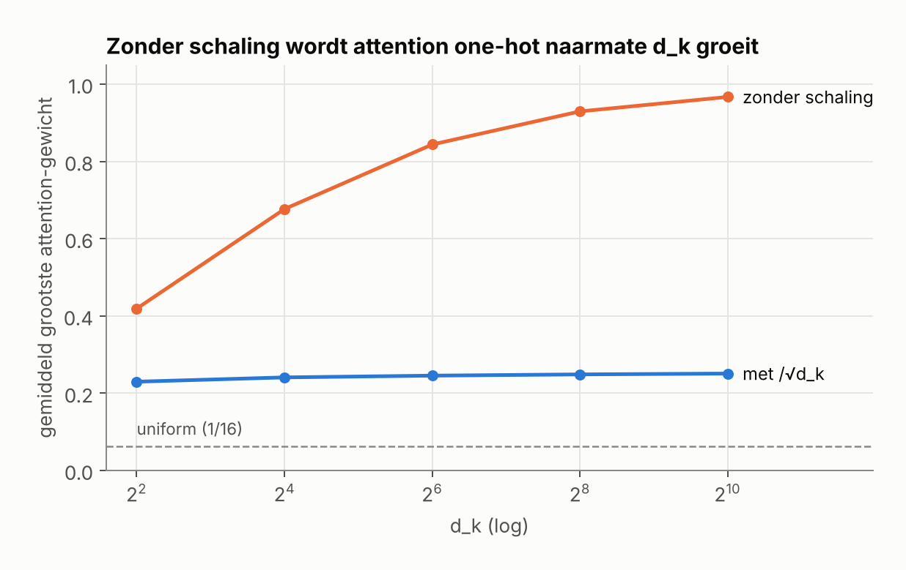

# 🟡 Mini M2: Waarom delen door √d_k?

*Komt terug in: attention (1.2), opdracht O2*

## De vraag

In $\text{softmax}(QK^\top / \sqrt{d_k})$: waarom staat daar precies $\sqrt{d_k}$, en niet $d_k$, of niets?

## Het argument (je kent dit al uit kansrekening)

Neem aan dat de componenten van $\mathbf{q}$ en $\mathbf{k}$ onafhankelijk zijn, met gemiddelde 0 en variantie 1 (ongeveer zo bij initialisatie). Dan:

$$\mathbf{q}^\top \mathbf{k} = \sum_{i=1}^{d_k} q_i k_i$$

Elke term $q_i k_i$ heeft gemiddelde $0$ en variantie $\text{Var}(q_i)\text{Var}(k_i) = 1$. De som van $d_k$ onafhankelijke termen heeft dus

$$\text{Var}(\mathbf{q}^\top \mathbf{k}) = d_k \quad\Rightarrow\quad \text{std} = \sqrt{d_k}$$

Bij $d_k = 128$ hebben scores een standaardafwijking van ~11. Logits van ±20 in een softmax geven een **vrijwel one-hot** verdeling (zie [M1](M1-softmax-en-temperatuur.md): grote logits zijn een lage temperatuur).

**Delen door $\sqrt{d_k}$ brengt de variantie terug naar 1**, ongeacht de dimensie.

## Waarom is "bijna one-hot" erg?

De afgeleide van softmax is $\partial p_i / \partial z_j = p_i(\delta_{ij} - p_j)$. Als $\mathbf{p}$ one-hot is ($p_i \in \{0, 1\}$), dan is elke term $\approx 0$:

- **verdwijnende gradiënten**: de attention-gewichten leren niet meer;
- elk token kijkt (willekeurig) naar precies één ander token, in plaats van informatie te mengen.

Je zag dit al in O2: zonder schaling was het gemiddelde maximale gewicht ~0,97, met schaling ~0,42. Over verschillende dimensies:



*Figuur M2. Simulatie met 16 tokens en willekeurige q, k ~ N(0,1). Zonder schaling loopt het grootste attention-gewicht naar 1 (one-hot) naarmate d_k groeit. Met /√d_k blijft de verdeling even "zacht", ongeacht de dimensie. Dat is precies wat je wilt: het gedrag van attention mag niet afhangen van hoe breed je de heads maakt.*

## 🔬 Verifieer het zelf

```python
import numpy as np
rng = np.random.default_rng(0)
for d in [4, 16, 64, 256, 1024]:
    q, k = rng.normal(size=(10000, d)), rng.normal(size=(10000, d))
    dots = (q * k).sum(1)
    print(f"d={d:5}: std(q·k)={dots.std():6.2f}  √d={np.sqrt(d):6.2f}  "
          f"std(q·k/√d)={(dots / np.sqrt(d)).std():.2f}")
```

## Kanttekening
Dit argument geldt bij initialisatie. Tijdens training kan het model de normen van $W_Q$ en $W_K$ zelf aanpassen en dus effectief een eigen "temperatuur" leren. Sommige moderne modellen gebruiken extra trucs, zoals **QK-norm** (LayerNorm op $\mathbf{q}$ en $\mathbf{k}$), omdat attention-logits bij grote modellen alsnog kunnen exploderen.
