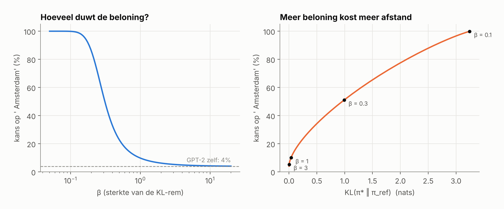

# 🟡 Mini M5: KL-divergentie, of "hoe ver ben je afgedreven?"

*Komt terug in: notes 2.4 (de KL-rem in RLHF), 2.5 (DPO), 2.6 (GRPO), module 4 (distillation), module 5 (PPO en trust regions), module 6 (VAE's)*

## Je kent het (bijna) al

Uit [Mini M4](M4-cross-entropy.md) ken je cross-entropy: als de echte verdeling $p$ is en jouw model $q$ zegt, dan is je gemiddelde verrassing

$$H(p, q) = -\sum_x p(x) \log q(x)$$

Die is nooit kleiner dan de **entropie** van $p$ zelf, $H(p) = -\sum_x p(x) \log p(x)$: de verrassing die je hebt als je de echte verdeling kent. Het verschil is de **KL-divergentie** (Kullback-Leibler):

$$\mathrm{KL}(p \Vert q) = H(p, q) - H(p) = \sum_x p(x) \log \frac{p(x)}{q(x)}$$

Lees het als: **hoeveel extra verrassing (in nats) krijg je gemiddeld als de wereld $p$ is, maar jij $q$ gelooft?** Is $q = p$, dan is de KL nul. Anders is hij positief. (Dat hij nooit negatief is, volgt uit de ongelijkheid van Jensen; je kent dat uit je Bayesiaanse vak, waar de KL in de ELBO zit.)

Daarom is het minimaliseren van cross-entropy tijdens pretraining hetzelfde als het minimaliseren van $\mathrm{KL}(p_{\text{data}} \Vert q_\theta)$: de entropie van de data hangt niet van je model af.

## Twee dingen om te onthouden

**1. KL is geen afstand.** Hij is niet symmetrisch: $\mathrm{KL}(p \Vert q) \neq \mathrm{KL}(q \Vert p)$. Een voorbeeld met twee munten: $p$ = (0,5; 0,5) en $q$ = (0,9; 0,1).

| | berekening | waarde |
|---|---|---|
| $\mathrm{KL}(p \Vert q)$ | $0{,}5 \ln\frac{0{,}5}{0{,}9} + 0{,}5 \ln\frac{0{,}5}{0{,}1}$ | 0,51 nats |
| $\mathrm{KL}(q \Vert p)$ | $0{,}9 \ln\frac{0{,}9}{0{,}5} + 0{,}1 \ln\frac{0{,}1}{0{,}5}$ | 0,37 nats |

De richting doet ertoe: in $\mathrm{KL}(p \Vert q)$ wordt er gemiddeld onder $p$. Als $q$ ergens een kans van bijna nul geeft waar $p$ dat niet doet, wordt de KL enorm.

**2. Bij een taalmodel tel je hem per token op.** De kans op een heel antwoord is het product van de tokenkansen, dus de log-verhouding is een som:

$$\log \frac{\pi_\theta(y \mid x)}{\pi_{\text{ref}}(y \mid x)} = \sum_t \log \frac{\pi_\theta(y_t \mid x, y_{<t})}{\pi_{\text{ref}}(y_t \mid x, y_{<t})}$$

Gemiddeld over antwoorden $y \sim \pi_\theta$ is dat precies $\mathrm{KL}(\pi_\theta \Vert \pi_{\text{ref}})$. Daarom kun je in RLHF de KL-straf per token aftrekken van de beloning: je hebt alleen de log-kansen van beide modellen op de gegenereerde tokens nodig.

## De KL-rem in actie

In RLHF (notes [2.4](../modules/02-training/notes/2.4-rlhf.md)) maximaliseer je beloning min $\beta$ keer de KL tot het referentiemodel. In [2.5](../modules/02-training/notes/2.5-constitutional-ai-en-dpo.md) zie je dat de oplossing daarvan $\pi^* \propto \pi_{\text{ref}} \cdot e^{r/\beta}$ is. Dat kun je op een echte verdeling uitrekenen. Neem de voorspelling van GPT-2 na *"The capital of the Netherlands is"* (uit de [Sampling-speeltuin](https://jeroenderuijter2002.github.io/Self-learning-AI/interactief/sampling.html)), en geef een beloning van 1 aan het token " Amsterdam" en 0 aan alle andere:

*Figuur M5. Het RLHF-optimum op de echte next-token-verdeling van GPT-2. Links: de kans op " Amsterdam" na optimalisatie, voor verschillende $\beta$. Rechts: diezelfde kans tegen de KL tot GPT-2. Gemaakt met [`tools/make_figures_module02.py`](../tools/make_figures_module02.py) (`m5`).*

Drie dingen om te zien. Bij grote $\beta$ (sterke rem) blijft het model bij GPT-2: 4% kans. Bij kleine $\beta$ gaat alle kans naar " Amsterdam". En de KL heeft dan een plafond van $-\ln(0{,}04) \approx 3{,}2$ nats: als het nieuwe model zeker is van één token, is de KL precies de verrassing die het oude model bij dat token had. **Hoe onwaarschijnlijker het gedrag dat je wilt onder het oude model, hoe meer KL het kost.** Dat is de intuïtie achter de rem: het model mag veranderen, maar elke stap weg van wat het "van nature" zou doen, wordt in rekening gebracht.

---
[← Terug naar het overzicht](../README.md)
