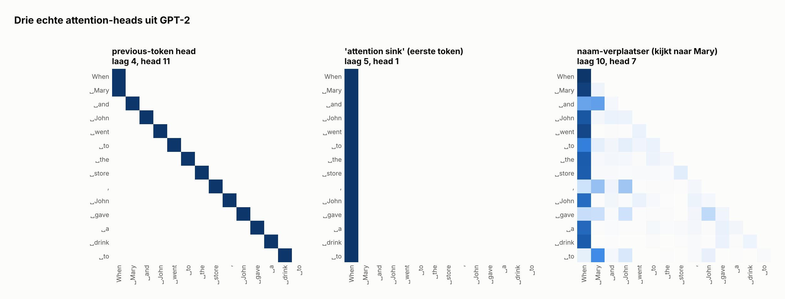
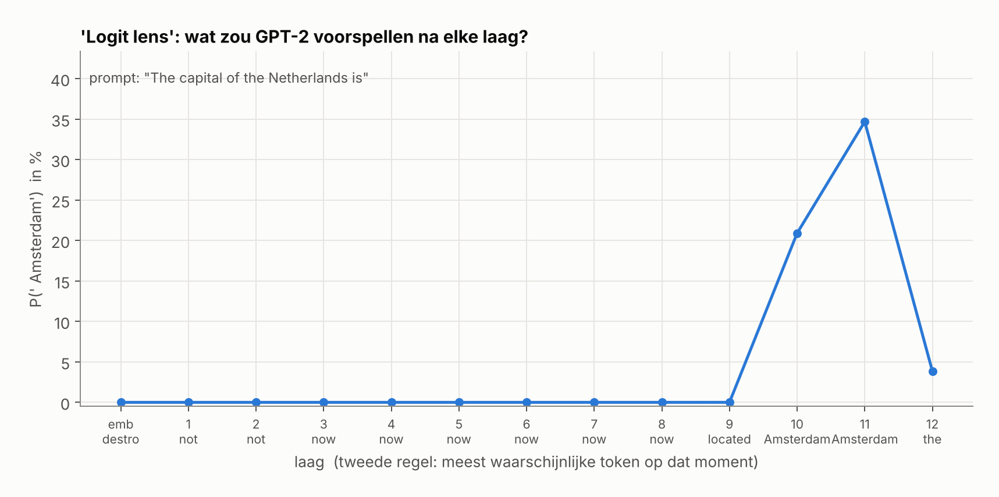
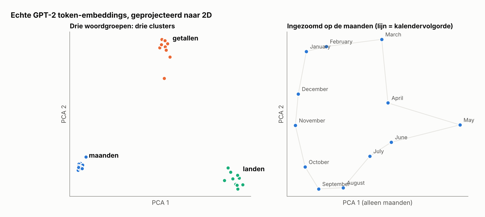
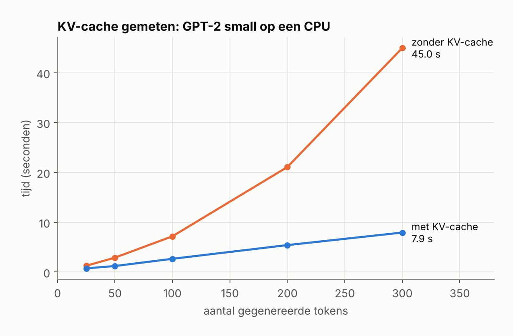

# Module 1: Transformers van binnen

> *"Attention is all you need."* Vaswani et al., 2017. Bijna elke AI die je nu gebruikt (Claude, GPT, Gemini, Llama) is in de kern deze architectuur, opgeschaald.

## Waarom deze module?

Als iemand vraagt "hoe werkt Claude?", is het eerlijke antwoord in twee delen te splitsen:
1. **De architectuur**: een *decoder-only transformer* die gegeven tekst steeds het volgende token voorspelt. **(Deze module.)**
2. **De training**: hoe je dat ding zo traint dat het een behulpzame assistent wordt. (Module 2.)

Na deze module kun je deel 1 uitleggen op whiteboard-niveau én in code.

## Leerdoelen

Na deze module kun je:
- [ ] uitleggen waarom LLM's werken met **tokens** in plaats van woorden of letters, en zelf een BPE-tokenizer bouwen;
- [ ] **self-attention** uitleggen in termen van queries, keys en values, en het implementeren in NumPy;
- [ ] uitleggen waarom we door $\sqrt{d_k}$ delen en waarom er een **causal mask** is;
- [ ] een volledig **transformer-block** tekenen (attention, MLP, residuals, LayerNorm) en zeggen wat elk onderdeel doet;
- [ ] zelf een mini-GPT trainen die Shakespeare-achtige tekst genereert;
- [ ] uitleggen hoe tekst gegenereerd wordt: sampling, temperatuur, **KV-cache**;
- [ ] moderne varianten plaatsen: RoPE, Mixture-of-Experts, lange context windows.

## Voorkennis

Je hebt al: lineaire algebra, gradient descent, cross-entropy, basis neurale netwerken. Is backprop wat weggezakt? Kijk dan eerst Karpathy's [micrograd-video](https://www.youtube.com/watch?v=VMj-3S1tku0) (optioneel).

## Wat je gaat zien

Een paar van de 15 figuren in deze module, allemaal gemaakt met echte modeldata:

| | |
|---|---|
|  |  |
| *Echte attention-heads uit GPT-2 (1.2)* | *GPT-2 "denkt" laag voor laag naar Amsterdam toe (1.3)* |
|  |  |
| *Maanden vormen een ring in de embedding-ruimte (1.1)* | *KV-cache gemeten: 45 s → 8 s (1.4)* |

## Leespad

| Stap | Type | Wat | Tijd |
|------|------|-----|------|
| 1 | 🎬 Video | 3Blue1Brown, [*But what is a GPT?*](https://www.youtube.com/watch?v=wjZofJX0v4M): het grote plaatje | 27 min |
| 2 | 📖 Notes | [1.1 Tokens en embeddings](notes/1.1-tokens-en-embeddings.md) | 30 min |
| 3 | 🛠️ Opdracht | [O1: Bouw je eigen BPE-tokenizer](opdrachten/O1-tokenizer.md) | 1–2 u |
| 4 | 🎬 Video | 3Blue1Brown, [*Attention in transformers, step-by-step*](https://www.youtube.com/watch?v=eMlx5fFNoYc) | 26 min |
| 5 | 📖 Notes | [1.2 Attention](notes/1.2-attention.md) + [Mini M2](../../minis/M2-waarom-wortel-dk.md) | 45 min |
| 6 | 🛠️ Opdracht | [O2: Attention from scratch in NumPy](opdrachten/O2-attention-numpy.md) | 1–2 u |
| 7 | 📖 Notes | [1.3 Het transformer-block](notes/1.3-transformer-block.md) | 30 min |
| 8 | 🎬🛠️ Video + opdracht | [O3: Bouw je eigen GPT](opdrachten/O3-bouw-je-eigen-gpt.md), met Karpathy's [*Let's build GPT*](https://www.youtube.com/watch?v=kCc8FmEb1nY) | 4–6 u |
| 9 | 📖 Notes | [1.4 Van model naar tekst](notes/1.4-van-model-naar-tekst.md) + [Mini M1](../../minis/M1-softmax-en-temperatuur.md) | 40 min |
| 10 | 🛠️ Opdracht | [O4: GPT-2 onder de loep](opdrachten/O4-gpt2-onder-de-loep.md) | 1–2 u |
| 11 | ✅ Toets | [Zelftoets](zelftoets.md) | 30 min |

**Totaal:** ongeveer 12–16 uur. Verspreid over 2–3 weken naast je thesis is dat goed te doen.

## Speeltuinen (interactief, geen installatie)

Open deze naast de notes. Zelf aan knoppen draaien is de snelste weg naar intuïtie.
- **[Tiktokenizer](https://tiktokenizer.vercel.app)**: typ tekst en zie hoe echte LLM's die opknippen
- **[Transformer Explainer](https://poloclub.github.io/transformer-explainer/)**: een live GPT-2 in je browser met elke matrix zichtbaar
- **[LLM Visualization (bbycroft)](https://bbycroft.net/llm)**: een 3D-doorloop van een volledige GPT, stap voor stap

## Verder lezen (optioneel)

- 📄 [*Attention Is All You Need*](https://arxiv.org/abs/1706.03762), het originele paper. Na deze module is het goed te lezen.
- 📖 Jay Alammar, [*The Illustrated Transformer*](https://jalammar.github.io/illustrated-transformer/)
- 🎬 Karpathy, [*Let's build the GPT Tokenizer*](https://www.youtube.com/watch?v=zduSFxRajkE): de diepe duik in tokenization (2u13m)
- 🎬 Karpathy, [*Let's reproduce GPT-2 (124M)*](https://www.youtube.com/watch?v=l8pRSuU81PU): de volgende stap na O3
- 💻 [nanoGPT](https://github.com/karpathy/nanoGPT) en de opvolger [nanochat](https://github.com/karpathy/nanochat), een complete ChatGPT-kloon in een minimale codebase
