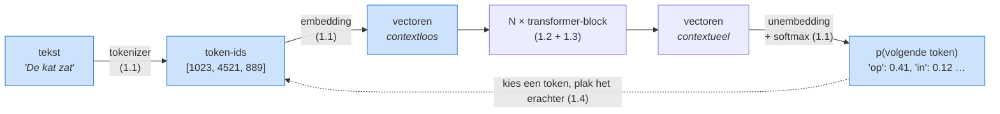
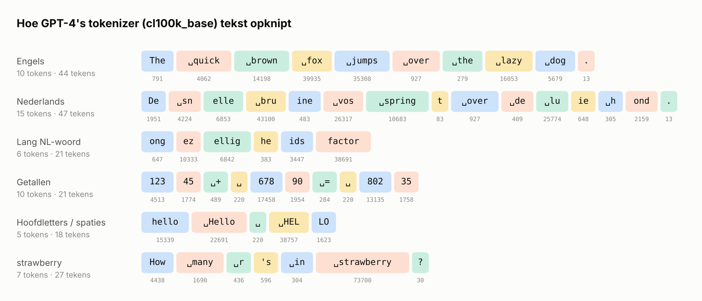
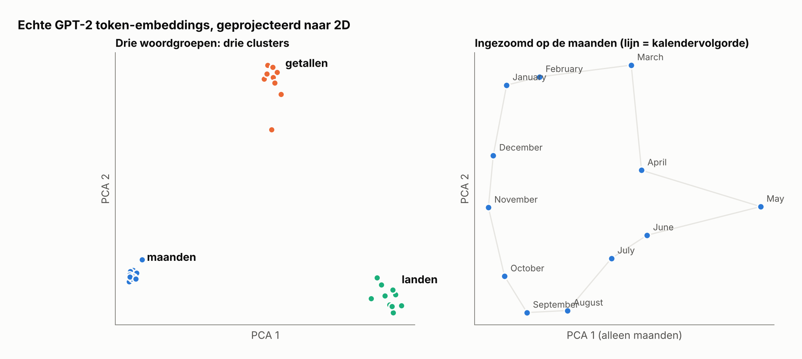

# 1.1 Tokens en embeddings

*Module 1: Transformers van binnen* · ⏱️ ~50 min · 🎬 vooraf of na afloop: 3B1B [*But what is a GPT?*](https://www.youtube.com/watch?v=wjZofJX0v4M)

> **Waar we naartoe werken.** Aan het eind van dit hoofdstuk weet je wat er gebeurt in de allereerste en allerlaatste stap van een taalmodel: hoe tekst getallen wordt, en hoe getallen weer tekst worden. Alles daartussen (attention, MLP's) behandelen we in 1.2 en 1.3.

---

## Begin met een spelletje

Maak deze zin af:

> *"Ik drink mijn koffie altijd met melk en …"*

Je dacht waarschijnlijk "suiker". Misschien "een koekje". Vrijwel zeker niet "een schroevendraaier". Zonder erbij na te denken heb je zojuist een **kansverdeling** gemaakt over mogelijke volgende woorden: "suiker" kreeg een hoge kans, "schroevendraaier" een heel lage.

Dat is, letterlijk, het enige wat een taalmodel doet. Claude, GPT, Gemini: het zijn allemaal machines die gegeven een stuk tekst een kansverdeling geven over wat er **direct daarna** komt. In formule:

$$p_\theta(x_{t+1} \mid x_1, \dots, x_t)$$

Lees dat als: "de kans op het volgende stukje $x_{t+1}$, gegeven alles wat er al stond ($x_1$ tot $x_t$)". De $\theta$ staat voor de parameters van het model: de miljarden getallen die tijdens het trainen worden afgesteld.

"Maar Claude schrijft hele essays en lost programmeerproblemen op!" Klopt. Dat doet hij door dit trucje **steeds te herhalen**: voorspel één stukje, plak het achter de tekst, voorspel het volgende, enzovoort. Je zult zien dat al het "slimme" gedrag uit deze ene simpele taak voortkomt. Hoe precies, dat is het verhaal van deze hele cursus.

> 🔁 **Weet je nog?** Dit is gewoon **classificatie**, zoals je die kent uit je ML-vakken. Een classifier krijgt input en geeft een kansverdeling over klassen (via een softmax). Hier is de input "alle tekst tot nu toe" en zijn de klassen "alle mogelijke volgende stukjes tekst". Het enige bijzondere is dat er zo'n 50.000 tot 200.000 klassen zijn.
>
> En de loss? Ook bekend: **cross-entropy**, $-\log p(\text{juiste antwoord})$. Het model wordt gestraft als het verrast is door het echte volgende woord. Is dit weggezakt, lees dan eerst [Mini M4: Cross-entropy](../../../minis/M4-cross-entropy.md) (5 minuten).

Het pad dat tekst door het model aflegt ziet er zo uit. De gekleurde stappen zijn voor dit hoofdstuk:

---

## Deel 1: wat is "een stukje tekst"? (tokenization)

We hebben het steeds over "het volgende stukje". Maar wat is een stukje? Een letter? Een woord? Dat is een echte ontwerpkeuze, en het blijkt nogal uit te maken.

### Poging 1: letters

Neem gewoon elke letter als een "klasse". Lekker simpel: je hebt maar een stuk of 100 klassen (a–z, A–Z, cijfers, leestekens).

**Probleem:** teksten worden heel lang. Deze alinea is al zo'n 300 letters. En je gaat in 1.2 zien dat het rekenwerk van een transformer **kwadratisch** groeit met de lengte: 2× zo lang is 4× zoveel werk. Bovendien moet het model dan eerst leren dat "k-a-t" samen een ding is, voordat het iets over katten kan leren. Zonde van de capaciteit.

### Poging 2: woorden

Neem dan elk woord als klasse. Teksten worden korter, en "kat" is meteen één ding.

**Probleem:** hoeveel woorden zijn er? Neem alleen al het Nederlands. Daarin plak je woorden gewoon aan elkaar: *arbeidsongeschiktheidsverzekering*, *ongezelligheidsfactor*, *koffiezetapparaatonderdeel*. Daar komen typfouten bij, namen, nieuwe woorden en andere talen. Je vocabulaire wordt oneindig groot, en elk woord dat je niet kent wordt een "onbekend"-token. Het model is dan blind voor alles wat het niet eerder zag.

### De oplossing: iets ertussenin (subwords)

De oplossing is een compromis: **veelvoorkomende woorden worden één stukje, zeldzame woorden worden opgeknipt in kleinere stukjes**. Die stukjes heten **tokens**. Zo ziet dat er in de praktijk uit:

*Figuur 1.1. Echte output van de GPT-4-tokenizer. Elk gekleurd blok is één token, het kleine getal eronder is het token-id (het "klassenummer"). Het teken ␣ is een spatie.*

Kijk er even rustig naar. Er gebeuren een paar opvallende dingen:

- **Engelse woorden zijn bijna allemaal één token.** De tokenizer is getraind op vooral Engelse tekst, dus die woorden kwamen vaak genoeg voor om een eigen token te verdienen.
- **Nederlandse woorden worden in stukken gehakt**: `␣sn` + `elle`, `␣bru` + `ine`. "Snelle" kwam niet vaak genoeg voor.
- **De spatie zit vast aan het woord erna.** `Hello` (id 9906), `␣Hello` (id 22691) en `hello` (id 15339) zijn drie verschillende tokens. Voor het model zijn het net zo verschillende symbolen als "kat" en "hond".
- **`␣strawberry` is één token.** Onthoud deze, we komen er zo op terug.

> ▶ **Probeer het zelf:** open de **[Tokenizer-speeltuin](https://jeroenderuijter2002.github.io/Self-learning-AI/interactief/tokenizer.html)** en typ je eigen naam, je woonplaats en een zin uit je thesis. Wissel tussen de tokenizer van GPT-2 (2019) en die van GPT-4o (2024): hoeveel tokens scheelt dat bij Nederlandse tekst?

### Hoe kiest de tokenizer die stukjes? Byte Pair Encoding

Wie bepaalt dat `␣the` één token wordt en `snelle` niet? Niemand met de hand. Dat doet een simpel algoritme, **Byte Pair Encoding (BPE)**. Het idee lijkt op hoe je zelf afkortingen verzint als je veel aantekeningen maakt: schrijf je tien keer per pagina "machine learning", dan ga je op een gegeven moment "ML" schrijven.

BPE doet dat systematisch:

1. **Begin met de allerkleinste stukjes: losse bytes.** Elke tekst op een computer is uiteindelijk een rij bytes (getallen van 0 tot 255). Een "a" is byte 97, een emoji is een reeks van 4 bytes. Begin je met bytes, dan kun je *alles* representeren: er bestaat nooit een "onbekend teken".
2. **Tel welk paar buren het vaakst voorkomt** in een grote berg trainingstekst.
3. **Maak van dat paar één nieuw token** en vervang het overal.
4. **Herhaal** tot je vocabulaire de gewenste grootte heeft (bijvoorbeeld 50.000 tokens).

*Figuur 1.2. BPE op de string `aaabdaaabac`. "aa" komt het vaakst voor en wordt Z. Daarna is "Za" het vaakst, en dat wordt Y. Enzovoort. Na drie stappen zijn 11 tokens er 5 geworden. Merk op dat nieuwe tokens bestaan uit eerder gemaakte tokens: X = Yb = Zab = aaab.*

Omdat de merges uit de trainingsdata komen, krijgen woorden die daar vaak in voorkomen hun eigen token. Is die data vooral Engels, dan krijgt Engels de mooie lange tokens:

*Figuur 1.3. De BPE-tokenizer die je zelf gaat bouwen in O1, getraind op Shakespeare. Hoe meer merges, hoe meer bytes er gemiddeld in één token passen (hogere compressie). Maar op Nederlandse tekst (Max Havelaar) blijft hij achter: hij heeft simpelweg weinig Nederlandse woorddelen geleerd.*

> ▶ **Probeer het zelf:** onderaan de [Tokenizer-speeltuin](https://jeroenderuijter2002.github.io/Self-learning-AI/interactief/tokenizer.html) staat **"BPE stap voor stap"**. Typ een zin en klik merge voor merge door het algoritme. Je ziet live welk paar het vaakst voorkomt en wordt samengevoegd. Daarna bouw je het zelf in **[Opdracht O1](../opdrachten/O1-tokenizer.md)**.

### Waarom dit belangrijker is dan het lijkt

Tokenization klinkt als saai voorwerk. Maar een verrassend groot deel van de rare dingen die LLM's doen, komt hiervandaan.

**De beroemde strawberry-vraag.** Vraag een taalmodel "hoeveel r'en zitten er in strawberry?" en het gaat vaak mis. Kijk nog eens naar figuur 1.1: het model ziet geen letters s-t-r-a-w-b-e-r-r-y. Het ziet **één symbool**, token 73700. Vragen hoeveel r'en daarin zitten is alsof iemand je het Chinese karakter 草 laat zien en vraagt hoeveel keer de letter "a" erin zit. Het model moet het antwoord "uit het hoofd" weten.

**Rekenen.** `12345` wordt `123` + `45`. Een ander getal wordt op een andere plek geknipt. Het model ziet dus nooit netjes "eenheden, tientallen, honderdtallen" in vaste kolommen, zoals jij op de basisschool leerde. Optellen wordt daardoor onnodig moeilijk.

**Taal kost geld.** Hoe meer tokens, hoe meer rekenwerk:

*Figuur 1.4. Dezelfde alinea in vier talen, geteld met de GPT-4-tokenizer. Nederlands kost ~1,7× zoveel tokens als Engels, Grieks (ander schrift) zelfs ~5,5×. Een Nederlandse gebruiker betaalt dus meer per API-aanroep en kan minder tekst kwijt in het context window. Nieuwere tokenizers met grotere vocabulaires (GPT-4o: 200k) verkleinen dit verschil.*

---

## Deel 2: van token-id naar vector (embeddings)

We hebben nu een rij getallen, bijvoorbeeld `[1951, 4224, 6853]`. Maar dat zijn **namen**, geen hoeveelheden. Token 4224 is niet "twee keer zo veel" als token 2112. Het zijn gewoon labels, net als huisnummers.

> 🔁 **Weet je nog?** In ML noem je zoiets een **categorische variabele**, en de standaardaanpak is **one-hot encoding**: een vector van nullen met één 1 op de plek van de categorie. Met 50.000 tokens wordt dat een vector van 50.000 lang met één enkele 1.

One-hot heeft twee problemen. Het is enorm verspillend (49.999 nullen). En erger: **alle woorden staan even ver van elkaar af**. Het inproduct van de one-hot-vectoren van "kat" en "hond" is 0, net als dat van "kat" en "spreadsheet". Het model kan nergens aan zien dat kat en hond meer op elkaar lijken.

### Het idee: geef elk token een plek in een ruimte

De oplossing is elegant. Geef elk token een vector van bijvoorbeeld 768 getallen, en **laat het model zelf leren** welke getallen dat moeten zijn. We zetten al die vectoren in één grote tabel, de **embedding-matrix** $E$:

$$E \in \mathbb{R}^{V \times d_\text{model}}$$

- $V$ = aantal tokens in de vocabulaire (aantal rijen)
- $d_\text{model}$ = hoeveel getallen per token (aantal kolommen)

Het token met id 4224 krijgt rij 4224 uit die tabel:

$$\mathbf{x} = E[4224]$$

Dat is alles: een **opzoektabel**. (Wiskundig is het precies hetzelfde als "one-hot-vector × $E$", want die vermenigvuldiging pakt ook één rij. Maar opzoeken is veel sneller.)

| Model | $V$ (vocab) | $d_\text{model}$ |
|-------|-------------|------------------|
| GPT-2 small | 50.257 | 768 |
| GPT-3 | 50.257 | 12.288 |
| Llama 3 | 128.256 | 4.096 (8B) – 16.384 (405B) |

### Waarom gaan die vectoren iets betekenen?

Aan het begin van de training is $E$ willekeurig: puur ruis. Maar het model wordt beloond als het het volgende woord goed voorspelt. Stel dat "kat" en "hond" in vergelijkbare zinnen voorkomen ("ik aai de ___", "de ___ slaapt in de mand"). Dan is het voor het model handig om ze een **vergelijkbare vector** te geven. Wat het over de ene leert, werkt dan ook voor de andere.

Na het trainen ontstaat zo vanzelf een soort landkaart van betekenis. Dat is geen theorie, je kunt het meten:

*Figuur 1.5. Echte token-embeddings uit GPT-2. Elke vector heeft 768 getallen; met PCA heb ik ze platgeslagen tot 2 dimensies zodat we ze kunnen zien. **Links:** maanden, getallen en landen vormen elk een eigen cluster. **Rechts:** zoom in op alleen de maanden en ze liggen in een **ring, in kalendervolgorde**, met december weer naast januari. Niemand heeft GPT-2 verteld dat het jaar rond is. Dat heeft het opgemaakt uit hoe mensen over maanden schrijven.*

Laat dat even inwerken. Het model kreeg nooit de opdracht "leer wat een maand is". Het kreeg alleen de opdracht "voorspel het volgende token". Een cyclische kalender in zijn interne ruimte bleek daarbij gewoon nuttig.

Er is nog een bekend voorbeeld. In een goed getrainde embedding-ruimte krijgen **richtingen** betekenis:

$$E[\text{koning}] - E[\text{man}] + E[\text{vrouw}] \approx E[\text{koningin}]$$

De stap van "man" naar "vrouw" is ongeveer dezelfde stap als van "koning" naar "koningin". Er bestaat dus zoiets als een "vrouwelijk-richting" in de ruimte. (Dit voorbeeld komt van word2vec; in GPT-modellen is het minder netjes, maar het principe is hetzelfde. 3Blue1Brown laat het mooi zien in de video bovenaan.)

### Eén ding om goed te onthouden

De embedding van een token is **contextloos**. Het woord "bank" krijgt precies dezelfde vector in

- "ik zit op de **bank**" (meubel), en
- "ik werk bij de **bank**" (geldinstelling).

De tabel weet niets van de zin eromheen. **De hele rest van de transformer is één grote machine om die vectoren bij te werken met context**, zodat de vector van "bank" na een paar lagen wél "weet" welke bank bedoeld wordt. Hoe dat gaat, is het onderwerp van 1.2 (attention).

---

## Deel 3: van vector terug naar een woord (unembedding)

Spring nu naar het einde van het model. Na alle lagen heeft het laatste token een vector $\mathbf{h}$ (768 getallen) die "alles weet" over de tekst tot nu toe. Hoe maken we daar een kansverdeling over 50.257 tokens van?

Het antwoord is een mooie spiegeling van de embedding. We vergelijken $\mathbf{h}$ met **elk token** en kijken welke er het meest op lijkt.

> 🔁 **Weet je nog?** "Hoeveel lijken twee vectoren op elkaar?" meet je met het **inproduct**. Groot positief: zelfde richting, lijken op elkaar. Nul: niets mee te maken. Negatief: tegengesteld. Dit idee komt in deze module steeds terug, dus als het weggezakt is: lees [Mini M3: Het inproduct](../../../minis/M3-inproduct-en-matrices.md).

We nemen het inproduct van $\mathbf{h}$ met een vector voor elk token. Dat geeft 50.257 scores, de **logits**:

$$\text{logits} = \mathbf{h} W_U \qquad W_U \in \mathbb{R}^{d_\text{model} \times V}$$

Elke kolom van $W_U$ is een "token-vector", dus elk getal in `logits` is het inproduct van $\mathbf{h}$ met één token. Daarna maakt de softmax er kansen van (alle getallen positief, samen 1):

$$p(x_{t+1}) = \text{softmax}(\text{logits})$$

En nu het mooie: veel modellen gebruiken voor $W_U$ gewoon **dezelfde matrix als de embedding** ($W_U = E^\top$). Dat heet *weight tying*. Het idee is intuïtief: "als mijn eindvector lijkt op de embedding van ' Amsterdam', dan is ' Amsterdam' waarschijnlijk het volgende woord." Embedding en unembedding zijn dan letterlijk elkaars spiegelbeeld.

---

## Samenvatting: wat je nu weet

1. Een taalmodel is een **classifier** die het volgende token voorspelt, getraind met cross-entropy.
2. Tekst wordt opgeknipt in **tokens** met **BPE**: veelvoorkomende stukjes worden één token. Dat verklaart waarom LLM's slecht zijn in letters tellen en rekenen, en waarom Nederlands duurder is.
3. Elk token krijgt een geleerde **embedding**: een vector waarin betekenis als **meetkunde** zit (clusters, richtingen, zelfs een kalenderring).
4. Die embedding is nog **contextloos**. Context toevoegen is de taak van de rest van het model.
5. Aan het eind vergelijkt de **unembedding** de eindvector met alle tokens (inproduct), en een softmax maakt daar kansen van.

---

### ✏️ Denkvragen (antwoorden in de [zelftoets](../zelftoets.md))
1. Waarom start BPE met bytes in plaats van met letters of Unicode-tekens?
2. Je verdubbelt de vocabulaire. Welke matrices worden groter? Wat win je, wat verlies je?
3. In figuur 1.5 (rechts) staat "May" een beetje apart van de andere maanden. Kun je bedenken waarom? (Hint: wat betekent "may" nog meer in het Engels, en waarom maakt dat uit voor een *contextloze* embedding?)

**Volgende:** [Opdracht O1: Bouw je eigen tokenizer](../opdrachten/O1-tokenizer.md) → [1.2 Attention](1.2-attention.md)
