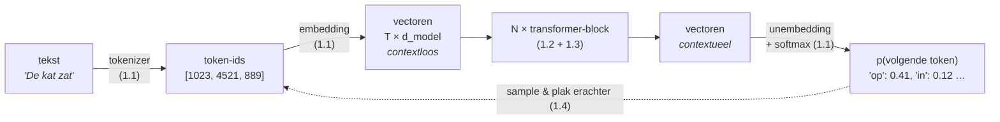
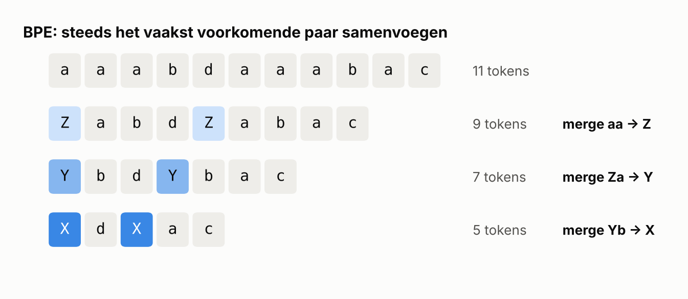
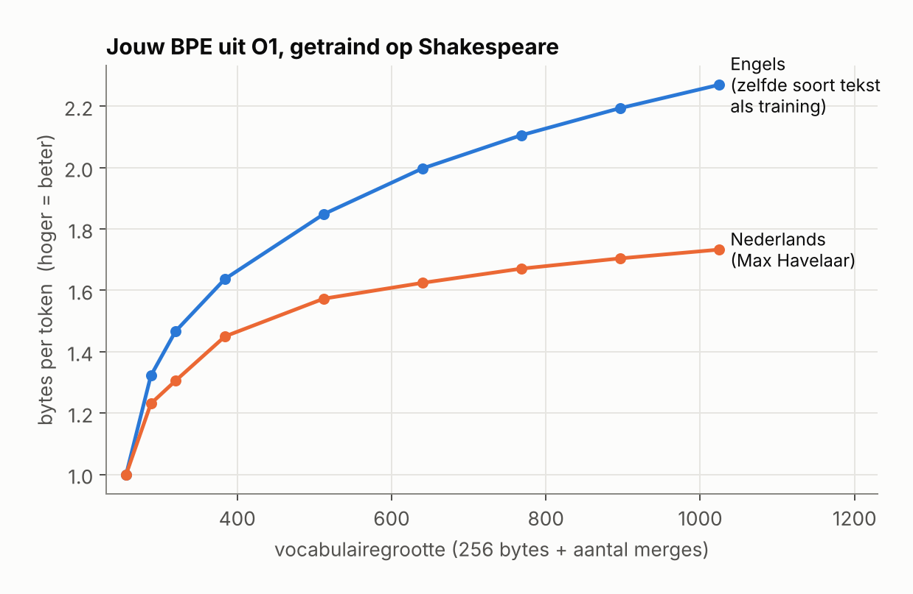
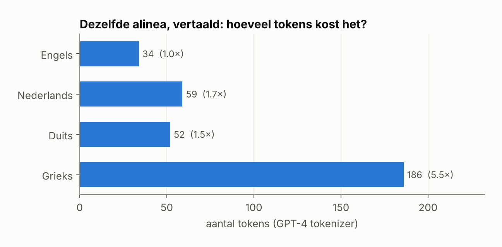

# 1.1 Tokens en embeddings

*Module 1: Transformers van binnen* · ⏱️ ~40 min · 🎬 vooraf: 3B1B [*But what is a GPT?*](https://www.youtube.com/watch?v=wjZofJX0v4M)

---

## Het hele idee in één zin

Een taalmodel is een functie

$$p_\theta(x_{t+1} \mid x_1, \dots, x_t)$$

die gegeven een reeks tokens een kansverdeling geeft over het **volgende** token. Dat is alles. Claude schrijven, code genereren, redeneren: het is allemaal herhaald next-token prediction. De rest van deze module gaat over *hoe* die functie eruitziet.

Voor ML-mensen: het is een classificatieprobleem met ~100.000 klassen (de vocabulaire), getraind met cross-entropy op biljoenen voorbeelden. Ook de loss ken je dus al:

$$\mathcal{L} = -\sum_t \log p_\theta(x_{t+1} \mid x_{\le t})$$

Het pad dat tekst door het model aflegt, dat we in deze module stap voor stap openbreken:

---

## Stap 1: van tekst naar getallen (tokenization)

Een neuraal netwerk eet getallen, geen tekst. Hoe hak je tekst op?

| Aanpak | Vocab-grootte | Probleem |
|--------|---------------|----------|
| Per **karakter** | ~100–300 | Sequenties worden heel lang, en attention is $O(T^2)$ |
| Per **woord** | miljoenen | Wat doe je met "ongezelligheidsfactor" of typfouten? |
| **Subword (BPE)** | 50k–200k | ✅ Een compromis: veelvoorkomende woorden zijn 1 token, zeldzame woorden worden in stukken geknipt |

Zo ziet dat er in de praktijk uit:

*Figuur 1.1. Echte output van GPT-4's tokenizer (cl100k_base). Elke blok is één token, het kleine getal is het token-id, ␣ is een spatie. Let op een paar dingen. Engelse woorden zijn bijna altijd 1 token, Nederlandse worden in stukken gehakt (`␣sn`+`elle`, `␣bru`+`ine`). Getallen worden in groepjes van 3 gesplitst. `Hello` en `␣Hello` zijn verschillende tokens. En `␣strawberry` is één token: het model ziet de letters r niet.*

### Byte Pair Encoding (BPE)

Het algoritme is verrassend simpel:

1. Begin met tekst als een rij **bytes** (256 mogelijke waarden). Daardoor bestaat er nooit een "onbekend" teken: emoji, Chinees, alles is uiteindelijk bytes.
2. Tel welk **paar** opeenvolgende tokens het vaakst voorkomt.
3. Vervang dat paar overal door een **nieuw token**.
4. Herhaal tot je vocabulaire groot genoeg is.

*Figuur 1.2. BPE op de string `aaabdaaabac`. Na drie merges is 11 tokens 5 tokens geworden. Nieuwe tokens kunnen uit eerder gemaakte tokens bestaan (X = Y + b = Z + a + b = a + a + a + b).*

Hoe meer merges, hoe beter de compressie. Maar een tokenizer is alleen goed in het soort tekst waarop hij getraind is:

*Figuur 1.3. Gemeten met de BPE-tokenizer die je zelf bouwt in O1, getraind op Shakespeare. Op nieuwe Engelse tekst stijgt de compressie naar ~2,3 bytes per token, op Nederlands (Max Havelaar) blijft hij steken rond 1,7. De tokenizer heeft simpelweg weinig Nederlandse woorddelen geleerd.*

Je gaat dit zelf bouwen in **[Opdracht O1](../opdrachten/O1-tokenizer.md)**.

### Waarom dit ertoe doet: rare LLM-gedragingen en kosten

Veel "domme" fouten van LLM's zijn tokenization-artefacten:
- **"Hoeveel r'en zitten er in strawberry?"** Het model ziet niet de letters, maar één token `␣strawberry` (figuur 1.1). Letters tellen in iets dat je niet kunt zien is lastig.
- **Rekenen**: `12345` wordt `123` + `45`, maar een ander getal wordt anders opgeknipt. Het model ziet dus geen consistente cijferposities.
- **Niet-Engelse talen** kosten meer tokens per zin:

*Figuur 1.4. Dezelfde alinea in vier talen, geteld met de GPT-4-tokenizer. Nederlands kost ~1,7× zoveel tokens als Engels, Grieks (ander schrift) zelfs ~5,5×. Meer tokens betekent meer rekenwerk, hogere API-kosten en minder tekst in het context window.*

🔬 **Probeer het:** open [Tiktokenizer](https://tiktokenizer.vercel.app) en typ:
- je eigen naam en woonplaats. Hoeveel tokens?
- `hello` / ` hello` / `Hello` / `HELLO`. Hoeveel verschillende tokens zie je?
- een stukje Python-code. Hoe gaan de inspringingen?

---

## Stap 2: van token-id naar vector (embeddings)

Een token-id (bijvoorbeeld `4875`) is een categorische variabele. We zetten het om naar een vector met een **lookup-tabel**:

$$E \in \mathbb{R}^{V \times d_\text{model}}, \qquad \mathbf{x}_i = E[\text{token}_i]$$

$E$ is een gewone geleerde parametermatrix. Wiskundig is het hetzelfde als one-hot × matrix, maar dan efficiënter. Typische groottes:

| Model | $V$ (vocab) | $d_\text{model}$ |
|-------|-------------|------------------|
| GPT-2 small | 50.257 | 768 |
| GPT-3 | 50.257 | 12.288 |
| Llama 3 | 128.256 | 4.096 (8B) – 16.384 (405B) |

### Wat betekent zo'n vector?

Tijdens training leert het model embeddings zo te plaatsen dat **woorden met een vergelijkbare rol dicht bij elkaar komen** en **richtingen in de ruimte betekenis krijgen**. Niemand programmeert dat erin. Het ontstaat omdat het helpt bij het voorspellen van het volgende token.

*Figuur 1.5. Echte token-embeddings uit GPT-2 (768 dimensies), met PCA teruggebracht naar 2D. **Links:** maanden, getallen en landen vormen drie aparte clusters. **Rechts:** zoom je in op alleen de maanden, dan liggen ze in een **ring in kalendervolgorde**, met december weer naast januari. Het model heeft de cyclische structuur van het jaar geleerd, puur uit tekst.*

Het klassieke voorbeeld van "richtingen met betekenis" (uit word2vec):

$$E[\text{koning}] - E[\text{man}] + E[\text{vrouw}] \approx E[\text{koningin}]$$

Er bestaat dus ongeveer een "vrouwelijk-richting" in de ruimte.

**Belangrijk inzicht:** de *initiële* embedding van een token kent geen context. "Bank" heeft dezelfde vector in "ik zit op de bank" en "ik werk bij de bank". De rest van de transformer is één grote machine om die vectoren **contextueel bij te werken**. Na tientallen lagen "weet" de vector van "bank" in welke zin hij staat. Dat is precies wat attention doet (notes 1.2).

### De laatste stap: unembedding

Aan het eind moet de vector van de laatste positie weer een kansverdeling over tokens worden:

$$\text{logits} = \mathbf{h}_T W_U \quad\text{met}\quad W_U \in \mathbb{R}^{d_\text{model} \times V}$$

$$p(x_{T+1}) = \text{softmax}(\text{logits})$$

Veel modellen gebruiken $W_U = E^\top$ (*weight tying*). Dat scheelt parameters, en het is intuïtief: "lijkt mijn eindvector op de embedding van token X? Dan is X waarschijnlijk het volgende token."

---

### ✏️ Denkvragen (antwoorden in de [zelftoets](../zelftoets.md))
1. Waarom start BPE met bytes in plaats van met Unicode-karakters?
2. Wat gebeurt er met de modelgrootte als je de vocabulaire verdubbelt? Waar zitten die extra parameters?
3. In figuur 1.5 staat "May" iets apart van de andere maanden. Kun je bedenken waarom? (Hint: wat betekent "may" nog meer in het Engels?)

**Volgende:** [Opdracht O1: Bouw je eigen tokenizer](../opdrachten/O1-tokenizer.md) → [1.2 Attention](1.2-attention.md)
