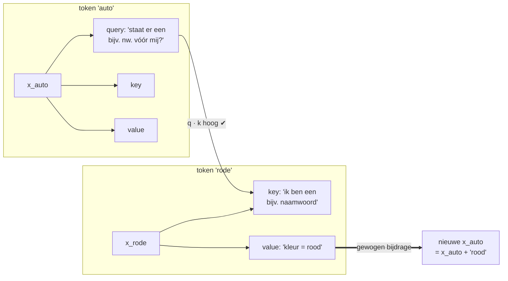
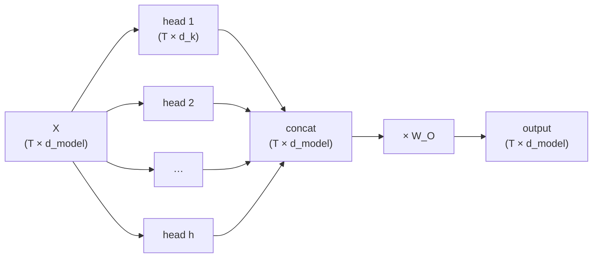
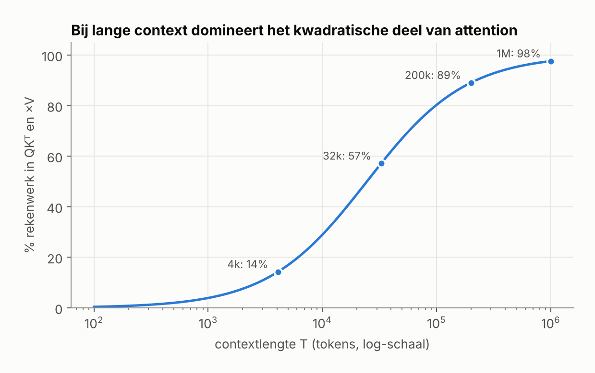

# 1.2 Attention

*Module 1: Transformers van binnen* · ⏱️ ~45 min · 🎬 vooraf: 3B1B [*Attention in transformers, step-by-step*](https://www.youtube.com/watch?v=eMlx5fFNoYc)

---

## Het probleem

Na de embedding heeft elk token een vector die **niets weet van zijn buren**. In "de *rode* auto" moet de vector van "auto" informatie krijgen van "rode". In "Jeroen gaf het boek aan Gijs, omdat *hij* het al gelezen had" moet "hij" uitzoeken naar wie hij verwijst.

Vóór 2017 deden RNN's/LSTM's dit sequentieel: token voor token een hidden state doorgeven. Dat is traag (niet te paralleliseren) en lange-afstandsinformatie verdwijnt.

**Attention**: laat elk token direct naar alle (eerdere) tokens kijken en zelf beslissen welke relevant zijn.

## De intuïtie: een zachte database-lookup

Elk token maakt drie vectoren uit zijn embedding $\mathbf{x}_i$:

| Vector | Vraag | Formule |
|--------|-------|---------|
| **Query** $\mathbf{q}_i$ | *"Wat zoek ik?"* | $\mathbf{q}_i = \mathbf{x}_i W_Q$ |
| **Key** $\mathbf{k}_j$ | *"Wat bied ik aan / wat ben ik?"* | $\mathbf{k}_j = \mathbf{x}_j W_K$ |
| **Value** $\mathbf{v}_j$ | *"Wat geef ik door als je mij kiest?"* | $\mathbf{v}_j = \mathbf{x}_j W_V$ |

Vergelijk het met een Python-dict: `db[query]` geeft de value van de key die *exact* matcht. Attention is de **zachte, differentieerbare** versie. Je krijgt een gewogen gemiddelde van *alle* values, gewogen naar hoe goed elke key bij je query past.

> ⚠️ "Bijvoeglijk naamwoord zoeken" is een mensvriendelijk verhaal. Wat heads écht leren is vaak minder netjes. Dat uitzoeken is het onderzoeksveld *interpretability* (module 7). Verderop zie je drie echte heads.

## De formule

Stapel alle tokens in matrices $Q, K, V \in \mathbb{R}^{T \times d_k}$:

$$\text{Attention}(Q, K, V) = \text{softmax}\left(\frac{QK^\top}{\sqrt{d_k}} + M\right) V$$

Stap voor stap:

1. **$S = QK^\top$**, een $(T \times T)$-matrix. $S_{ij}$ = hoe goed past key $j$ bij query $i$?
2. **$/\sqrt{d_k}$**: schaling, zodat de softmax niet verzadigt. Zie [Mini M2](../../minis/M2-waarom-wortel-dk.md).
3. **$+M$**, de causal mask: $M_{ij} = -\infty$ als $j > i$, anders $0$. Een token mag **niet in de toekomst kijken**.
4. **softmax per rij**: elke rij wordt een kansverdeling, de *attention pattern*.
5. **$\times V$**: elk token krijgt een gewogen som van values.

*Figuur 1.6. De formule als rekenvoorbeeld voor vier tokens. (1) Ruwe scores. (2) De mask zet alles boven de diagonaal op −∞. (3) Na de softmax telt elke rij op tot 1 en zijn de gemaskeerde vakjes exact 0. "De" kan alleen naar zichzelf kijken (gewicht 1,00). "zat" kijkt bijna volledig naar "kat", omdat de score 4,7 veel hoger is dan de rest.*

### Waarom de causal mask?

Tijdens training voorspellen we voor **elke positie tegelijk** het volgende token. Uit één zin van 100 tokens halen we zo 100 trainingsvoorbeelden in één forward pass. Dat kan alleen eerlijk als positie 5 niet stiekem naar positie 6 kan kijken, want dat is het antwoord.

Dit maakt het een **decoder-only** (of *causal*, *autoregressive*) transformer. GPT, Claude en Llama zijn allemaal decoder-only. BERT is *encoder-only*: geen mask, elk token ziet alles. Dat is goed voor begrip, maar je kunt er niet mee genereren.

## Multi-head attention

Eén attention-operatie kan maar één soort relatie tegelijk leren. Daarom draaien we er **$h$ parallel**, elk met eigen $W_Q, W_K, W_V$ en een kleinere dimensie $d_k = d_\text{model}/h$:

$$\text{head}_i = \text{Attention}(XW_Q^{(i)}, XW_K^{(i)}, XW_V^{(i)})$$

$$\text{MHA}(X) = \text{Concat}(\text{head}_1, \dots, \text{head}_h) W_O$$

### Hoe echte heads eruitzien

Elk head leert in de praktijk zijn eigen "specialisme". Hieronder drie heads uit GPT-2, automatisch opgezocht op hun patroon:

*Figuur 1.7. Drie echte attention patterns uit GPT-2 small voor de zin "When Mary and John went to the store, John gave a drink to". Rij = token dat kijkt, kolom = token waarnaar gekeken wordt. **Links:** een *previous-token head* kijkt altijd naar het vorige token. Dat is nuttig om bigrammen en woordvolgorde te herkennen. **Midden:** een *attention sink*: dit head parkeert al zijn aandacht op het eerste token als het "niets te doen" heeft. **Rechts:** vanaf het laatste token "to" kijkt dit head naar "Mary", precies de naam die het model moet voorspellen (niet "John", die al iets gaf). Dit is een onderdeel van een bekend "indirect object identification"-circuit.*

Je gaat deze heads zelf zoeken in **[Opdracht O4](../opdrachten/O4-gpt2-onder-de-loep.md)**.

## De prijs: kwadratische kosten

$QK^\top$ is een $T \times T$-matrix. Twee keer zoveel tokens betekent vier keer zoveel attention-werk.

*Figuur 1.8. Aandeel van het rekenwerk per laag dat in de $T \times T$-attention-matrix zit, voor een model met $d_\text{model} = 4096$. Bij een gewone chat (4k tokens) is het een klein deel. Bij 200k tokens context is het bijna alles. Daarom zijn lange contexten duur, en bestrijden veel innovaties precies dit kwadraat: FlashAttention, sliding-window attention, sparse attention.*

## Self-attention tegenover cross-attention

- **Self-attention**: $Q$, $K$ en $V$ komen uit dezelfde reeks. Dat is wat GPT en Claude doen.
- **Cross-attention**: $Q$ komt uit reeks A, $K$ en $V$ uit reeks B. Dit zat in de originele transformer voor vertaling (decoder kijkt naar encoder) en wordt gebruikt in sommige beeld-taalmodellen.

---

### 🛠️ Nu zelf doen
**[Opdracht O2: Attention from scratch in NumPy](../opdrachten/O2-attention-numpy.md)**: je implementeert precies figuur 1.6 en bewijst met een test dat je mask werkt.

### 🔬 Speeltuin
Open [Transformer Explainer](https://poloclub.github.io/transformer-explainer/), typ een zin en klik op een attention-head. Kun je een previous-token head vinden zoals in figuur 1.7?

### ✏️ Denkvragen
1. Wat gebeurt er met de attention-gewichten als alle keys identiek zijn?
2. Attention is **permutatie-equivariant**: als je de tokens husselt, hussel je de output op dezelfde manier. Waarom is dat een probleem voor taal? (Antwoord in notes 1.4.)
3. Waarom zou een model een "attention sink" leren (figuur 1.7, midden)? Hint: een softmax-rij *moet* optellen tot 1.

**Volgende:** [1.3 Het transformer-block](1.3-transformer-block.md)
