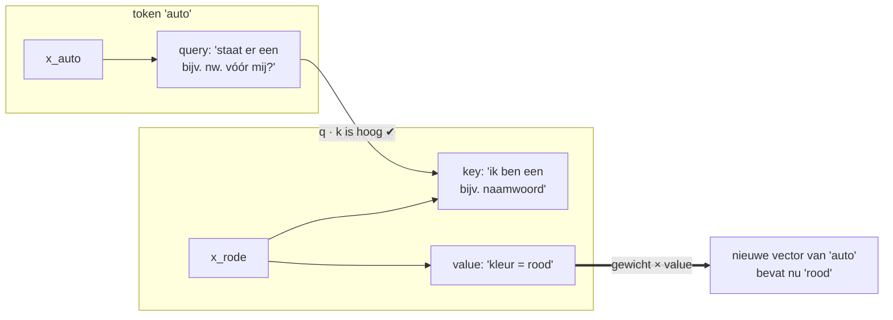
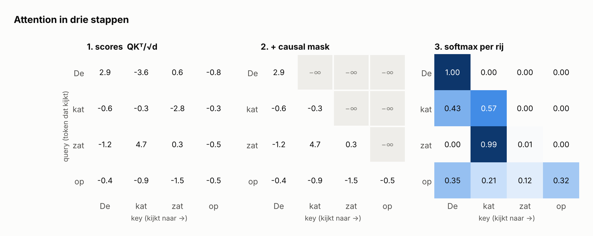
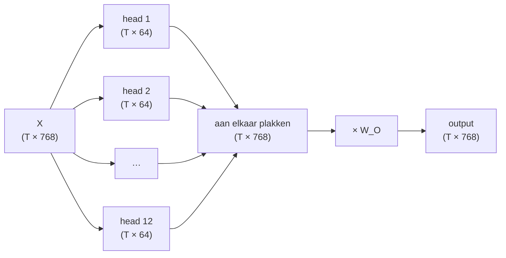
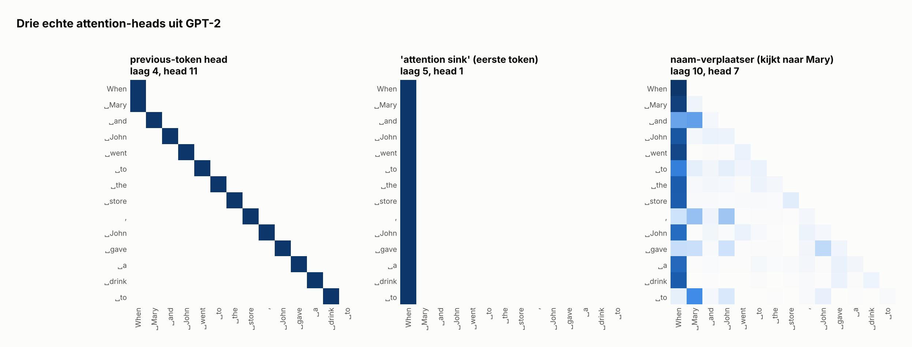

# 1.2 Attention

*Module 1: Transformers van binnen* · ⏱️ ~60 min · 🎬 vooraf of na afloop: 3B1B [*Attention in transformers, step-by-step*](https://www.youtube.com/watch?v=eMlx5fFNoYc)

> **Waar we naartoe werken.** Dit is het hart van de transformer, en het belangrijkste hoofdstuk van de module. We gaan de formule $\text{softmax}(QK^\top/\sqrt{d_k})V$ niet uit de lucht laten vallen. We gaan hem **zelf bedenken**, stap voor stap, door steeds een probleem op te lossen.

---

## Waar we gebleven waren

Weet je nog het einde van 1.1? Elk token heeft nu een embedding-vector, maar die is **contextloos**. "Bank" heeft dezelfde vector of het nu om een meubel gaat of om een geldinstelling.

Neem deze zin:

> *"Na een lange werkdag plofte ik neer op de **bank**."*

Om te weten welke "bank" bedoeld is, moet de vector van "bank" informatie krijgen van "plofte" en "neer". Of neem:

> *"Jeroen gaf het boek aan Gijs, omdat **hij** het al uit had."*

Om "hij" te begrijpen, moet het model uitzoeken naar wie het verwijst (Jeroen), en dat terugkoppelen.

**De vraag van dit hoofdstuk:** hoe laat je tokens informatie uitwisselen, zodat elk token "weet" in welke context het staat?

Voordat transformers bestonden (vóór 2017) deed men dit met RNN's: lees de tekst woord voor woord en geef een soort "geheugen" door. Twee problemen. Het is traag, want je kunt woord 100 pas verwerken als woord 99 klaar is. En informatie van ver terug in de tekst vervaagt onderweg. Attention lost allebei op: **elk token mag direct naar alle eerdere tokens kijken, allemaal tegelijk.**

---

## Poging 1: neem gewoon het gemiddelde

Het simpelste idee om context toe te voegen: geef elk token het **gemiddelde van zichzelf en alle tokens ervoor**.

$$\text{nieuw}_i = \frac{1}{i} \sum_{j=1}^{i} \mathbf{x}_j$$

Voor "bank" in onze zin wordt dat het gemiddelde van "Na", "een", "lange", "werkdag", "plofte", …, "bank". Er zit nu dus *iets* van "plofte" in de vector van "bank". Vooruitgang!

Karpathy noemt dit in zijn video (O3) de "wiskundige truc", en het is een prima eerste stap. Maar je voelt het probleem al: **alle woorden tellen even zwaar.** "Een" en "de" zijn net zo belangrijk als "plofte". Dat is natuurlijk onzin.

## Poging 2: een gewogen gemiddelde

Beter: neem een **gewogen** gemiddelde, waarbij belangrijke woorden zwaarder tellen:

$$\text{nieuw}_i = \sum_{j \le i} w_{ij} \, \mathbf{x}_j \qquad \text{met } w_{ij} \ge 0,\ \sum_j w_{ij} = 1$$

Mooi. Maar nu is de vraag: **wie bepaalt de gewichten $w_{ij}$?** Het antwoord moet afhangen van de woorden zelf. Voor "bank" is "plofte" belangrijk; voor een werkwoord is misschien het onderwerp belangrijk. En we willen dat het model dit zelf **leert**.

## Poging 3: laat elk token een vraag stellen

Hier komt het centrale idee. Laat elk token twee dingen maken:

- een **query** $\mathbf{q}$: *"wat zoek ik?"*
- een **key** $\mathbf{k}$: *"wat ben ik / wat heb ik te bieden?"*

Het gewicht dat token $i$ aan token $j$ geeft, hangt dan af van **hoe goed de query van $i$ past bij de key van $j$**.

> 🔁 **Weet je nog?** Hoe meet je hoe goed twee vectoren bij elkaar passen? Met het **inproduct** (zie [Mini M3](../../../minis/M3-inproduct-en-matrices.md)). Precies hetzelfde gereedschap als bij de unembedding in 1.1. Daar vergeleken we de eindvector met alle token-embeddings; hier vergelijken we een query met alle keys.

Een voorbeeld om het te voelen. In "de rode auto" zou de query van "auto" kunnen betekenen: *"staat er een bijvoeglijk naamwoord vóór mij?"* De key van "rode" zegt: *"ik ben een bijvoeglijk naamwoord."* Die passen goed bij elkaar, dus een hoog inproduct, dus een groot gewicht.

Waar komen $\mathbf{q}$ en $\mathbf{k}$ vandaan? Simpel: het zijn **lineaire projecties** van de embedding, met matrices die het model leert:

$$\mathbf{q}_i = \mathbf{x}_i W_Q \qquad \mathbf{k}_j = \mathbf{x}_j W_K$$

Vergelijk het met hoe een zoekmachine werkt. Jij typt een zoekvraag (query). Elke webpagina heeft trefwoorden (keys). De zoekmachine vergelijkt jouw vraag met alle trefwoorden en geeft de best passende resultaten. Attention is dat, maar dan **zacht**: in plaats van alleen de beste match terug te geven, krijg je een mengsel van alles, gewogen naar hoe goed het past.

## Van scores naar gewichten: de softmax (weer)

De inproducten $\mathbf{q}_i \cdot \mathbf{k}_j$ zijn gewoon getallen: soms positief, soms negatief, en ze tellen niet op tot 1. We willen gewichten die **positief zijn en samen 1 zijn**.

> 🔁 **Weet je nog?** Dit is precies het probleem dat we aan het eind van 1.1 hadden: logits omzetten in kansen. Daar gebruikten we de **softmax**, en hier doen we hetzelfde. Hoge scores krijgen veel gewicht, lage bijna niets. (Meer over hoe "scherp" een softmax is: [Mini M1](../../../minis/M1-softmax-en-temperatuur.md).)

$$w_{ij} = \text{softmax}_j(\mathbf{q}_i \cdot \mathbf{k}_j)$$

## Poging 4: scheid "waar ik op match" van "wat ik doorgeef" (value)

Er is nog één verfijning. In poging 2 namen we een gewogen gemiddelde van de embeddings $\mathbf{x}_j$ zelf. Maar dat waar een token op *matcht* (zijn key) hoeft niet hetzelfde te zijn als wat het *doorgeeft*.

"Rode" matcht op "ik ben een bijvoeglijk naamwoord". Maar wat het moet doorgeven aan "auto" is iets anders: *"de kleur is rood"*. Daarom krijgt elk token een derde vector, de **value**:

$$\mathbf{v}_j = \mathbf{x}_j W_V$$

| Vector | Vraag | In het zoekmachine-beeld |
|--------|-------|------|
| **Query** $\mathbf{q}$ | *"Wat zoek ik?"* | je zoekvraag |
| **Key** $\mathbf{k}$ | *"Waar match ik op?"* | de trefwoorden van een pagina |
| **Value** $\mathbf{v}$ | *"Wat geef ik door als je mij kiest?"* | de inhoud van de pagina |

> ⚠️ "Bijvoeglijk naamwoord zoeken" is een verhaaltje om het te begrijpen. In het echt zijn de queries en keys gewoon vectoren van 64 getallen, en wat ze betekenen is vaak minder netjes. Verderop zie je echte voorbeelden.

## Alles samen: de formule

We doen dit niet voor één token tegelijk, maar voor **alle tokens tegelijk** met matrices. Stapel alle queries als rijen in een matrix $Q$ (shape $T \times d_k$, met $T$ = aantal tokens), en net zo voor $K$ en $V$. Dan is:

$$\text{Attention}(Q, K, V) = \text{softmax}\left(\frac{QK^\top}{\sqrt{d_k}} + M\right) V$$

Schrik niet, je kent nu elk onderdeel:

| Stukje | Wat het is | Waar je het van kent |
|--------|-----------|----------------------|
| $QK^\top$ | een $T \times T$-tabel met **alle inproducten** van alle queries met alle keys | Mini M3: matrixvermenigvuldiging = veel inproducten tegelijk |
| $/\sqrt{d_k}$ | de scores kleiner maken zodat de softmax niet te "scherp" wordt | zie hieronder + [Mini M2](../../../minis/M2-waarom-wortel-dk.md) |
| $+M$ | de **mask**: verbiedt kijken naar de toekomst | zie hieronder |
| softmax | per rij: scores → gewichten die optellen tot 1 | poging 3, en 1.1 |
| $\times V$ | gewogen som van de values | poging 2 en 4 |

*Figuur 1.6. De formule als rekenvoorbeeld met vier tokens. Rij = het token dat kijkt (query), kolom = het token waarnaar gekeken wordt (key). (1) De ruwe scores $QK^\top/\sqrt{d}$. (2) De mask zet alles boven de diagonaal op −∞. (3) Na de softmax telt elke rij op tot 1. "De" kan alleen naar zichzelf kijken, dus krijgt gewicht 1,00. "zat" heeft een hoge score (4,7) bij "kat" en geeft daar dus 99% van zijn aandacht aan.*

> ▶ **Probeer het zelf:** in de **[Attention-speeltuin](https://jeroenderuijter2002.github.io/Self-learning-AI/interactief/attention.html)** staat precies dit voorbeeld, maar dan met **aanpasbare getallen**. Verander scores, zet de mask aan of uit, schuif aan de schaalfactor en kijk wat er met de gewichten gebeurt.

### Waarom delen door $\sqrt{d_k}$?

De query en key zijn vectoren van $d_k$ getallen (vaak 64 of 128). Hun inproduct is een som van $d_k$ termen. Hoe meer termen je optelt, hoe groter de getallen gemiddeld worden. Met willekeurige vectoren groeit de spreiding als $\sqrt{d_k}$.

Grote getallen in een softmax maken hem heel **scherp**: één score wint alles en de rest krijgt ~0 (weet je nog, lage temperatuur uit Mini M1). Dan kijkt elk token naar precies één ander token, en leert het model slecht, omdat de gradiënten bijna nul worden. Delen door $\sqrt{d_k}$ zet de schaal terug naar normaal, ongeacht hoe groot $d_k$ is. De volledige afleiding (5 regels kansrekening) staat in [Mini M2](../../../minis/M2-waarom-wortel-dk.md).

### Waarom de mask? Het geheim van efficiënt trainen

Hier zit een slim idee achter. Tijdens het trainen geven we het model een zin van bijvoorbeeld 100 tokens. Weet je nog de loss uit 1.1: voorspel het volgende token. Maar welk "volgende token"? Na token 1 moet token 2 komen, na token 2 token 3, enzovoort.

Met attention kun je **alle 100 voorspellingen tegelijk** doen in één keer door het model. Dat is een enorme versnelling: 100 trainingsvoorbeelden voor de prijs van één. Maar dat kan alleen eerlijk als positie 5 **niet stiekem naar positie 6 kan kijken**, want positie 6 is precies het antwoord dat positie 5 moet voorspellen.

Daarom zetten we alle scores "naar de toekomst" op $-\infty$. Na de softmax wordt dat $e^{-\infty} = 0$: geen enkele aandacht. Dat is de driehoek in figuur 1.6.

Een model met deze mask heet een **decoder-only** of **causaal** model. GPT, Claude en Llama zijn allemaal causaal. BERT is een voorbeeld zonder mask (elk token ziet alles): goed om tekst te *begrijpen*, maar je kunt er geen tekst mee *schrijven*.

---

## Meerdere vragen tegelijk: multi-head attention

Eén set $(W_Q, W_K, W_V)$ kan maar één soort vraag stellen. Maar een woord heeft veel verschillende soorten context nodig: welk woord stond er net voor? Wie is het onderwerp? Waar verwijst "hij" naar?

Oplossing: doe attention **een aantal keer parallel**, elk met eigen matrices. Elke kopie heet een **head**. Je kunt het zien als een vergadering waarin elke deelnemer met een eigen vraag de tekst doorleest. De één let op grammatica, de ander op namen, een derde op wat er vlak ervoor stond.

$$\text{head}_i = \text{Attention}(XW_Q^{(i)}, XW_K^{(i)}, XW_V^{(i)})$$

$$\text{MHA}(X) = \text{Concat}(\text{head}_1, \dots, \text{head}_h) \, W_O$$

Om het rekenwerk gelijk te houden, krijgt elk head een kleinere dimensie: $d_k = d_\text{model} / h$. GPT-2 heeft 12 heads van elk 64 dimensies (12 × 64 = 768). Aan het eind plakken we alle heads aan elkaar en mengen we ze met één matrix $W_O$.

### Wat leren echte heads?

Niemand vertelt een head wat het moet doen. Het leert dat zelf. Wat komt er uit? Hier drie echte heads uit GPT-2:

*Figuur 1.7. Drie echte attention patterns uit GPT-2 voor de zin "When Mary and John went to the store, John gave a drink to". Lees ze net als figuur 1.6: rij = token dat kijkt, kolom = waarnaar gekeken wordt, donkerder = meer aandacht.*

- **Links, de previous-token head.** Een perfecte diagonaal: elk token kijkt naar het token er direct voor. Simpel maar nuttig: zo weet "Mary" dat er "When" voor stond.
- **Midden, de attention sink.** Alle aandacht gaat naar het eerste token. Waarom? Een softmax-rij *moet* optellen tot 1. Als een head in een bepaalde situatie niets nuttigs te doen heeft, moet die aandacht toch ergens heen. Het eerste token wordt dan een soort "parkeerplaats".
- **Rechts, de naam-head.** Kijk naar de onderste rij (het token "to"). Daar kijkt dit head sterk naar **"Mary"**. En dat is precies het antwoord! "John gave a drink to …" → **Mary** (want John is degene die geeft). Dit head is onderdeel van een bekend "circuit" dat onderzoekers in GPT-2 hebben gevonden om dit soort zinnen op te lossen.

> ▶ **Probeer het zelf:** in de **[Attention-speeltuin](https://jeroenderuijter2002.github.io/Self-learning-AI/interactief/attention.html)** zie je alle **144 heads** van GPT-2 voor vier zinnen. Zoek zelf een **induction head**: een head dat bij een herhaling ("Harry Potter … Harry Potter") kijkt naar wat er de vorige keer *na* dat woord kwam. Dit soort heads is een van de belangrijkste ontdekkingen in het onderzoek naar hoe taalmodellen werken. Je gaat ze in module 7 opnieuw tegenkomen.

---

## De prijs: kwadratische kosten

$QK^\top$ is een $T \times T$-tabel. Elk token vergelijkt zich met elk ander token. Twee keer zoveel tokens betekent dus **vier keer** zoveel vergelijkingen.

*Figuur 1.8. Welk deel van het rekenwerk per laag zit in die $T \times T$-tabel? (Berekend voor een model met $d_\text{model} = 4096$.) Bij een gewone chat (4k tokens) is het 14%; de rest zit in de matrixvermenigvuldigingen met de gewichten. Maar bij 200k tokens context is het bijna alles.*

Dit is de reden dat lange contexten zo duur zijn, en dat er zoveel onderzoek is naar slimmere attention (FlashAttention, sliding windows, sparse attention). We komen hierop terug in 1.4 bij de KV-cache.

---

## Samenvatting: wat je nu weet

1. Attention lost het probleem op dat embeddings **contextloos** zijn: elk token haalt informatie op bij eerdere tokens.
2. Het is een **gewogen gemiddelde** van **values**, waarbij de gewichten komen uit het **inproduct** van **query** (wat zoek ik?) en **key** (wat bied ik?), door een **softmax**.
3. **$\sqrt{d_k}$** houdt de softmax "zacht". De **causal mask** voorkomt spieken naar de toekomst en maakt efficiënt trainen mogelijk.
4. **Multi-head** = meerdere vragen tegelijk. Echte heads leren herkenbare taken (vorig token, namen, herhalingen).
5. De prijs is **$O(T^2)$**: lange context is duur.

---

### 🛠️ Nu zelf doen
**[Opdracht O2: Attention from scratch in NumPy](../opdrachten/O2-attention-numpy.md)**: je implementeert precies figuur 1.6 en bewijst met een test dat je mask werkt.

### ✏️ Denkvragen
1. Wat gebeurt er met de attention-gewichten als alle keys identiek zijn? (Hint: denk aan poging 1.)
2. Attention is **permutatie-equivariant**: hussel je de tokens, dan hussel je de output op dezelfde manier. Waarom is dat een probleem voor taal? (Het antwoord, en de oplossing, staat in 1.4.)
3. Waarom zou je aparte $W_Q$ en $W_K$ willen, in plaats van tokens met zichzelf te vergelijken ($\mathbf{x}_i \cdot \mathbf{x}_j$)? (Hint: moet "rode" naar "auto" kijken net zo sterk als "auto" naar "rode"?)

**Volgende:** [1.3 Het transformer-block](1.3-transformer-block.md)
