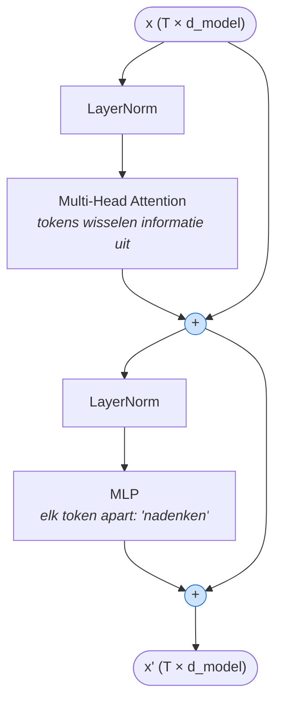
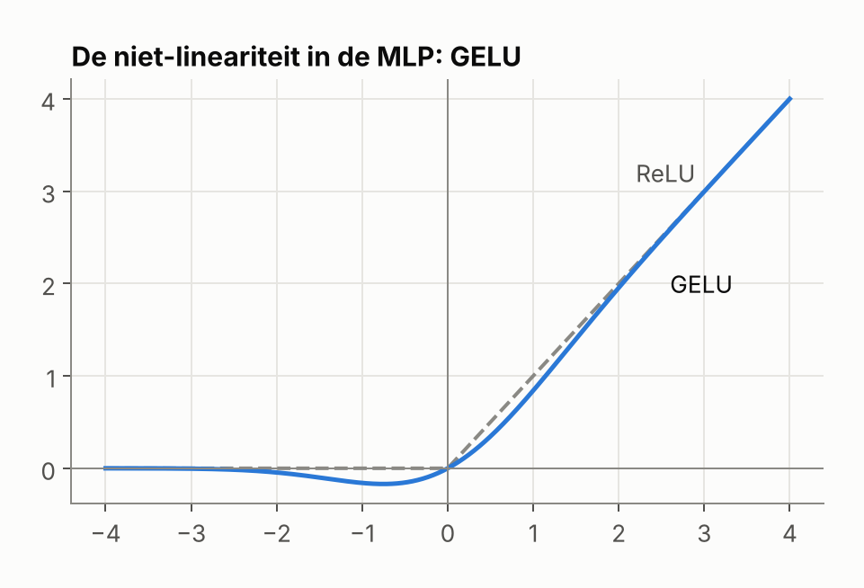

# 1.3 Het transformer-block

*Module 1: Transformers van binnen* · ⏱️ ~40 min

---

Attention alleen is niet genoeg. Een transformer bestaat uit $N$ identieke **blocks** op elkaar gestapeld (GPT-2 small: 12, GPT-3: 96). Elk block ziet er zo uit (de moderne *pre-norm*-variant):



In code (dit ga je zelf schrijven in O3):

```python
def block(x):
    x = x + attention(layer_norm_1(x))
    x = x + mlp(layer_norm_2(x))
    return x
```

Vier regels. Laten we elk onderdeel bekijken.

## 1. De MLP: waar de kennis zit

```python
def mlp(x):                       # x: (T, d_model)
    h = x @ W1 + b1               # (T, 4*d_model)  ← opblazen
    h = gelu(h)                   # niet-lineariteit
    return h @ W2 + b2            # (T, d_model)    ← terug
```

- Werkt **per token, onafhankelijk**. Hier is geen interactie tussen posities; dat deed attention al.
- Bevat **~2/3 van de parameters in de blocks** (zie figuur 1.10).
- Een veelgebruikte (vereenvoudigde) intuïtie: attention *verzamelt* informatie, de MLP *verwerkt* die en haalt feiten op. Onderzoek suggereert dat feitenkennis ("Amsterdam is de hoofdstad van...") grotendeels in MLP-gewichten zit. Zie 3B1B's [*How might LLMs store facts*](https://www.3blue1brown.com/lessons/mlp).



*Figuur 1.9. De niet-lineariteit in de MLP. GELU is een gladde versie van ReLU. Moderne modellen (Llama en anderen) gebruiken vaak **SwiGLU**, een "gated" variant die iets beter presteert.*

## 2. De residual stream: de ruggengraat

Let op `x = x + ...`. Elk block **schrijft iets bij** in plaats van $x$ te vervangen.

Waarom dit zo belangrijk is:
- **Gradiënten** vloeien ongehinderd terug via de $+$. Zonder residuals zijn netwerken van 96 lagen niet te trainen (bekend van ResNet).
- **Interpretatie:** zie de residual stream als een gedeeld **kladblok**. Elk attention-head en elke MLP leest ervan en schrijft er een bijdrage naar. De uiteindelijke voorspelling is de som van alle bijdragen. Dit perspectief komt uit Anthropic's [*A Mathematical Framework for Transformer Circuits*](https://transformer-circuits.pub/2021/framework/index.html).

Omdat elke laag in dezelfde ruimte schrijft, kun je **halverwege het model meekijken**. Stuur de residual stream na laag $\ell$ direct door de unembedding en vraag: "wat zou het model nu voorspellen?" Dit heet de **logit lens**:


*Figuur 1.10. Logit lens op GPT-2 voor "The capital of the Netherlands is". Tot laag 9 heeft het model geen idee (top-voorspellingen als "now" en "located"). In laag 10–11 verschijnt " Amsterdam" ineens met 35% kans. Daarna gebeurt iets interessants: de laatste laag duwt de kans terug naar ~4% en kiest " the". Je ziet de kennis letterlijk opgebouwd worden in de residual stream, én je ziet dat de laatste laag nog "herziet" (hier richting een veiliger, generiek vervolg). Onderzoekers zien dit vaker: late lagen kalibreren of maken voorspellingen voorzichtiger.*

## 3. LayerNorm: stabiliteit

$$\text{LN}(\mathbf{x}) = \gamma \odot \frac{\mathbf{x} - \mu}{\sigma} + \beta$$

Normaliseert elke token-vector (over de $d_\text{model}$-dimensie, **niet** over de batch zoals BatchNorm). Dit houdt activaties in een redelijk bereik door tientallen lagen heen.

- **Pre-norm** (LN vóór attention/MLP, zoals hierboven) traint stabieler dan het originele post-norm. Iedereen gebruikt nu pre-norm.
- **RMSNorm** (alleen schalen, niet centreren) is iets goedkoper en wordt gebruikt in Llama en vele anderen.

## 4. Alles bij elkaar: het volledige model

```python
def gpt(token_ids):
    x = E[token_ids] + P[positions]     # embedding (+ positie, zie 1.4)
    for block in blocks:                # N keer
        x = block(x)
    x = final_layer_norm(x)
    logits = x @ W_U                    # (T, vocab_size)
    return logits
```

### Parameters tellen (GPT-2 small, controleer dit zelf!)

| Onderdeel | Berekening | Aantal |
|-----------|-----------|--------|
| Token-embedding | 50.257 × 768 | 38,6M |
| Positie-embedding | 1.024 × 768 | 0,8M |
| Per block: attention | 4 × 768² (Q, K, V, O) | 2,4M |
| Per block: MLP | 2 × 768 × 3.072 | 4,7M |
| 12 blocks | 12 × ~7,1M | 85M |
| **Totaal** (met weight tying) | | **~124M** |


*Figuur 1.11. Geteld uit het echte GPT-2-model. Bij zo'n klein model is bijna een derde embedding. Bij grote modellen verschuift dat: de blocks groeien met $d_\text{model}^2 \times N$, de embedding alleen met $V \times d_\text{model}$. Bij GPT-3 is de embedding nog geen 0,4% van het totaal.*

## Encoder, decoder, encoder-decoder

| Type | Mask | Voorbeelden | Goed voor |
|------|------|-------------|-----------|
| Encoder-only | geen | BERT | classificatie, embeddings, zoeken |
| Decoder-only | causal | GPT, Claude, Llama | **genereren**: de huidige standaard |
| Encoder-decoder | beide + cross-attn | T5, originele Transformer | vertaling, samenvatten |

Decoder-only heeft "gewonnen" omdat het simpel is, goed schaalt en elke taak als tekstgeneratie kan behandelen.

---

### ✏️ Denkvragen
1. Wat zou er gebeuren als je de MLP's weglaat en alleen attention stapelt? (Hint: wat is een gewogen gemiddelde van gewogen gemiddelden?)
2. Waarom kan de logit lens (figuur 1.10) überhaupt werken? Welke architectuurkeuze maakt dat mogelijk?
3. Reken uit: hoeveel parameters zitten er in de attention van **één laag** van GPT-3 ($d_\text{model} = 12.288$)?

**Volgende:** [Opdracht O3: Bouw je eigen GPT](../opdrachten/O3-bouw-je-eigen-gpt.md). Dit is de grote opdracht van deze module.
