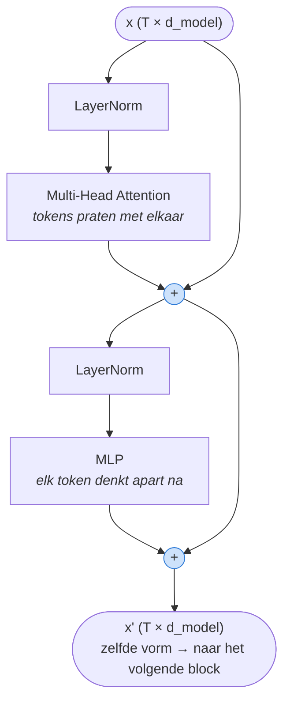
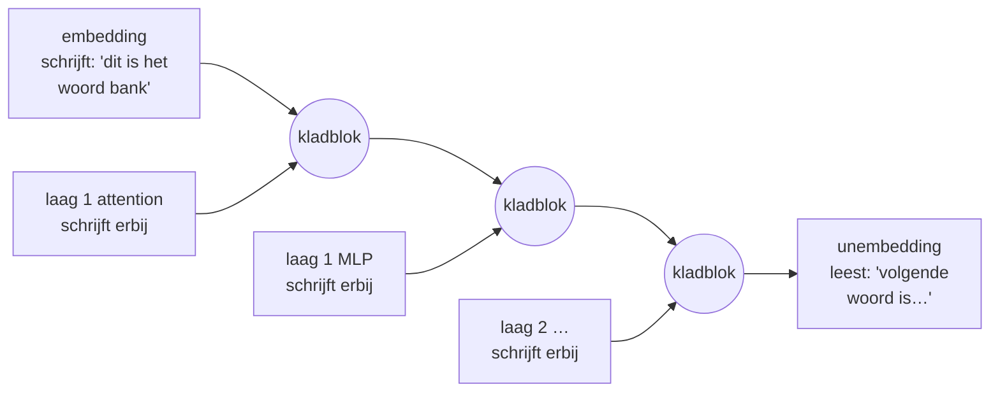
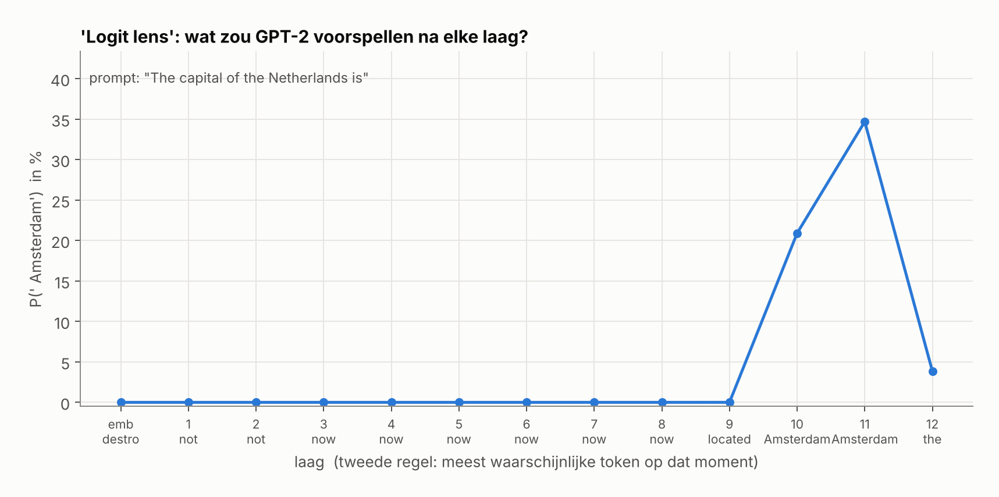
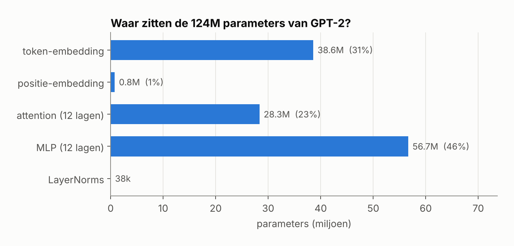

# 1.3 Het transformer-block

*Module 1: Transformers van binnen* · ⏱️ ~45 min · 🎬 aanrader: 3B1B [*How might LLMs store facts*](https://www.youtube.com/watch?v=9-Jl0dxWQs8)

> **Waar we naartoe werken.** Je kent nu de twee uiteinden (1.1) en het belangrijkste onderdeel (1.2). In dit hoofdstuk zetten we alles in elkaar tot een compleet model. Daarna kun je een transformer op een whiteboard tekenen, de parameters narekenen, en heb je een nieuwe manier om "in het model te kijken".

---

## Wat ontbreekt er nog?

Na attention heeft elk token informatie opgehaald bij andere tokens. De vector van "bank" bevat nu iets van "plofte neer". Maar daarmee zijn we er nog niet. Twee dingen ontbreken.

**1. Nadenken over wat je hebt opgehaald.** Attention is in de kern een **gewogen gemiddelde** (weet je nog, poging 2 uit 1.2). Een gemiddelde verzamelt informatie, maar *doet* er niets mee. Je kunt met gemiddelden niet redeneren als "plofte neer + bank → het gaat om een meubel, dus zacht, in een woonkamer…". Daar is een niet-lineaire bewerking voor nodig.

**2. Diepte.** Eén ronde informatie uitwisselen is niet genoeg. "John gave a drink to …" → "Mary" vereist meerdere stappen: eerst uitzoeken welke namen er zijn, dan wie al voorkwam, dan de andere kiezen. Daarvoor stapelen we het geheel **tientallen keren**.

Het antwoord is het **transformer-block**: attention plus een klein neuraal netwerk (de MLP), met een paar slimme verbindingen eromheen. GPT-2 stapelt er 12, GPT-3 96.



In code is het verrassend kort (dit schrijf je zelf in O3):

```python
def block(x):
    x = x + attention(layer_norm_1(x))   # stap 1: communiceren
    x = x + mlp(layer_norm_2(x))         # stap 2: nadenken
    return x
```

Een handige manier om dit te onthouden: **attention is vergaderen, de MLP is daarna ieder voor zich aan je bureau nadenken.** In de vergadering wisselt iedereen informatie uit. Aan je bureau verwerk je die. Dan weer vergaderen, weer nadenken. Twaalf keer (of 96).

We lopen de onderdelen één voor één door.

---

## 1. De MLP: waar de kennis zit

> 🔁 **Weet je nog?** Een **MLP** (multilayer perceptron) is het meest basale neurale netwerk dat er is: lineaire laag, niet-lineariteit, lineaire laag. Die ken je uit elke ML-cursus.

```python
def mlp(x):                       # x: (T, d_model)
    h = x @ W1 + b1               # (T, 4*d_model)  ← 4× zo breed maken
    h = gelu(h)                   # niet-lineariteit
    return h @ W2 + b2            # (T, d_model)    ← terug naar de oude breedte
```

Twee dingen om op te letten:

**Hij werkt per token, helemaal los van de andere tokens.** Elke rij van $x$ (één token) gaat los door hetzelfde netwerkje. Hier wordt níet gecommuniceerd; dat deed attention al. Daarom de vergelijking met "aan je eigen bureau nadenken".

**Hij is groot.** Hij blaast de vector op naar 4× de breedte (768 → 3072 bij GPT-2) en zet hem dan terug. Daardoor zit ongeveer **2/3 van alle parameters in de blocks** in de MLP's. Dat is een hint over hun rol: veel onderzoek wijst erop dat **feitenkennis** grotendeels in de MLP-gewichten zit. Bijvoorbeeld "de hoofdstad van Nederland is Amsterdam". 3Blue1Brown heeft hier een prachtige video over (link bovenaan): hij laat zien hoe een MLP zo'n feit kan "opslaan" als een soort opzoektabel.

De niet-lineariteit is meestal **GELU**, een gladde variant van ReLU:


*Figuur 1.9. GELU tegenover ReLU. Het verschil is klein: GELU is glad rond nul en heeft een klein negatief dipje. Waarom glad? Gladde functies geven nettere gradiënten. Nieuwere modellen (Llama en anderen) gebruiken vaak **SwiGLU**, een variant met een extra "poort" die iets beter werkt.*

---

## 2. De residual stream: de ruggengraat van het model

Kijk nog eens naar de code: `x = x + attention(...)`. Niet `x = attention(...)`. Dat plusje is misschien het belangrijkste teken in het hele model.

> 🔁 **Weet je nog?** Dit heet een **residual connection** (of skip connection), bekend van **ResNet** uit 2015. Daar ontdekte men dat heel diepe netwerken zonder dit trucje niet te trainen zijn: de gradiënt wordt bij het terugpropageren door tientallen lagen steeds kleiner (*vanishing gradients*). Met het plusje is er altijd een "snelweg" waarlangs de gradiënt direct terug kan stromen.

Maar er is een tweede, misschien nog mooiere manier om ernaar te kijken. Stel je de vector $x$ voor als een **gedeeld kladblok** dat door het hele model loopt, van onder naar boven:



Elk attention-head en elke MLP **leest** het kladblok, en **schrijft er iets bij** (het plusje). Niemand gumt iets uit. De uiteindelijke voorspelling is dus letterlijk de **som van alle bijdragen** van alle lagen. Dit perspectief heet de **residual stream** en komt uit het onderzoek van Anthropic ([*A Mathematical Framework for Transformer Circuits*](https://transformer-circuits.pub/2021/framework/index.html)). Je komt het in module 7 weer tegen.

### Een gevolg: je kunt halverwege meekijken (logit lens)

Hier wordt het leuk. Elke laag schrijft in **dezelfde ruimte** (dezelfde 768 dimensies). En weet je nog uit 1.1 hoe het model aan het eind een voorspelling maakt? Het vergelijkt de vector met alle token-embeddings (unembedding).

Dus: wat als we die unembedding **halverwege** toepassen? Dan vragen we het model als het ware: *"stel dat je nu moest stoppen, wat zou je dan zeggen?"* Dit heet de **logit lens**:



*Figuur 1.10. De logit lens op GPT-2 voor "The capital of the Netherlands is". De lijn is de kans op " Amsterdam" als je na die laag zou stoppen. Onder elke laag staat het token dat op dat moment het meest waarschijnlijk is.*

Lees de figuur als een verhaal:
- **Laag 1–9:** het model heeft nog geen idee. Het reageert vooral op het laatste woord "is" (→ "now", "not", "located"). Zinnig als vervolg op "is", maar het heeft de vraag nog niet "begrepen".
- **Laag 10–11:** ineens verschijnt **" Amsterdam"**, met tot 35% kans. Ergens in deze lagen is het feit opgehaald (waarschijnlijk door de MLP's!).
- **Laag 12:** verrassing: de kans zakt terug naar 4% en " the" wint. De laatste laag maakt de voorspelling voorzichtiger, alsof het model denkt "het zou ook 'the city of Amsterdam' kunnen zijn". Onderzoekers zien dit vaker: late lagen **kalibreren** de voorspelling.

Je ziet hier kennis letterlijk **ontstaan**, laag voor laag, in de residual stream. Dat werkt alleen dankzij het plusje.

> ▶ **Probeer het zelf:** in de **[Logit lens-speeltuin](https://jeroenderuijter2002.github.io/Self-learning-AI/interactief/logitlens.html)** zie je de top-5 per laag voor vier prompts. Bij de Eiffeltoren gokt het model eerst "London", en pas één laag later "Paris".

---

## 3. LayerNorm: de boel stabiel houden

Als 96 lagen allemaal iets bij het kladblok optellen, kunnen de getallen flink uit de hand lopen. LayerNorm houdt ze in toom:

$$\text{LN}(\mathbf{x}) = \gamma \odot \frac{\mathbf{x} - \mu}{\sigma} + \beta$$

> 🔁 **Weet je nog?** Dit is gewoon **standaardiseren** (z-scores): trek het gemiddelde af en deel door de standaardafwijking. Precies wat je met features doet vóór je een regressie draait. Het enige verschil: $\gamma$ en $\beta$ zijn geleerde getallen, zodat het model zelf kan kiezen welke schaal het prettig vindt.

Belangrijk detail: LayerNorm normaliseert **per token** (over de 768 getallen van één vector), niet over de batch zoals BatchNorm. Elk token wordt dus los genormaliseerd, ongeacht wat de andere tokens doen.

In het schema staat LayerNorm **vóór** attention en MLP, niet erna. Dat heet **pre-norm**. De originele Transformer uit 2017 deed het andersom (post-norm), maar pre-norm traint stabieler, dus iedereen doet het nu zo. Veel moderne modellen gebruiken **RMSNorm**, een versimpelde versie die alleen deelt (zonder het gemiddelde af te trekken). Die is iets sneller en werkt net zo goed.

---

## 4. Alles bij elkaar: het complete model

Nu kun je het hele model lezen. Alles wat hier staat ken je:

```python
def gpt(token_ids):
    x = E[token_ids] + P[positions]     # 1.1: embedding (+ positie, zie 1.4)
    for block in blocks:                # 1.3: N keer: vergaderen + nadenken
        x = block(x)
    x = final_layer_norm(x)
    logits = x @ W_U                    # 1.1: unembedding
    return logits                       # → softmax → kansen
```

### Parameters tellen

Een goede test of je de architectuur echt snapt: kun je narekenen hoeveel parameters GPT-2 heeft? Probeer het eerst zelf met $V = 50.257$, $d = 768$, 12 lagen en context 1024. Kijk dan pas naar de tabel.

<details>
<summary>De berekening</summary>

| Onderdeel | Berekening | Aantal |
|-----------|-----------|--------|
| Token-embedding $E$ | 50.257 × 768 | 38,6M |
| Positie-embedding $P$ | 1.024 × 768 | 0,8M |
| Per block: attention | 4 × 768² ($W_Q, W_K, W_V, W_O$) | 2,4M |
| Per block: MLP | 768 × 3.072 + 3.072 × 768 | 4,7M |
| 12 blocks | 12 × ~7,1M | 85M |
| **Totaal** (met weight tying, plus wat biases) | | **~124M** |

</details>



*Figuur 1.11. Geteld uit het echte GPT-2-model. Bij dit kleine model zit bijna een derde in de embedding. Bij grote modellen verschuift dat sterk: de blocks groeien met $d^2 \times N$, de embedding alleen met $V \times d$. Bij GPT-3 is de embedding nog geen 0,4% van het totaal.*

### Even terugkijken: drie soorten transformers

Je weet nu genoeg om een veelgehoorde indeling te begrijpen:

| Type | Mask? | Voorbeelden | Goed voor |
|------|-------|-------------|-----------|
| Encoder-only | geen mask, elk token ziet alles | BERT | tekst begrijpen, classificeren, embeddings voor zoeken |
| Decoder-only | causal mask | GPT, Claude, Llama | **tekst genereren**: de huidige standaard |
| Encoder-decoder | beide, plus cross-attention | T5, de originele Transformer | vertalen, samenvatten |

Decoder-only heeft "gewonnen" omdat het simpel is, goed schaalt, en je elke taak kunt formuleren als "maak deze tekst af".

---

## Samenvatting: wat je nu weet

1. Een **transformer-block** = attention (communiceren) + MLP (nadenken), elk met LayerNorm ervoor en een residual eromheen.
2. De **MLP** werkt per token en bevat de meeste parameters, en waarschijnlijk veel feitenkennis.
3. De **residual stream** is een gedeeld kladblok waar elke laag iets bij schrijft. Daardoor kun je met de **logit lens** halverwege meekijken.
4. **LayerNorm** = standaardiseren per token, voor stabiliteit.
5. Je kunt de **124M parameters** van GPT-2 zelf narekenen.

---

### ✏️ Denkvragen
1. Wat zou er gebeuren als je de MLP's weglaat en alleen attention stapelt? (Hint: wat krijg je als je gewogen gemiddelden van gewogen gemiddelden neemt?)
2. Waarom kan de logit lens (figuur 1.10) überhaupt werken? Wat zou er misgaan zonder residual connections?
3. Reken uit: hoeveel parameters zitten er in de attention van **één laag** van GPT-3 ($d_\text{model} = 12.288$)?

**Volgende:** [Opdracht O3: Bouw je eigen GPT](../opdrachten/O3-bouw-je-eigen-gpt.md). Dit is de grote opdracht van deze module: nu bouw je alles wat je in 1.1–1.3 hebt gelezen.
