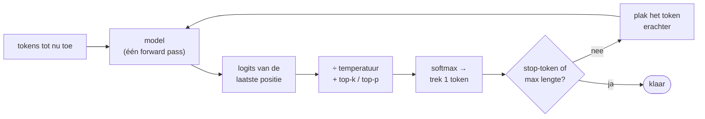
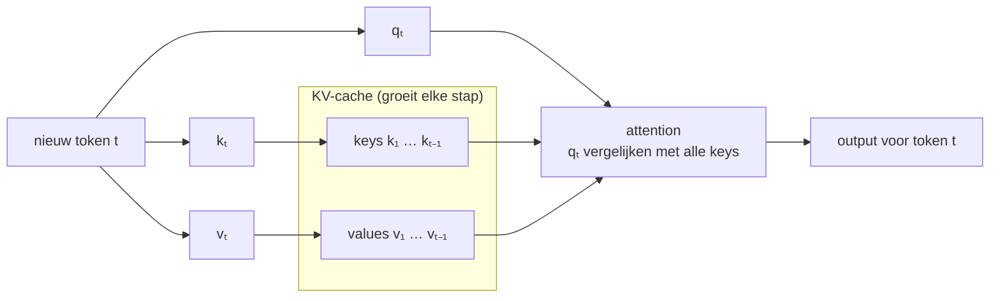
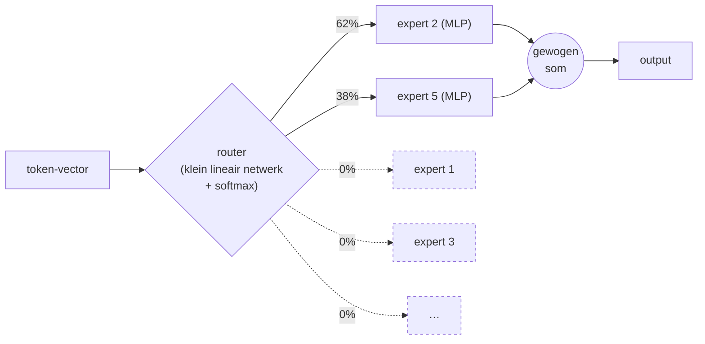

# 1.4 Van model naar tekst, en wat er sinds GPT-2 veranderd is

*Module 1: Transformers van binnen* · ⏱️ ~50 min

> **Waar we naartoe werken.** Je hebt nu een compleet model (1.3) dat voor elke positie een kansverdeling over het volgende token geeft. In dit laatste hoofdstuk lossen we drie losse eindjes op: hoe weet het model in welke **volgorde** de woorden staan? Hoe maak je van kansen een **lopende tekst**? En waarom is dat genereren eigenlijk **betaalbaar**? Aan het eind kijken we wat moderne modellen zoals Claude anders doen dan GPT-2.

---

## Deel A: het volgorde-probleem

### Er is iets geks aan de hand

Weet je nog denkvraag 2 uit 1.2? Neem deze twee zinnen:

> *"De hond bijt de man."*
> *"De man bijt de hond."*

Dezelfde woorden, totaal andere betekenis. Kan attention het verschil zien?

Denk terug aan hoe attention werkt: elk token berekent inproducten met alle andere tokens en neemt een gewogen gemiddelde. Maar nergens in die berekening zit **waar** een token staat. Het inproduct van "hond" met "bijt" is hetzelfde, of "hond" nu vooraan of achteraan staat. Voor attention is een zin eigenlijk een **zak met woorden**, zonder volgorde.

(Strikt genomen ziet de causal mask wel een beetje volgorde, want je kunt alleen naar links kijken. Maar dat is lang niet genoeg om "3 woorden terug" van "8 woorden terug" te onderscheiden.)

We moeten het model dus vertellen **waar** elk token staat.

### Oplossing 1: tel een "positie-vector" erbij op

Het simpelste idee, en wat GPT-2 doet: maak nóg een opzoektabel $P$, net als de embedding-tabel $E$ uit 1.1, maar dan met één vector per **positie** (positie 0, 1, 2, … tot 1023). Tel die op bij de embedding:

$$\mathbf{x}_i = E[\text{token}_i] + P[i]$$

Nu is "hond op positie 1" een andere vector dan "hond op positie 4". Het model leert zelf wat het met die positie-informatie doet. Dit is wat je in O3 bouwt.

Nadeel: het model leert alleen posities die het in de training heeft gezien. Is de tabel 1024 lang, dan weet het niets van positie 2000. En "positie 847" is een vrij betekenisloos begrip. Wat je meestal wilt weten is: *hoe ver staat dat woord van mij af?*

### Oplossing 2: RoPE, of positie als de wijzers van een klok

De meeste moderne modellen (Llama, Qwen, Mistral, …) gebruiken een slimmere methode: **RoPE** (*Rotary Position Embedding*, [paper](https://arxiv.org/abs/2104.09864)). Het idee is mooi meetkundig.

Denk aan de wijzers van een klok. De secondewijzer draait snel, de minutenwijzer langzaam, de urenwijzer heel langzaam. Kijk je naar alle drie, dan weet je precies hoeveel tijd er verstreken is, van seconden tot uren.

RoPE doet hetzelfde met de query- en key-vectoren uit 1.2:
1. Knip de vector op in **paartjes** getallen. Elk paartje kun je zien als een pijl in een 2D-vlak.
2. **Draai** elk paartje over een hoek die afhangt van de positie $m$ van het token: hoek $= m \cdot \theta$.
3. Elk paartje heeft zijn eigen snelheid $\theta$, net als de wijzers van een klok: sommige paartjes draaien snel, andere langzaam.


*Figuur 1.12. Eén paartje van een vector, gedraaid op posities m = 0 tot 7. **Links** een "secondewijzer": draait flink per positie, goed om naburige woorden te onderscheiden. **Rechts** een "urenwijzer": draait nauwelijks, maar blijft over lange afstanden betekenisvol.*

En nu het slimme deel. Weet je nog: attention-scores zijn **inproducten** van query en key, en het inproduct hangt af van de **hoek** tussen twee vectoren (Mini M3). Draai je de query met hoek $m\theta$ en de key met hoek $n\theta$, dan is de hoek ertussen veranderd met $(m - n)\theta$. Het inproduct hangt dus alleen af van het **verschil** in positie, $m - n$.

Het model ziet dus automatisch **relatieve** afstanden ("dit woord staat 3 plekken terug"), in plaats van absolute posities. Dat generaliseert veel beter naar langere teksten, en daarom is het nu de standaard.

---

## Deel B: van kansen naar tekst (decoding)

Het model geeft een kansverdeling over het volgende token. Hoe wordt dat een lopende tekst? Met een simpele lus:



```python
ids = tokenize(prompt)
for _ in range(max_new_tokens):
    logits = model(ids)[-1]               # alleen de laatste positie interesseert ons
    probs = softmax(logits / temperature)
    next_id = sample(probs)               # trek één token
    ids.append(next_id)
    if next_id == EOS: break              # model zegt "ik ben klaar"
```

Dit verklaart ook iets wat je elke dag ziet: **waarom Claude's antwoord woord voor woord op je scherm verschijnt.** Elk token vereist een volledige ronde door het model. Een antwoord van 500 tokens is 500 rondes, en elk token wordt naar je scherm gestuurd zodra het klaar is.

### Hoe kies je een token uit de verdeling?

Het voor de hand liggende antwoord: kies gewoon het meest waarschijnlijke (**greedy**). Maar dat werkt verrassend slecht. Teksten worden saai en blijven vaak in herhalingen hangen ("the the the …"). Mensen kiezen ook niet altijd het meest voor de hand liggende woord.

Dus we **trekken** (samplen) uit de verdeling: een token met 30% kans wordt in 30% van de gevallen gekozen. Daar heb je knoppen voor.

**Temperatuur.** Deel de logits door een getal $\tau$ vóór de softmax.

> 🔁 **Weet je nog?** Dit is precies hetzelfde effect als de $\sqrt{d_k}$ in attention (1.2), maar dan andersom. Grote logits geven een scherpe softmax, kleine logits een vlakke. Delen door $\tau < 1$ maakt de logits groter (scherper, voorspelbaarder). Delen door $\tau > 1$ maakt ze kleiner (vlakker, creatiever, maar ook chaotischer). Zie [Mini M1](../../../minis/M1-softmax-en-temperatuur.md).


*Figuur 1.13. De echte verdeling van GPT-2 na "The capital of the Netherlands is …" bij drie temperaturen. Bij T = 0,5 heeft " the" 51%. Bij T = 1,5 krijgen de top-8 samen nog maar 8%. De rest gaat naar de lange staart van ~50.000 andere tokens, en dat is meestal onzin.*

Dat laatste is een probleem. Daarom zijn er twee extra knoppen die de staart afknippen:

| Strategie | Wat | Wanneer handig |
|-----------|-----|-------|
| **Top-k** | houd alleen de $k$ meest waarschijnlijke tokens over | simpel, maar $k$ past zich niet aan |
| **Top-p (nucleus)** | houd de kleinste groep tokens over die samen ≥ $p$ kans hebben | slim: is het model zeker, dan blijven er weinig opties over; twijfelt het, dan veel |

> ▶ **Probeer het zelf:** in de **[Sampling-speeltuin](https://jeroenderuijter2002.github.io/Self-learning-AI/interactief/sampling.html)** draai je zelf aan temperatuur, top-k en top-p op echte GPT-2-voorspellingen, en trek je tokens. Zet de temperatuur op 2 en trek 20 tokens. Zet dan top-p op 0,9 en doe het nog eens.

**Een belangrijk inzicht:** het model zelf is volledig **deterministisch**. Dezelfde tekst erin geeft altijd exact dezelfde logits eruit. Alle variatie, alle "creativiteit", het feit dat Claude op dezelfde vraag twee keer iets anders antwoordt: dat komt **allemaal uit de sampling-stap**.

---

## Deel C: de KV-cache, of waarom genereren betaalbaar is

### Het probleem

Kijk nog eens naar de lus hierboven. Elke ronde stoppen we de **hele** tekst opnieuw in het model, terwijl er maar één token bij is gekomen. Het is alsof je een boek schrijft en voor elk nieuw woord eerst het hele boek opnieuw leest. Bij token 500 lees je 499 tokens opnieuw, voor één nieuw woord.

### De observatie

Weet je nog de causal mask uit 1.2? Een token kan alleen naar links kijken, nooit naar rechts. Wat betekent dat?

Als token 5 eenmaal berekend is, verandert er **nooit meer iets** aan. Token 6, 7 en 8 komen erbij, maar token 5 kijkt niet naar rechts, dus zijn keys en values blijven precies hetzelfde.

### De oplossing

Bewaar de keys en values van alle eerdere tokens in een cache, en bereken voor elk **nieuw** token alleen zijn eigen $\mathbf{q}$, $\mathbf{k}$ en $\mathbf{v}$:



Het effect is groot:


*Figuur 1.14. Echte meting: GPT-2 small op een CPU. Zonder cache groeit het werk per stap mee met de lengte (alles opnieuw lezen), dus het totaal groeit ongeveer kwadratisch: 300 tokens duren 45 seconden. Met cache is elke stap ongeveer even duur en groeit het totaal lineair: 8 seconden. In O4 doe je deze meting zelf.*

### De prijs: geheugen

Niets is gratis. De cache moet ergens staan, en hij groeit met elk token, in elke laag, voor elke head:


*Figuur 1.15. Berekende grootte van de KV-cache voor **één gesprek** met een 70B-model. Met 64 KV-heads is de cache bij ~55k tokens al groter dan het hele model (140 GB)! De oplossing heet **Grouped-Query Attention (GQA)**: laat meerdere query-heads één set keys en values delen (hier 8 sets in plaats van 64). Dat maakt de cache 8× kleiner, en het model presteert nauwelijks slechter.*

Nu snap je ook waarom API's per token rekenen, en waarom lange gesprekken duurder zijn: elk extra token kost rekenwerk én geheugen op een dure GPU.

---

## Deel D: wat is er veranderd sinds GPT-2?

Hier is iets wat je misschien niet verwacht: **de kern is hetzelfde gebleven.** Een GPT-2 uit 2019 en een frontier-model nu zijn familie van elkaar. Alles wat je in 1.1 tot en met 1.4 hebt geleerd, geldt ook voor de nieuwste modellen. De belangrijkste upgrades zijn:

| Upgrade | Wat | Waarom | Ken je uit… |
|---------|-----|--------|-------------|
| **Schaal** | 124M → honderden miljarden parameters, biljoenen trainingstokens | scaling laws: groter = voorspelbaar beter | module 2 |
| **RoPE** | positie via rotatie | relatieve afstanden, langere context | deel A |
| **RMSNorm, SwiGLU** | kleine tweaks aan LayerNorm en MLP | stabieler, iets beter | 1.3 |
| **GQA** | gedeelde K/V-heads | kleinere KV-cache | deel C |
| **FlashAttention** | slimmere GPU-implementatie van **dezelfde** wiskunde | veel sneller, minder geheugen | 1.2 |
| **Lange context** | 1k → honderdduizenden tokens | RoPE-schaling, efficiëntere attention | 1.2, deel A |
| **Mixture-of-Experts** | zie hieronder | meer kennis zonder evenredig meer rekenwerk | 1.3 |

### Mixture-of-Experts (MoE)

Weet je nog uit 1.3 dat de MLP's de meeste parameters bevatten, en waarschijnlijk veel kennis? Wat als je méér kennis wilt, zonder dat elk token door een gigantische MLP moet?

Vergelijk het met een ziekenhuis. Je wordt niet door álle artsen onderzocht. Een triage-verpleegkundige stuurt je door naar de twee specialisten die bij jouw klacht passen. Het ziekenhuis heeft enorm veel kennis in huis, maar per patiënt wordt maar een klein deel gebruikt.

MoE doet hetzelfde. In plaats van één MLP per block zijn er bijvoorbeeld 8 tot 128 MLP's (**experts**). Een kleine **router** (de triage) kiest per token de beste paar:



Voorbeeld: Mixtral 8×7B ([paper](https://arxiv.org/abs/2401.04088)) heeft ~47B parameters, maar gebruikt er per token maar ~13B. Veel frontier-modellen gebruiken volgens publieke rapporten MoE. De exacte architectuur van gesloten modellen zoals Claude is echter niet openbaar.

---

## Terug naar de vraag waarmee het begon: "hoe werkt Claude?"

Je kunt nu een antwoord geven dat de meeste mensen niet kunnen geven:

> *"Claude is, voor zover publiek bekend, een decoder-only transformer. Tekst wordt opgeknipt in subword-tokens, en elk token wordt een vector. Die vectoren gaan door tientallen lagen. In elke laag wisselen tokens informatie uit via multi-head self-attention (alleen naar links kijken, dankzij een causal mask), en verwerkt elk token die informatie in een MLP. Alles schrijft bij in een gedeelde residual stream. Aan het eind wordt de laatste vector vergeleken met alle tokens, en dat geeft een kansverdeling over het volgende token. Generatie herhaalt dat token voor token, met sampling en een KV-cache."*

Maar er is nog een groot gat. Kijk nog eens naar figuur 1.13. GPT-2 is een **tekstvoorspeller**: geef het een vraag en het voorspelt wat er op een willekeurige webpagina na die vraag zou staan. Dat kan het antwoord zijn, maar ook een tweede vraag, of reclame. Claude is een **assistent**: het beantwoordt je vraag, volgt instructies, weigert schadelijke verzoeken, en denkt na voor het antwoordt.

Dat verschil zit **niet in de architectuur**. Die is, zoals je net zag, grotendeels hetzelfde. Het zit in de **training**. → **[Module 2](../../02-training/README.md).**

---

## Samenvatting: wat je nu weet

1. Attention ziet zelf geen volgorde. **Positie-embeddings** (GPT-2) of **RoPE** (modern, als klokwijzers) lossen dat op.
2. Genereren is een **lus**: voorspel, trek een token, plak erachter, herhaal. Alle variatie komt uit **sampling** (temperatuur, top-k, top-p).
3. De **KV-cache** maakt genereren betaalbaar, omdat de causal mask garandeert dat oude tokens niet veranderen. De prijs is geheugen, en **GQA** beperkt die.
4. Moderne modellen zijn **dezelfde familie** als GPT-2, met upgrades als schaal, RoPE, GQA en **MoE**.
5. Het verschil tussen een tekstvoorspeller en een assistent zit in de **training** (module 2).

---

### ✏️ Denkvragen
1. Je zet de temperatuur op 0. Wat gebeurt er wiskundig met $\text{softmax}(z/\tau)$, en waarom implementeren systemen dat als greedy?
2. Waarom kan een KV-cache niet werken bij een model zonder causal mask, zoals BERT?
3. Een API rekent output-tokens duurder dan input-tokens. Leg uit waarom. (Hint: de prompt kan in één keer door het model, parallel. Hoe zit dat met de output?)

**Volgende:** [Opdracht O4: GPT-2 onder de loep](../opdrachten/O4-gpt2-onder-de-loep.md) → [Zelftoets](../zelftoets.md)
