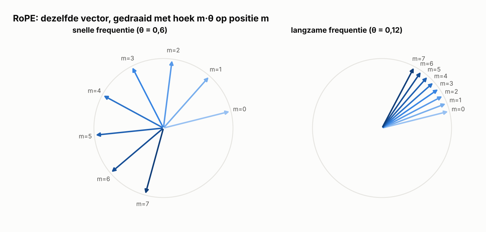
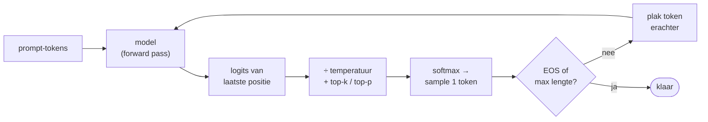
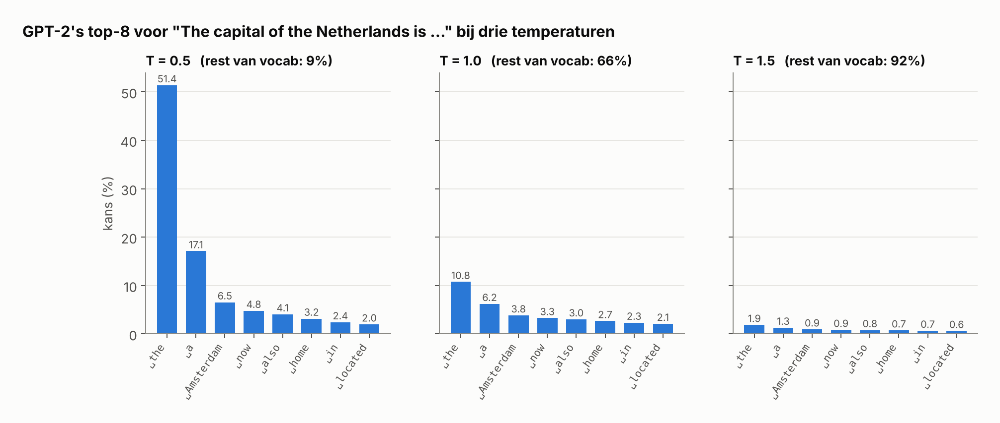
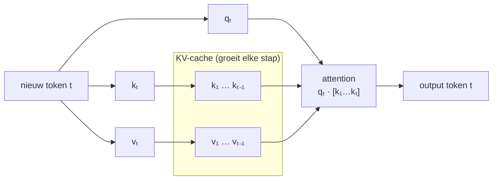
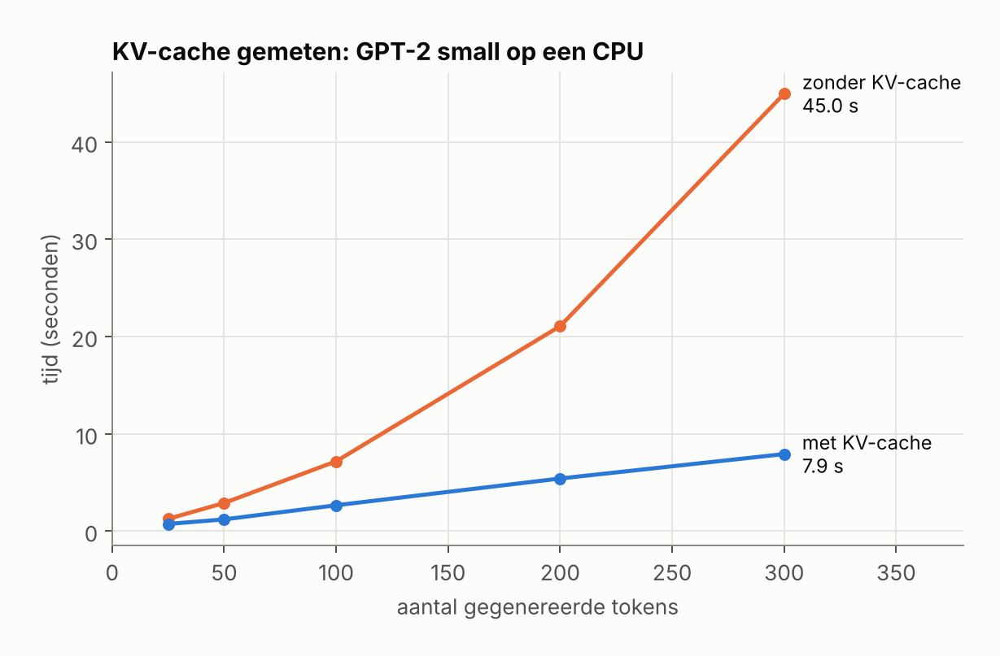
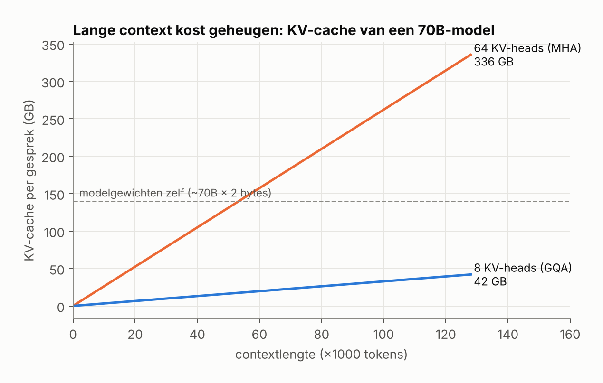
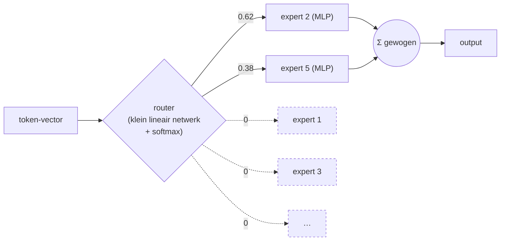

# 1.4 Van model naar tekst, en moderne varianten

*Module 1: Transformers van binnen* · ⏱️ ~45 min

---

Je hebt nu een model dat logits geeft. Hoe wordt dat de stroom tekst die je van Claude ziet? En wat hebben moderne modellen veranderd sinds GPT-2?

## Deel A: positie-informatie

In notes 1.2 zag je dat attention **permutatie-equivariant** is: "hond bijt man" en "man bijt hond" geven zonder extra informatie dezelfde set vectoren. We moeten het model vertellen **waar** elk token staat.

| Methode | Hoe | Gebruikt in |
|---------|-----|-------------|
| Sinusoïdaal | vaste sin/cos-golven optellen bij embedding | originele Transformer |
| Geleerd absoluut | extra lookup-tabel $P[\text{positie}]$ optellen | GPT-2, jouw O3-model |
| **RoPE** | $Q$ en $K$ **roteren** met een hoek die afhangt van positie | Llama, Qwen, Mistral, de meeste moderne modellen |

**RoPE** ([paper](https://arxiv.org/abs/2104.09864)) verdeelt $\mathbf{q}$ en $\mathbf{k}$ in paren van dimensies en roteert elk paar met hoek $m\theta_i$, waarbij $m$ de positie is:



*Figuur 1.12. RoPE draait hetzelfde 2D-paar verder naarmate het token later in de tekst staat. Elk paar dimensies heeft een eigen frequentie $\theta_i$. Snelle paren (links) draaien flink per positie en onderscheiden dichtbij-gelegen tokens. Langzame paren (rechts) draaien nauwelijks en coderen lange afstanden.*

**De truc:** als je $\mathbf{q}$ draait met hoek $m\theta$ en $\mathbf{k}$ met $n\theta$, dan hangt het inproduct alleen af van het **verschil** $(m-n)\theta$. Het model leert zo *relatieve* posities ("3 tokens terug") in plaats van absolute ("positie 847"). Dat generaliseert beter naar langere teksten.

## Deel B: genereren (decoding)

Genereren is een lus:



```python
ids = tokenize(prompt)
for _ in range(max_new_tokens):
    logits = model(ids)[-1]           # alleen de laatste positie
    probs = softmax(logits / temperature)
    next_id = sample(probs)
    ids.append(next_id)
    if next_id == EOS: break
```

### Sampling-strategieën

| Strategie | Wat | Effect |
|-----------|-----|--------|
| **Greedy** | altijd argmax | deterministisch, maar vaak repetitief en saai |
| **Temperatuur** $\tau$ | logits / $\tau$ vóór softmax | $\tau<1$: scherper, voorspelbaarder; $\tau>1$: platter, creatiever en chaotischer |
| **Top-k** | alleen de $k$ meest waarschijnlijke tokens | snijdt onzin-staart af |
| **Top-p (nucleus)** | kleinste set tokens met cumulatieve kans ≥ $p$ | adaptief: weinig opties bij zekerheid, veel bij twijfel |



*Figuur 1.13. Echte next-token-verdeling van GPT-2 voor "The capital of the Netherlands is …" bij drie temperaturen. Bij T = 0,5 heeft " the" 51%. Bij T = 1,5 krijgt de top-8 samen nog maar 8%, de rest gaat naar de staart van ~50.000 tokens (meestal onzin). Daarom combineer je hoge temperatuur bijna altijd met top-p. En zie hoe weinig GPT-2 "weet": " Amsterdam" staat pas op plek 3.*

Meer over temperatuur: [Mini M1](../../minis/M1-softmax-en-temperatuur.md).

**Inzicht:** het model zelf is deterministisch. Dezelfde input geeft dezelfde logits. Alle variatie tussen antwoorden komt uit de sampling-stap. Elke stap vereist een volledige forward pass, en daarom zie je tekst token voor token binnendruppelen.

## Deel C: de KV-cache, waarom generatie betaalbaar is

Naïef herbereken je bij elke nieuwe stap $Q, K, V$ voor **alle** voorgaande tokens. Maar door de causal mask veranderen de keys en values van oude tokens nooit: token 5 kijkt niet naar token 6, dus zijn representatie blijft gelijk.

**Oplossing:** bewaar $K$ en $V$ van alle eerdere tokens (per laag, per head) en bereken alleen voor het **nieuwe** token $\mathbf{q}, \mathbf{k}, \mathbf{v}$:





*Figuur 1.14. Echte meting: GPT-2 small op een CPU. Zonder cache groeit het werk per stap mee met de lengte, dus de totale tijd groeit ongeveer kwadratisch (300 tokens: 45 s). Met cache is elke stap ongeveer even duur en groeit het totaal lineair (8 s). Je herhaalt deze meting zelf in O4.*

**De prijs is geheugen.** De cache groeit met contextlengte × lagen × heads:



*Figuur 1.15. Berekende KV-cache-grootte voor één gesprek met een 70B-model (80 lagen, bf16). Met 64 aparte KV-heads is de cache bij ~55k tokens al groter dan het hele model. **Grouped-Query Attention (GQA)** laat meerdere query-heads één set K/V delen (hier 8 in plaats van 64) en maakt de cache 8× kleiner. Daarom gebruiken vrijwel alle moderne modellen GQA, en daarom rekenen API's per token.*

## Deel D: wat is er veranderd sinds GPT-2?

De kern is hetzelfde gebleven. Een GPT-2 uit 2019 en een frontier-model nu zijn familie. De belangrijkste upgrades:

| Upgrade | Wat | Waarom |
|---------|-----|--------|
| **Schaal** | 124M → honderden miljarden parameters, biljoenen trainingstokens | scaling laws (module 2) |
| **RoPE** | relatieve positie via rotatie | betere lengte-generalisatie |
| **RMSNorm, SwiGLU** | kleinere architectuurtweaks | stabieler, iets beter |
| **GQA** | gedeelde K/V-heads | kleinere KV-cache (figuur 1.15) |
| **FlashAttention** | slimmere GPU-implementatie van dezelfde wiskunde | veel sneller en minder geheugen |
| **Lange context** | 1k → honderdduizenden tokens | RoPE-schaling, efficiëntere attention |
| **Mixture-of-Experts (MoE)** | zie hieronder | meer capaciteit zonder evenredig meer rekenwerk |

### Mixture-of-Experts

In plaats van één MLP per block heb je er bijvoorbeeld 8 tot 128 (*experts*). Een kleine **router** kiest per token een paar experts:



Zo heeft het model veel parameters (kennis), maar gebruikt het per token maar een fractie (rekenwerk). Voorbeeld: Mixtral 8×7B ([paper](https://arxiv.org/abs/2401.04088)) heeft ~47B parameters, maar gebruikt er ~13B per token. Veel frontier-modellen gebruiken volgens publieke rapporten MoE, maar de exacte architectuur van gesloten modellen zoals Claude is niet openbaar.

## Terug naar de vraag: "Hoe werkt Claude?"

Met deze module kun je nu zeggen:

> *"Claude is (voor zover publiek bekend) een decoder-only transformer. Tekst wordt opgeknipt in subword-tokens, die embeddings worden. Die vectoren gaan door tientallen lagen van multi-head self-attention, waarin tokens informatie uitwisselen onder een causal mask, en MLP's die per token kennis toepassen. Alles hangt aan een residual stream. Aan het eind komt er een kansverdeling over het volgende token uit. Generatie herhaalt dat token voor token met sampling, versneld door een KV-cache."*

Wat je nog **niet** kunt uitleggen: waarom dat ding behulpzaam is, instructies volgt en nadenkt voor het antwoordt. GPT-2 in figuur 1.13 is een pure tekstvoorspeller; Claude is een assistent. Dat verschil zit niet in de architectuur, maar in de **training**. → **Module 2.**

---

### ✏️ Denkvragen
1. Je zet temperatuur op 0. Wat gebeurt er wiskundig, en waarom implementeren systemen dat als greedy?
2. Waarom kan een KV-cache niet werken bij een encoder-only model zoals BERT?
3. Een API rekent output-tokens duurder dan input-tokens. Leg uit waarom, met figuur 1.14 in je achterhoofd.

**Volgende:** [Opdracht O4: GPT-2 onder de loep](../opdrachten/O4-gpt2-onder-de-loep.md) → [Zelftoets](../zelftoets.md)
