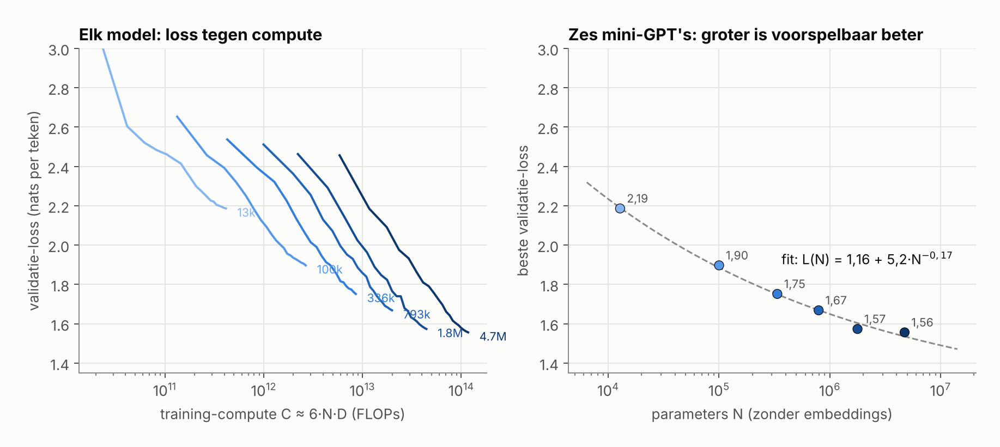
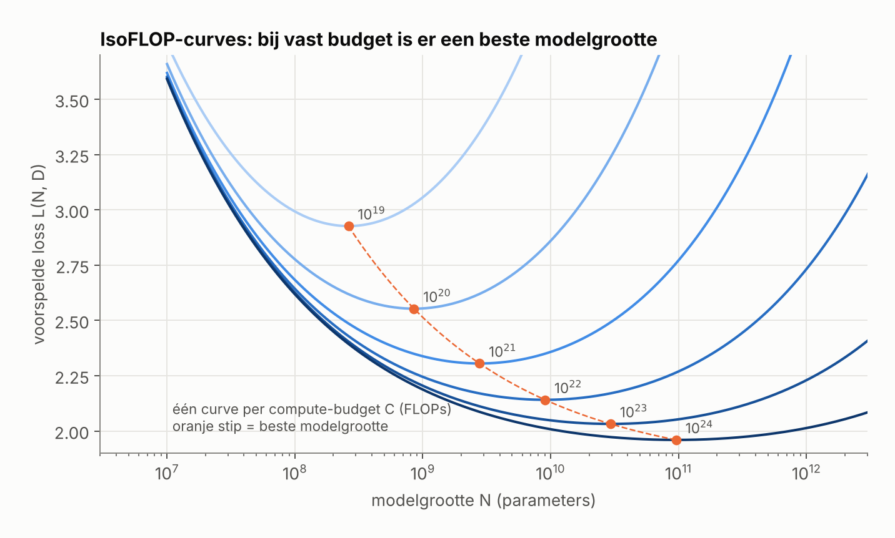
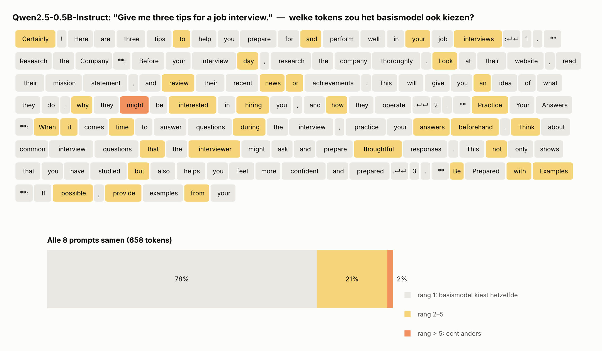
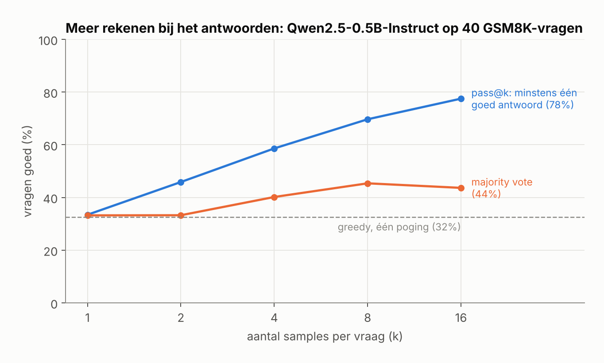

# Module 2: Van tekstvoorspeller naar assistent

> Een basismodel is geen assistent, maar een simulator van internetdocumenten. Zo legt Andrej Karpathy het uit in zijn [*Deep Dive into LLMs*](https://www.youtube.com/watch?v=7xTGNNLPyMI). Deze module gaat over alles wat er gebeurt om van die simulator een assistent te maken.

⚪ *Kern: hoe moderne AI werkt* · **Status: ✅ beschikbaar**

## Waarom deze module?

[Module 1](../01-transformers/README.md) eindigde met een raadsel: GPT-2 en Claude hebben grofweg dezelfde architectuur, maar het ene is een tekstvoorspeller en het andere een behulpzame assistent die nadenkt. Het verschil zit volledig in de **training**. Na deze module kun je het hele trainingsproces van een frontier-model uitleggen: pretraining, de wetten die bepalen hoe groot een model moet zijn, supervised fine-tuning, RLHF, Constitutional AI en DPO, en reinforcement learning voor redeneermodellen. En je hebt van elke stap de kern zelf gebouwd en gemeten.

## 🌍 In de praktijk

**Van GPT-3 naar ChatGPT (2022).** GPT-3 bestond al sinds 2020, maar was een pure tekstvoorspeller: stel het een vraag en het verzint misschien nog drie vragen erbij. Het verschil met ChatGPT zat niet in de architectuur maar in de **training uit deze module**: supervised fine-tuning plus RLHF. In het [InstructGPT-paper](https://arxiv.org/abs/2203.02155) (maart 2022) gaven labelaars de voorkeur aan de antwoorden van een model van 1,3 miljard parameters, getraind met RLHF, boven die van het ruim honderd keer grotere GPT-3 (175 miljard). Betere training versloeg brute grootte. Ruim een half jaar later, op 30 november 2022, was ChatGPT er.

**DeepSeek-R1 (2025).** In januari 2025 publiceerde DeepSeek een open redeneermodel dat op wiskunde- en programmeertaken het niveau haalde van OpenAI's o1. De sleutel was geen nieuwe architectuur, maar reinforcement learning met beloningen die je automatisch kunt controleren (2.6). Volgens [het paper](https://arxiv.org/abs/2501.12948) steeg de score van de pure-RL-variant op de wiskundewedstrijd AIME 2024 tijdens de training van 15,6% naar 71,0%. Het werk verscheen later dat jaar, na peer review, in [*Nature*](https://doi.org/10.1038/s41586-025-09422-z).

## Leerdoelen

Na deze module kun je:
- [ ] uitleggen wat een **basismodel** is, waar de trainingsdata vandaan komt en hoe een pretraining-run eruitziet (learning-rate-schema, $C \approx 6ND$, loss-spikes);
- [ ] **scaling laws** uitleggen, zelf meten, en de Chinchilla-optimale verdeling van een compute-budget afleiden, en uitleggen waarom labs daar bewust van afwijken;
- [ ] uitleggen wat **supervised fine-tuning** doet (chat-template, loss-masker), waarom weinig data volstaat, en zelf **LoRA** implementeren;
- [ ] de drie stappen van **RLHF** uitleggen: Bradley-Terry-reward model, RL met een KL-rem, en hoe het misgaat (reward hacking, sycophancy);
- [ ] **Constitutional AI** beschrijven en de **DPO-loss** afleiden uit het RLHF-doel;
- [ ] uitleggen waarom **reasoning-modellen** werken: chain-of-thought, test-time compute, RL met verifieerbare beloningen en GRPO;
- [ ] als consultant onderbouwen of een klant moet **fine-tunen of prompten**.

## Wat je al kent (en wat we dus overslaan)

> ⏭️ **Overgeslagen:** gradient descent en Adam, cross-entropy, overfitting en regularisatie, logistische regressie, MDP's en policy gradients in de basis, Lagrange-multiplicatoren, PCA en lage-rang-benaderingen, en de transformer-architectuur zelf (module 1). Waar de notes erop voortbouwen, staat een korte "🔁 Weet je nog?" in plaats van een herhaling. Is cross-entropy weggezakt? Lees eerst [Mini M4](../../minis/M4-cross-entropy.md). Nieuw in deze module is [Mini M5: KL-divergentie](../../minis/M5-kl-divergentie.md).

## Wat je gaat zien

Een paar van de 11 figuren in deze module, allemaal gemaakt met echte metingen of gepubliceerde data:

| | |
|---|---|
|  |  |
| *Zes eigen mini-GPT's volgen een machtswet (2.2)* | *Bij elk budget is er een beste modelgrootte (2.2)* |
|  |  |
| *Wat verandert SFT? Vooral de stijl (2.3)* | *Meer rekenwerk bij het antwoorden (2.6)* |

## Leespad

| Stap | Type | Wat | Tijd |
|------|------|-----|------|
| 0 | 🟡 Opfrissen | [Mini M4: cross-entropy](../../minis/M4-cross-entropy.md), als die weggezakt is | 10 min |
| 1 | 🎬 Video | 3Blue1Brown, [*Large Language Models explained briefly*](https://www.youtube.com/watch?v=LPZh9BOjkQs): de hele module in 8 minuten | 8 min |
| 2 | 📖 Notes | [2.1 Pretraining](notes/2.1-pretraining.md) | 50 min |
| 3 | ▶ Speeltuin | [Basismodel vs assistent](https://jeroenderuijter2002.github.io/Self-learning-AI/interactief/basis-vs-assistent.html): GPT-2, een basismodel en een assistent op dezelfde vraag | 15 min |
| 4 | 📖 Notes | [2.2 Scaling laws](notes/2.2-scaling-laws.md) | 55 min |
| 5 | ▶ Speeltuin | [Scaling-calculator](https://jeroenderuijter2002.github.io/Self-learning-AI/interactief/scaling.html): Chinchilla, echte modellen, en inference meegerekend | 15 min |
| 6 | 🛠️ Opdracht | [O1: Meet je eigen scaling law](opdrachten/O1-scaling-experiment.md) | 2–3 u |
| 7 | 🎬 Video | Karpathy, [*State of GPT*](https://www.youtube.com/watch?v=bZQun8Y4L2A) (Microsoft Build 2023): de hele pijplijn van pretraining tot RLHF | 42 min |
| 8 | 📖 Notes | [2.3 Supervised fine-tuning](notes/2.3-supervised-fine-tuning.md) | 50 min |
| 9 | 🛠️ Opdracht | [O3: SFT met je eigen LoRA](opdrachten/O3-sft-met-lora.md) | 2–4 u |
| 10 | 📖 Notes | [2.4 RLHF](notes/2.4-rlhf.md) + [Mini M5: KL-divergentie](../../minis/M5-kl-divergentie.md) | 60 + 15 min |
| 11 | 📖 Notes | [2.5 Constitutional AI en DPO](notes/2.5-constitutional-ai-en-dpo.md) | 50 min |
| 12 | 🛠️ Opdracht | [O2: Een reward model en de DPO-loss](opdrachten/O2-reward-model-en-dpo.md) | 2–3 u |
| 13 | 🎬 Video | Karpathy, [*Deep Dive into LLMs like ChatGPT*](https://www.youtube.com/watch?v=7xTGNNLPyMI): het laatste uur, over RL en "thinking"-modellen | 60 min |
| 14 | 📖 Notes | [2.6 Reasoning-modellen](notes/2.6-reasoning-modellen.md) | 55 min |
| 15 | 🛠️ Opdracht | [O4: Test-time compute](opdrachten/O4-test-time-compute.md) | 1,5–3 u |
| 16 | ✅ Toets | [Zelftoets](zelftoets.md) | 30 min |
| 17 | 💼 Praktijk | [P2: Fine-tunen of prompten?](opdrachten/P2-fine-tunen-of-prompten.md): een consultancy-opdracht voor een verzekeraar | 8–12 u |

**Totaal:** ongeveer 22–30 uur, inclusief de praktijkopdracht. Verspreid over drie weken naast je thesis is dat goed te doen. De opdrachten O1 tot en met O4 draaien op een laptop-CPU; voor de praktijkopdracht is een gratis Colab-GPU handig.

> **O2 na O3?** Ja, bewust. O3 (SFT) volgt de leesvolgorde van de notes; O2 gebruikt bouwstenen (`sequence_logprob`) die na O3 vanzelf spreken.

> De ▶-speeltuinen werken online, maar je kunt de bestanden in [`interactief/`](../../interactief/) ook lokaal openen.

## Bestanden in deze module

```
notes/          2.1 … 2.6
figures/        alle figuren (gemaakt met tools/make_figures_module02.py)
opdrachten/     O1–O4 (.md + .py met tests), minigpt.py, P2 (praktijkopdracht)
oplossingen/    uitwerkingen van O1–O4 (getest)
zelftoets.md
```

De metingen achter de figuren komen uit [`tools/m2_experiments.py`](../../tools/m2_experiments.py) en staan als kleine JSON-bestanden in [`tools/results/`](../../tools/results/), zodat je elke figuur kunt hermaken zonder alles opnieuw te trainen.

## Verder lezen (optioneel)

- 📖 Nathan Lambert, [*Reinforcement Learning from Human Feedback*](https://rlhfbook.com): een gratis online boek over de hele post-training, van reward models tot RLVR
- 📖 Lilian Weng, [*Reward Hacking in Reinforcement Learning*](https://lilianweng.github.io/posts/2024-11-28-reward-hacking/): het overzicht van alles wat er in 2.4 mis kan gaan
- 📖 Hugging Face, [*Illustrating RLHF*](https://huggingface.co/blog/rlhf): het RLHF-recept met heldere plaatjes
- 📖 Sebastian Raschka, [*Understanding Reasoning LLMs*](https://magazine.sebastianraschka.com/p/understanding-reasoning-llms): de vier manieren om redeneermodellen te bouwen
- 📄 De papers: [Chinchilla](https://arxiv.org/abs/2203.15556) · [InstructGPT](https://arxiv.org/abs/2203.02155) · [Constitutional AI](https://arxiv.org/abs/2212.08073) · [DPO](https://arxiv.org/abs/2305.18290) · [DeepSeek-R1](https://arxiv.org/abs/2501.12948). Na deze module zijn ze goed te lezen.
- 📜 Anthropic, [Claude's constitutie](https://www.anthropic.com/constitution) (januari 2026): het document dat in 2.5 besproken wordt, volledig te lezen
- 💻 [nanochat](https://github.com/karpathy/nanochat): pretraining, SFT, RL en een chat-interface in één kleine codebase. De ideale volgende stap als je het hele proces één keer zelf wilt draaien (met gehuurde GPU's).

---
[← Terug naar het overzicht](../../README.md)
