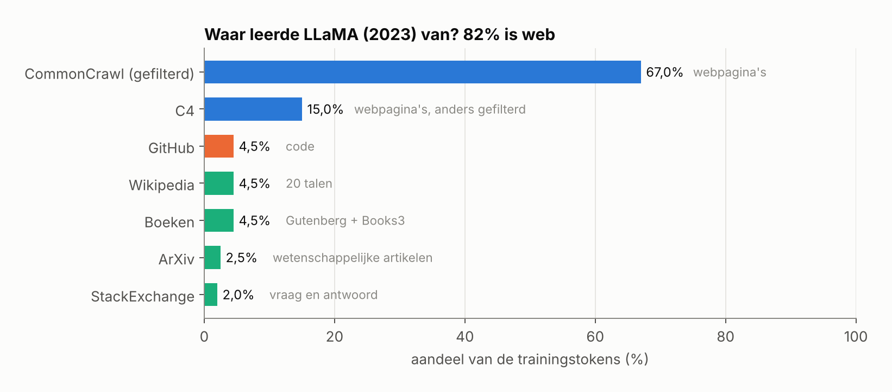
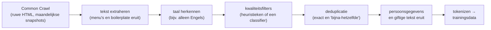
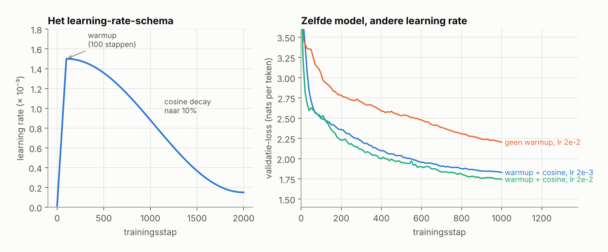

# 2.1 Pretraining: een tekstvoorspeller bouwen

*Module 2: Van tekstvoorspeller naar assistent* · ⏱️ ~50 min · 🎬 aanrader: Karpathy, [*Deep Dive into LLMs like ChatGPT*](https://www.youtube.com/watch?v=7xTGNNLPyMI), het eerste uur

> **Waar we naartoe werken.** Module 1 eindigde met een raadsel. GPT-2 en Claude zijn familie van elkaar: dezelfde blocks, dezelfde attention, dezelfde lus van token voor token. Toch is het ene een tekstvoorspeller en het andere een assistent. In deze module volgen we een model door zijn hele opleiding. Dit eerste hoofdstuk gaat over de basisschool: **pretraining**, waarin het model leert wat er op het internet staat. Aan het eind snap je waarom zo'n basismodel al heel veel *weet*, maar nog niet *wil helpen*.

---

## Een experiment om mee te beginnen

Stel GPT-2 een vraag, en kijk wat er gebeurt. Dit is een echte uitvoer (zie de speeltuin verderop):

> **Prompt:** *What is the capital of France?*
>
> **GPT-2:** *The capital of France, however, is not French. The capital of France is not a capital of France. It is French capital. But, no, in this case, it is not French capital. […] Why is this capital different from the capital of another country?*

GPT-2 is niet kapot. Het doet precies waarvoor het getraind is. Stel je de vraag voor als het begin van een webpagina. Wat staat er op het internet meestal ná zo'n regel? Soms het antwoord. Maar vaak ook een lijstje met méér vragen (een quiz, een FAQ), of een forumdraad waar iemand reageert. Het model maakt het document af. Het heeft geen idee dat jij een antwoord wilt.

Karpathy noemt een basismodel daarom een **internet-document-simulator**. Dat is het beste mentale model voor dit hoofdstuk: alles wat een basismodel doet, is antwoord op de vraag *"hoe gaat dit document verder?"*

> 🔁 **Weet je nog?** In [1.4](../../01-transformers/notes/1.4-van-model-naar-tekst.md) zag je de lus: voorspel een verdeling over het volgende token, trek er één, plak hem erachter, herhaal. Daar verandert in deze hele module niets aan. Wat verandert is *welke* verdeling het model heeft geleerd.

---

## Waarom "volgende token voorspellen" zo krachtig is

Het trainingsdoel is bijna beledigend simpel. Neem een stuk tekst, verberg steeds het volgende token, en straf het model met de cross-entropy-loss als het dat token een lage kans gaf:

$$\mathcal{L} = -\frac{1}{T}\sum_{t=1}^{T} \log p_\theta(x_t \mid x_{<t})$$

> 🔁 **Weet je nog?** Dit is de cross-entropy uit [Mini M4](../../../minis/M4-cross-entropy.md): de gemiddelde "verrassing" van het model, in nats per token. Een loss van $\ln(65) \approx 4{,}17$ betekent "ik gok uniform tussen 65 tekens"; elke nat eronder is iets wat het model heeft geleerd.

Waarom levert zo'n simpel doel zoveel kennis op? Kijk naar wat je moet weten om het volgende woord goed te voorspellen:

| Begin van de tekst | Wat je nodig hebt om het volgende woord te raden |
|---|---|
| *"De hoofdstad van Frankrijk is …"* | een feit over de wereld |
| *"Ze pakte haar paraplu, want het …"* | oorzaak en gevolg |
| *"def fibonacci(n): if n <= 1: return …"* | programmeren |
| *"17 × 3 = …"* | rekenen |
| *"Hij keek haar boos aan en zei: '…"* | een idee van wat mensen voelen |

Een model dat de loss op álle tekst van het internet omlaag wil krijgen, moet dus al die dingen een beetje leren. Niemand vertelt het model "leer rekenen"; rekenen is gewoon een handige manier om de loss op tekst met sommen te verlagen. Dat is de diepe truc van pretraining: **voorspellen dwingt tot begrijpen**, of in elk geval tot iets wat er van buiten erg op lijkt.

Je kunt het ook zien als **compressie**. Een model met een lage loss kan tekst in weinig bits opslaan (je codeert alleen de "verrassing"). En goed comprimeren lukt alleen als je de structuur van de tekst kent. Een model dat weet dat na "De hoofdstad van Frankrijk is" bijna altijd "Parijs" komt, hoeft dat woord bijna niet op te slaan.

---

## Waar leert het model van?

"Het internet" klinkt als één ding, maar trainingsdata is een zorgvuldig samengesteld recept. Neem LLaMA, het eerste open model van Meta uit 2023, omdat Meta het recept daarvan [precies publiceerde](https://arxiv.org/abs/2302.13971):



*Figuur 2.1. De pretraining-mix van LLaMA (Touvron et al., 2023, tabel 1). Ruim vier vijfde is gefilterde webtekst. Code, Wikipedia, boeken en wetenschappelijke artikelen zijn klein in tokens, maar hoog in kwaliteit. Wikipedia en de boeken werden ruim twee keer doorlopen (ongeveer 2,4 en 2,2 epochs), de rest ongeveer één keer.*

Twee dingen vallen op. Ten eerste: het meeste is gewoon web. Ten tweede: de kleine, nette bronnen worden **vaker** gezien. Het recept is dus geen afspiegeling van het internet, maar een keuze: "hier wil ik dat het model extra goed in wordt".

### Van ruw web naar trainingsdata

Het ruwe web is grotendeels rommel: menu's, cookiemeldingen, spam, dubbele pagina's, machinaal gegenereerde tekst. Een moderne datapipeline is daarom vooral een **filter**. De stappen zijn bij vrijwel elk lab hetzelfde:



Hoeveel dat uitmaakt, liet Hugging Face zien met [FineWeb](https://arxiv.org/abs/2406.17557) (2024): 15 biljoen tokens uit 96 Common Crawl-snapshots, met elke filterstap apart getest. Daarna trainden ze een **classifier** die per webpagina inschat hoe "leerzaam" de tekst is. De labels daarvoor kwamen van Llama-3-70B-Instruct, dat een paar honderdduizend pagina's een cijfer gaf. Alleen pagina's met minstens een 3 op 5 bleven over. Dat werd [FineWeb-Edu](https://huggingface.co/datasets/HuggingFaceFW/fineweb-edu): 1,3 biljoen tokens, minder dan een tiende van het origineel, en modellen die erop getraind zijn scoren duidelijk beter op kennis- en redeneertaken.

Hier zie je al iets wat in deze hele module terugkomt: **een AI-model helpt bij het trainen van het volgende**. Onthoud dat voor 2.5.

**Deduplicatie** verdient een apart woord. [Lee et al. (2022)](https://arxiv.org/abs/2107.06499) vonden in C4, een veelgebruikte webdataset, één zin van 61 woorden (een stuk reclametekst over trouwdecoratie) die er **61.036 keer** letterlijk in stond. Dubbele data is om twee redenen slecht. Het model verspilt rekenwerk aan iets wat het al kent, en het gaat zulke tekst **letterlijk onthouden** en later opdreunen. Na deduplicatie produceerden hun modellen tien keer minder vaak letterlijk onthouden tekst, en ze hadden minder trainingsstappen nodig voor dezelfde kwaliteit.

### Wat er níet in zit

Net zo belangrijk: wat het model niet ziet, kan het niet weten. Tekst achter een betaalmuur of login, je eigen e-mails, interne bedrijfsdocumenten, en alles wat na de laatste snapshot gebeurde. Dat laatste is de **knowledge cutoff**: het model weet niets van de wereld na het moment waarop de data is verzameld. Als je in module 3 een bedrijfsassistent bouwt, is dit precies het gat dat je met RAG moet dichten.

> 💡 **Voor de consultant.** "Kan het model onze interne data?" Nee, tenzij je die meegeeft (module 3) of het model erop traint (2.3). En "Is ons bedrijfsgeheim in de trainingsdata beland?" hangt af van wat er publiek op internet stond, en van de voorwaarden van de API die je gebruikt.

---

## Hoe ziet een trainingsrun eruit?

Stel, de data is klaar. Wat gebeurt er dan in de weken (of maanden) dat duizenden GPU's draaien? In de kern precies wat je in O3 van module 1 deed: batches tekst, forward pass, loss, backward pass, AdamW-stap. Maar op deze schaal worden een paar keuzes ineens heel belangrijk.

### Hoeveel rekenwerk is het?

Er is een prachtig simpele vuistregel. Per token en per parameter kost de forward pass ongeveer **2 FLOPs** (één vermenigvuldiging en één optelling in een matrixproduct). De backward pass kost ongeveer twee keer zoveel als de forward pass, dus samen **6 FLOPs per parameter per token**:

$$C \approx 6 \cdot N \cdot D$$

met $N$ het aantal parameters en $D$ het aantal trainingstokens. Voor GPT-3 ($N$ = 175 miljard, $D$ = 300 miljard tokens) is dat $6 \times 1{,}75 \cdot 10^{11} \times 3 \cdot 10^{11} \approx 3{,}2 \cdot 10^{23}$ FLOPs. Het [GPT-3-paper](https://arxiv.org/abs/2005.14165) rapporteert zelf $3{,}14 \cdot 10^{23}$. Een vuistregel van één regel, en hij klopt op een paar procent.

> 🔁 **Weet je nog?** In [1.3](../../01-transformers/notes/1.3-transformer-block.md) telde je de parameters van GPT-2 na. Die telling heb je hier nodig: $N$ is de som van alle gewichten in alle blocks (meestal zonder de embeddings).

Deze formule is de munteenheid van de hele volgende hoofdstuk: een "compute-budget" is gewoon een aantal FLOPs, en elke keuze in 2.2 gaat over hoe je dat budget uitgeeft.

### Het learning-rate-schema

Bij je ML-vakken was de learning rate meestal één getal. Bij grote modellen is het een **schema** over de tijd, en bijna iedereen gebruikt hetzelfde: eerst een **warmup**, waarin de learning rate lineair oploopt vanaf bijna nul, en daarna een langzame daling, meestal een **cosine** naar zo'n 10% van het maximum. LLaMA gebruikte bijvoorbeeld 2.000 warmup-stappen en een cosine-schema naar 10% ([paper](https://arxiv.org/abs/2302.13971), sectie 2.3).

Waarom die warmup? Aan het begin zijn de gewichten willekeurig en zijn de gradiënten groot en chaotisch. AdamW deelt elke stap door een lopend gemiddelde van de gekwadrateerde gradiënten, en dat gemiddelde is in de eerste stappen nog een slechte schatting. Grote stappen op dat moment kunnen het model in een slecht gebied gooien waar het niet meer uit komt. Ik heb dat nagedaan met de mini-GPT uit deze module:



*Figuur 2.2. Links het schema dat alle scaling-runs in deze module gebruiken: 100 stappen warmup, dan cosine naar 10%. Rechts drie runs van hetzelfde model (0,8M parameters, tiny Shakespeare) met een andere learning rate. Echte metingen met [`tools/m2_experiments.py`](../../../tools/m2_experiments.py) (`lr`). Alle drie de runs hebben na stap 100 hetzelfde cosine-verloop; alleen het begin verschilt.*

Het verschil is groot. Zonder warmup en met een hoge learning rate van $2 \cdot 10^{-2}$ blijft het model eerst tientallen stappen hangen rond een loss van 3,35. Dat is opvallend dicht bij 3,31, de entropie van de letterfrequenties in Shakespeare: het model voorspelt dan niet veel meer dan "de letter e komt vaak voor". Daarna verbetert het maar langzaam, en na 1.000 stappen zit het nog op 2,20. Dezelfde hoge learning rate **mét** 100 stappen warmup geeft juist de beste run van de drie: 1,74, iets beter dan de voorzichtige $2 \cdot 10^{-3}$ (1,83). De warmup maakt een hoge learning rate dus niet alleen veilig, hij maakt hem bruikbaar.

> 🔁 **Weet je nog?** Dit is het klassieke stabiliteitsverhaal uit je optimalisatievak: een te grote stapgrootte laat gradient descent oscilleren of divergeren. Bij een kwadratische functie is de grens $\eta < 2/\lambda_{\max}$. Een neuraal netwerk heeft geen vaste $\lambda_{\max}$; de kromming verandert tijdens de training, en is aan het begin vaak het grootst. De warmup geeft het model tijd om in een rustiger gebied te komen.

### Verlies-spikes: als het tóch misgaat

Zelfs met een goed schema gaat het op grote schaal soms mis. Bij het trainen van PaLM (540 miljard parameters) zag Google [ongeveer twintig keer](https://arxiv.org/abs/2204.02311) een plotselinge piek in de loss, ondanks gradient clipping. Ze vonden geen principiële oplossing. Wat wel werkte, was pragmatisch: terug naar een checkpoint van zo'n 100 stappen vóór de piek, en de 200 tot 500 batches eromheen overslaan. Opvallend genoeg was de data zelf niet "slecht": dezelfde batches gaven geen piek als ze op een ander moment werden gevoerd. Het ging om de combinatie van die data met die toestand van het model.

Dit is het onglamoureuze deel van frontier-AI: een groot deel van een trainingsteam houdt zich bezig met monitoring, checkpoints, en beslissen wanneer je terugrolt. De lezenswaardige [logboeken van Meta's OPT-175B-training](https://github.com/facebookresearch/metaseq/tree/main/projects/OPT/chronicles) laten zien hoe dat er in de praktijk uitziet.

### Batches van miljoenen tokens

Nog één verschil met je ML-vakken: de batchgrootte. Waar jij batches van 32 of 64 voorbeelden gebruikte, rekenen grote runs in **tokens per batch**, en dat zijn er miljoenen. Llama 3 begon met 4 miljoen tokens per batch en verhoogde dat tijdens de training naar 8 en later 16 miljoen ([paper](https://arxiv.org/abs/2407.21783)). Een grotere batch geeft een minder ruizige gradiënt, en dat kan het model pas goed gebruiken als het al wat geleerd heeft. Ook hier dus een schema.

---

## Het resultaat: een basismodel

Na pretraining heb je een **basismodel** (*base model*, ook wel *foundation model*). Wat kan het?

Het kan verrassend veel, zolang je de vraag verpakt als een **document dat het wil afmaken**. Het [GPT-3-paper](https://arxiv.org/abs/2005.14165) heette niet voor niets *Language Models are Few-Shot Learners*: geef een paar voorbeelden, en het model pikt het patroon op.

```text
Engels: cheese → Nederlands: kaas
Engels: bicycle → Nederlands: fiets
Engels: house → Nederlands:
```

Ik gaf dit aan Qwen2.5-0.5B, een klein basismodel (een half miljard parameters). Het antwoordt met " huis", en schrijft daarna zelf een nieuwe regel *"Engels: house → N…"*: het document gaat gewoon door. Met andere woorden ging het vaker mis: "dog" werd "vogel", "lighthouse" werd "licht". Het **format** heeft dit kleine model perfect opgepikt, de **kennis** is beperkt. Grotere modellen doen dit veel beter, en dat was precies de boodschap van het GPT-3-paper: het vermogen om uit een paar voorbeelden een taak op te pikken groeit met de grootte van het model. Geen van deze modellen heeft ooit een vertaaltraining gehad; ze hebben gewoon heel veel tweetalige lijstjes gezien.

Wat kan het níet (betrouwbaar)?

- **Een vraag beantwoorden en dan stoppen.** Het weet niet wanneer "het antwoord" klaar is, want op internet loopt een document na het antwoord vaak gewoon door.
- **Instructies volgen.** "Schrijf een samenvatting van de volgende tekst" is voor het model het begin van een document, misschien een opdracht op een schoolsite, gevolgd door … de volgende opdracht.
- **Kiezen wie het is.** Het model simuleert *elk* type schrijver: de expert, de troll, de spammer. Welke je krijgt, hangt af van welk soort document je prompt het meest lijkt.
- **Weigeren.** Op internet staat van alles. Een basismodel maakt elk document af, ook als dat document schadelijk is.

Daarvoor is de rest van deze module. Maar onthoud dit: **alle kennis zit er al in.** Wat er na pretraining komt, verandert vooral *hoe* het model die kennis gebruikt. In 2.3 ga je dat letterlijk meten.

> ▶ **Probeer het zelf:** in de **[Basismodel-vs-assistent-speeltuin](https://jeroenderuijter2002.github.io/Self-learning-AI/interactief/basis-vs-assistent.html)** zie je voor acht prompts wat GPT-2 (2019), een modern basismodel (Qwen2.5-0.5B) en zijn assistent-versie ervan maken. Begin met de eerste prompt en vergelijk GPT-2 met de rest. Kijk daarna bij *"Wat is de hoofdstad van Nederland?"* naar het eerste sample van het Qwen-basismodel: dat maakt er een invuloefening van, met een rijtje antwoordopties en daarna een Chinees examenblad vol meerkeuzevragen. Een documentsimulator in optima forma. (En zie je bij GPT-2 ergens `[email protected]` staan? Dat is geen fout van mij: zo verbergt de dienst Cloudflare e-mailadressen op webpagina's, en GPT-2 heeft dat duizenden keren gezien.)

---

## Samenvatting: wat je nu weet

1. Pretraining is **volgende-token-voorspelling** op een enorme hoeveelheid tekst, met de cross-entropy-loss uit module 1. Omdat goed voorspellen kennis vereist, leert het model feiten, taal, code en een beetje redeneren als bijproduct.
2. Trainingsdata is een **recept**: vooral gefilterd web, aangevuld met kleinere, schonere bronnen. Filteren, dedupliceren en kwaliteitsclassifiers (zoals bij FineWeb-Edu) maken een groot verschil.
3. Het rekenwerk is ongeveer $C \approx 6ND$ FLOPs. Dat getal is de munteenheid voor het volgende hoofdstuk.
4. Een run gebruikt een **warmup en cosine-schema**, batches van miljoenen tokens, en checkpoints om terug te rollen bij **loss-spikes**.
5. Het resultaat is een **basismodel**: een document-simulator die veel weet, maar niet uit zichzelf helpt.

---

### ✏️ Denkvragen
1. Je traint een model op 1 biljoen tokens, waarvan Wikipedia 4,5% is en twee keer wordt doorlopen. Hoeveel unieke Wikipedia-tokens zitten er dan ongeveer in je data? Waarom zou je een bron bewust vaker laten zien?
2. Een collega stelt voor om de loss niet over alle tokens te middelen, maar alleen over "moeilijke" tokens (waar het model een lage kans geeft). Wat zou er misgaan?
3. Leg aan een niet-techneut uit waarom een basismodel op "Wat is de hoofdstad van Frankrijk?" soms met nog een vraag antwoordt. Gebruik het woord "document".
4. Hoeveel FLOPs kost het om jouw mini-GPT uit O3 van module 1 te trainen (0,8M parameters, 3000 stappen van 32 × 64 tokens)? Hoe lang zou een GPU van $10^{14}$ FLOP/s daarover doen, en waarom duurt het op je laptop toch minuten?

**Volgende:** [2.2 Scaling laws](2.2-scaling-laws.md)
