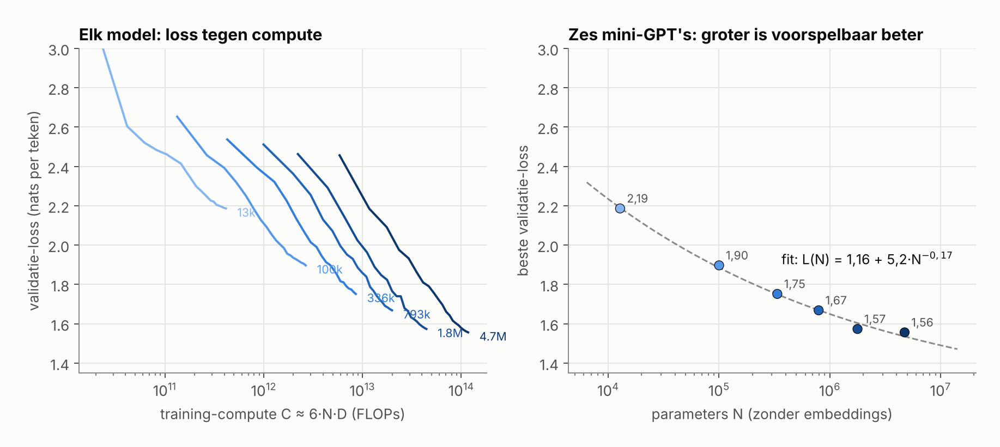
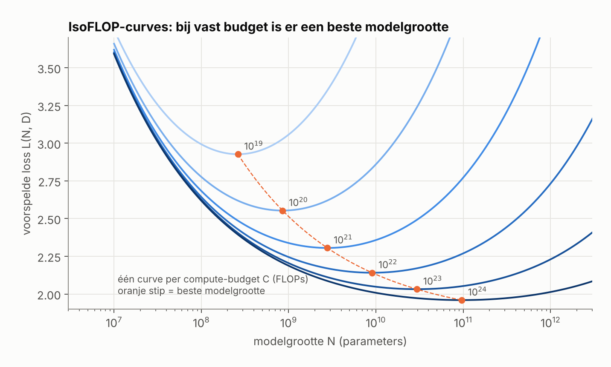
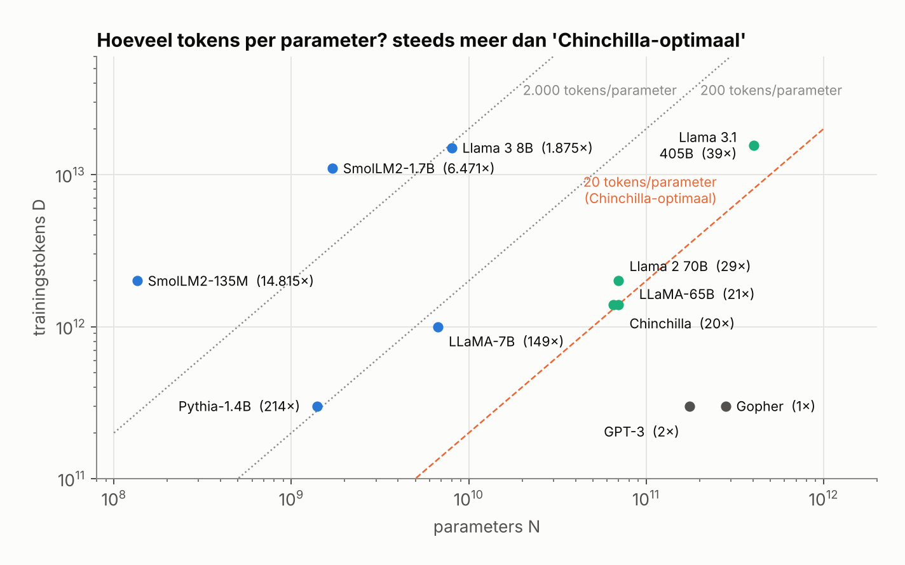
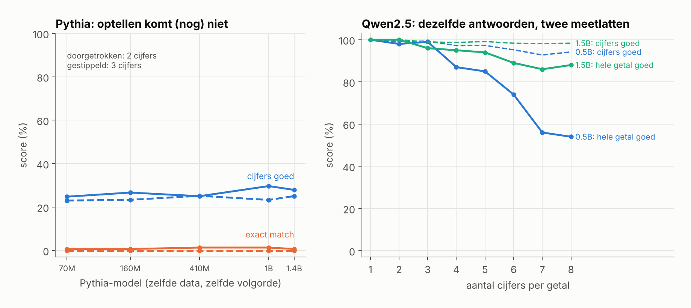

# 2.2 Scaling laws: hoe groot, hoe lang?

*Module 2: Van tekstvoorspeller naar assistent* · ⏱️ ~55 min · ▶ speeltuin: [Scaling-calculator](https://jeroenderuijter2002.github.io/Self-learning-AI/interactief/scaling.html)

> **Waar we naartoe werken.** Een trainingsrun van een frontier-model kost tientallen tot honderden miljoenen dollars aan rekenwerk, en je krijgt maar één kans. Hoe weet een lab vooraf hoe groot het model moet worden, en hoeveel data het nodig heeft? Het antwoord is een van de verrassendste ontdekkingen van de afgelopen jaren: **de loss van een taalmodel is voorspelbaar**, met een formule van één regel. In dit hoofdstuk meet je die wet zelf, leid je de optimale verdeling van een budget af, en zie je waarom labs die optimale verdeling tegenwoordig bewust negeren.

---

## Een puzzel om mee te beginnen

Je bent hoofd van een trainingsteam. Je krijgt een budget van $3 \cdot 10^{23}$ FLOPs (ongeveer het budget van GPT-3). Met de vuistregel uit 2.1, $C \approx 6ND$, zijn er oneindig veel manieren om dat uit te geven:

| Keuze | Parameters $N$ | Trainingstokens $D$ |
|---|---|---|
| groot model, weinig data | 500 miljard | 100 miljard |
| wat GPT-3 deed | 175 miljard | 300 miljard |
| klein model, veel data | 10 miljard | 5 biljoen |

Alle drie kosten evenveel. Welke geeft het beste model? Je kunt ze niet alle drie trainen; elk kost maanden. Je moet het **voorspellen**.

---

## Groter is voorspelbaar beter

In januari 2020 publiceerden Kaplan en collega's bij OpenAI [*Scaling Laws for Neural Language Models*](https://arxiv.org/abs/2001.08361). Ze trainden honderden transformers van verschillende grootte en vonden iets wat bijna te mooi klinkt: als je de test-loss uitzet tegen het aantal parameters, op **log-log-schaal**, krijg je een **rechte lijn**. Over zeven ordes van grootte. Hetzelfde geldt voor de hoeveelheid data en voor het rekenwerk.

Een rechte lijn op log-log-schaal is een **machtswet**:

$$L(N) \approx \left(\frac{N_c}{N}\right)^{\alpha_N}, \qquad \alpha_N \approx 0{,}076$$

Die exponent is klein. Tien keer zoveel parameters verlaagt de loss met een factor $10^{0{,}076} \approx 1{,}19$, dus ongeveer 16%. Dat lijkt weinig, maar het is **betrouwbaar**: je kunt een klein model trainen, de lijn doortrekken, en vooraf weten wat een honderd keer groter model gaat doen. Het [GPT-4-rapport](https://arxiv.org/abs/2303.08774) beschrijft precies dit: OpenAI voorspelde de uiteindelijke loss van GPT-4 met modellen die tot 10.000 keer minder rekenwerk kostten.

### Meet het zelf

Dat hoef je niet te geloven; je kunt het meten. Ik heb zes versies van de mini-GPT uit module 1 getraind, van 13 duizend tot 4,7 miljoen parameters, allemaal op dezelfde data (tiny Shakespeare), met hetzelfde schema en hetzelfde aantal tokens. Dit doe je zelf in [opdracht O1](../opdrachten/O1-scaling-experiment.md).

*Figuur 2.3. Zes mini-GPT's, gemeten met [`tools/m2_experiments.py`](../../../tools/m2_experiments.py) (`scaling`). **Links** de validatie-loss van elk model tegen het rekenwerk dat erin zit ($6 \cdot N \cdot$ tokens). **Rechts** de beste loss per model tegen het aantal parameters, met de fit $L(N) = E + A \cdot N^{-\alpha}$. Elk model zag 4,1 miljoen tekens: 2.000 stappen van 32 × 64, ongeveer vier keer de hele trainingsset. De fit: $L(N) \approx 1{,}16 + 5{,}2 \cdot N^{-0{,}17}$.*

Zes punten, verspreid over bijna drie ordes van grootte, en ze liggen netjes op één vloeiende curve. Elke keer dat het model ongeveer drie keer zo groot wordt, daalt de loss met een vergelijkbare stap: van 2,19 naar 1,90 naar 1,75 naar 1,67. Ter vergelijking: het bigram-model uit O3 van module 1 kwam rond de 2,5 uit.

Twee dingen zijn anders dan bij Kaplan. Mijn exponent is $\alpha \approx 0{,}17$, ruim twee keer zo groot als hun 0,076. Dat is geen tegenspraak: wij voorspellen losse tekens in plaats van tokens, op een minuscule dataset, met piepkleine modellen, en de exponent hangt van al die dingen af. En kijk naar de laatste twee punten. Van 1,8 naar 4,7 miljoen parameters levert maar 0,02 op, minder dan de lijn belooft. Het grootste model heeft 4,7 miljoen parameters en maar 1 miljoen tekens om van te leren; het loopt tegen de grens van zijn **data** aan, niet van zijn grootte. Dat is precies de term die in het volgende deel verschijnt.

Kijk ook naar het linkerpaneel, want daar zit een les die op het eerste gezicht vreemd is. Bij een **klein** budget (links in de figuur) wint het kleine model: het grote model heeft nog maar weinig stappen gezet en is nog nergens. Bij een **groot** budget wint het grote model: het kleine model zit tegen zijn plafond aan. De oranje stippellijn verbindt per budget het beste model. Er is dus bij elk budget een **beste modelgrootte**. Dat is het hele idee van dit hoofdstuk.

### Waarom een machtswet?

Niemand weet het zeker, maar er is een intuïtie die helpt. Taal zit vol patronen met een **lange staart**: een paar patronen komen heel vaak voor ("de", "het", zinsbouw), en een enorme hoeveelheid patronen is zeldzaam (een feit over een klein dorp, een zeldzame programmeertaal). Een klein model leert alleen de vaakste patronen. Elk groter model leert weer een stukje van de staart erbij. Als die staart zelf een machtswet volgt (en de frequentie van woorden in taal doet dat, de [wet van Zipf](https://nl.wikipedia.org/wiki/Wet_van_Zipf)), dan volgt de verbetering ook een machtswet. Dit is een intuïtie, geen bewijs; er zijn verschillende theoretische verklaringen in omloop.

---

## Chinchilla: de wet herschreven

Kaplan en collega's trokken ook een conclusie over de **verdeling** van een budget: maak vooral het model groter, en de data veel minder hard (in hun fit groeide de optimale $N$ ongeveer als $C^{0{,}73}$). Dat advies is precies wat de industrie deed. GPT-3 (175 miljard parameters), Gopher (280 miljard) en Megatron-Turing NLG (530 miljard) zagen allemaal maar 270 à 300 miljard tokens.

Twee jaar later keek DeepMind opnieuw, in [*Training Compute-Optimal Large Language Models*](https://arxiv.org/abs/2203.15556) (maart 2022). Ze trainden meer dan 400 modellen, van 70 miljoen tot 16 miljard parameters, op 5 tot 500 miljard tokens. Hun conclusie was anders: **model en data moeten even hard groeien**. Elke verdubbeling van het model vraagt een verdubbeling van de data.

Om het te bewijzen trainden ze **Chinchilla**: 70 miljard parameters op 1,4 biljoen tokens. Dat kostte evenveel rekenwerk als hun eigen Gopher (280 miljard parameters, 300 miljard tokens), maar met een vier keer kleiner model en vier keer zoveel data. Chinchilla versloeg Gopher, GPT-3 en Megatron-Turing NLG op een grote reeks taken. En omdat het model kleiner was, was het daarna ook nog eens goedkoper in gebruik.

De vuistregel die daaruit kwam: **ongeveer 20 tokens per parameter**.

### De formule, en de optimale verdeling afgeleid

De derde methode in het Chinchilla-paper fit een formule met drie termen die je elk een betekenis kunt geven:

$$L(N, D) = \underbrace{E}_{\text{ruis in taal}} + \underbrace{\frac{A}{N^{\alpha}}}_{\text{model te klein}} + \underbrace{\frac{B}{D^{\beta}}}_{\text{te weinig data}}$$

$E$ is de loss die zelfs een perfect model niet kan halen: tekst is nu eenmaal niet volledig voorspelbaar. De tweede term verdwijnt als het model oneindig groot wordt, de derde als je oneindig veel data hebt.

Nu wordt het een optimalisatieprobleem, en dat is jouw terrein.

> 🔁 **Weet je nog?** Minimaliseren onder een gelijkheidsrestrictie: substitueer de restrictie of gebruik een Lagrange-multiplicator. Hier is de restrictie het budget, $6ND = C$.

Substitueer $D = C / (6N)$:

$$L(N) = E + A N^{-\alpha} + B \left(\frac{6N}{C}\right)^{\beta}$$

Zet de afgeleide naar $N$ op nul: $-\alpha A N^{-\alpha-1} + \beta B (6/C)^{\beta} N^{\beta-1} = 0$. Herschrijven geeft

$$N_{\text{opt}} = G \cdot \left(\frac{C}{6}\right)^{\frac{\beta}{\alpha+\beta}}, \qquad G = \left(\frac{\alpha A}{\beta B}\right)^{\frac{1}{\alpha+\beta}}, \qquad D_{\text{opt}} = \frac{C}{6 N_{\text{opt}}}$$

De hele vraag "groot model of veel data?" hangt dus af van de verhouding tussen $\alpha$ en $\beta$. Zijn ze ongeveer gelijk, dan groeien $N$ en $D$ allebei ongeveer als $\sqrt{C}$. Dat is precies "even hard groeien".

Er is één kanttekening. Toen onderzoekers van Epoch AI de fit [opnieuw deden](https://arxiv.org/abs/2404.10102) (2024), met data die ze uit de figuren van het paper reconstrueerden, kwamen ze op andere constanten uit: $E = 1{,}82$, $A = 482$, $B = 2085$, $\alpha = 0{,}35$ en $\beta = 0{,}37$. De gepubliceerde constanten bleken niet te passen bij de andere twee methoden in hetzelfde paper; de nieuwe wel. Met de nieuwe fit is de optimale verhouding bij het Gopher-budget ongeveer 18 tokens per parameter, keurig in lijn met Chinchilla zelf. Ik gebruik daarom de Epoch-constanten in de figuren en de speeltuin. Een mooie les in wetenschap: ook een beroemde tabel kan een fout bevatten.

*Figuur 2.4. IsoFLOP-curves: elke lijn is één vast budget $C$, en laat de voorspelde loss zien voor elke manier om dat budget te verdelen. Links op een lijn is het model te klein (de $A/N^\alpha$-term domineert), rechts heeft het te weinig data (de $B/D^\beta$-term). De oranje stip is het optimum. Berekend met de fit van [Besiroglu et al. (2024)](https://arxiv.org/abs/2404.10102); de Chinchilla-auteurs maakten dezelfde soort figuur met echte trainingsruns.*

Terug naar de puzzel. Met het budget van GPT-3 voorspelt deze fit een optimum rond **50 miljard parameters op 1 biljoen tokens**. GPT-3 was dus volgens Chinchilla ruim drie keer te groot, en had drie keer te weinig data gezien.

> ▶ **Probeer het zelf:** in de **[Scaling-calculator](https://jeroenderuijter2002.github.io/Self-learning-AI/interactief/scaling.html)** kies je een budget en zie je de isoFLOP-curve, de optimale $N$ en $D$, en waar bekende modellen liggen. Schuif het budget naar dat van Llama 3.1 405B ($3{,}8 \cdot 10^{25}$ FLOPs, volgens het [paper](https://arxiv.org/abs/2407.21783)). Hoe ver ligt de echte keuze van Meta van het optimum?

---

## Waarom iedereen nu "overtraint"

Kijk naar wat er na Chinchilla gebeurde:

*Figuur 2.5. Parameters en trainingstokens van bekende modellen, uit hun papers en modelkaarten. Tussen haakjes het aantal tokens per parameter. De oranje lijn is de Chinchilla-vuistregel van 20. Modellen van vóór 2022 (grijs) zaten er ver onder; recente modellen (blauw) zitten er ver boven.*

GPT-3 en Gopher zaten met 1 à 2 tokens per parameter ver onder de lijn. Maar recente modellen schieten er ver overheen: Llama 3 8B zag 15 biljoen tokens, bijna **1.900 tokens per parameter**. Is Meta het Chinchilla-paper vergeten?

Nee. Chinchilla beantwoordt de vraag: *"wat is het beste model voor een vast **trainings**budget?"* Maar een model wordt niet één keer gebruikt. Het wordt miljoenen keren aangeroepen, en elke aanroep kost rekenwerk dat evenredig is met $N$ (weet je nog: ~$2N$ FLOPs per token in de forward pass). Het LLaMA-paper zei het al in 2023: een kleiner model dat langer is getraind, is uiteindelijk goedkoper in gebruik, en de prestaties van hun 7B-model bleven zelfs na 1 biljoen tokens nog verbeteren.

Reken het als consultant na. Een model van 70 miljard parameters dat een jaar lang elke dag een miljard tokens genereert, kost aan inference $2 \cdot 7 \cdot 10^{10} \cdot 10^9 \cdot 365 \approx 5 \cdot 10^{22}$ FLOPs. Een model van 8 miljard parameters doet hetzelfde voor een negende daarvan. Als het kleine model door extra training even goed wordt, betaal je die extra training één keer terug, en verdien je hem daarna elke dag.

Dit heet **inference-aware scaling**: train kleiner en langer dan "optimaal", omdat je de prijs per gebruik minimaliseert in plaats van de prijs per training. [Sardana et al. (2024)](https://arxiv.org/abs/2401.00448) werkten dat uit door de Chinchilla-formule uit te breiden met de inference-kosten, en vonden dat de modelkwaliteit bleef verbeteren tot extreme verhoudingen van wel 10.000 tokens per parameter. Het onderste paneel van de scaling-calculator rekent met dit idee. Het verklaart waarom de nieuwste kleine open modellen (SmolLM2-135M: 2 biljoen tokens, bijna 15.000 per parameter) zo absurd veel data zien.

> 💡 **Voor de consultant.** "Groter model = beter" is geen bruikbaar advies. De vraag is: *beter voor welk budget?* Voor een klant die miljoenen aanroepen per dag doet, is een kleiner model dat langer is getraind (of gedistilleerd, module 4) bijna altijd de betere keuze.

---

## Emergentie: plotselinge sprongen, of een meetfout?

Er is één fenomeen dat niet in een rechte lijn lijkt te passen. Het paper [*Emergent Abilities of Large Language Models*](https://arxiv.org/abs/2206.07682) (Wei et al., 2022) liet taken zien waarop kleine modellen op gokniveau scoren, en waarboven een bepaalde grootte de score ineens omhoog schiet. Rekenen met meerdere cijfers was een bekend voorbeeld. Als vaardigheden zo plotseling verschijnen, kun je ze niet voorspellen. Dat zou een probleem zijn, zeker voor veiligheid.

Een jaar later kwamen Schaeffer, Miranda en Koyejo met een andere verklaring: [*Are Emergent Abilities of Large Language Models a Mirage?*](https://arxiv.org/abs/2304.15004). Hun punt: veel van die sprongen komen door de **meetlat**. Neem optellen met vijf cijfers, gemeten met **exact match**: het antwoord telt alleen als alle cijfers goed zijn. Stel dat een model elk cijfer met kans $p$ goed heeft. Dan is de kans dat het hele antwoord goed is $p^5$. Groeit $p$ rustig van 0,5 naar 0,9, dan groeit $p^5$ van 0,03 naar 0,59: eerst bijna niets, dan ineens veel. Het model wordt geleidelijk beter, maar de meetlat maakt er een sprong van. Het paper kreeg een Outstanding Paper Award op NeurIPS 2023.

Ik heb geprobeerd dit na te meten, en dat liep anders dan gepland: een mooie les op zich.

Eerst met de [Pythia-modellen](https://arxiv.org/abs/2304.01373) van EleutherAI: een reeks van 70 miljoen tot 12 miljard parameters, allemaal getraind op precies dezelfde data in dezelfde volgorde. Perfect voor een eerlijke vergelijking. Ik nam de vijf kleinste, tot 1,4 miljard (groter past niet in het geheugen van een laptop). Elk model kreeg 150 optelsommen met acht voorbeelden in de prompt, met spaties tussen de cijfers (*4 7 + 3 8 = 8 5*) zodat elk cijfer precies één token is. Daarna met twee moderne modellen, Qwen2.5-0.5B en -1.5B, op sommen van 1 tot 8 cijfers per getal (Qwen knipt getallen zelf al in losse cijfers).

*Figuur 2.6. **Links:** Pythia 70M tot 1,4B op optelsommen van 2 en 3 cijfers. Oranje: exact match (greedy, het hele antwoord goed). Blauw: het percentage antwoordcijfers dat het model als meest waarschijnlijke token voorspelt, als je het de eerdere cijfers van het juiste antwoord geeft. **Rechts:** Qwen2.5-0.5B en -1.5B (basismodellen) op 100 sommen per lengte, met dezelfde twee meetlatten. Gemeten met [`tools/m2_experiments.py`](../../../tools/m2_experiments.py) (`pythia` en `digits`).*

Links gebeurt er niets. Tot 1,4 miljard parameters kan Pythia gewoon niet optellen: exact match blijft rond de 0%, en per cijfer zit het rond de 25%, nauwelijks beter dan gokken tussen een paar waarschijnlijke cijfers. Geen sprong, maar ook geen geleidelijke groei. Wie emergentie wil zien, heeft grotere modellen nodig dan op een laptop passen. Pythia is getraind op 300 miljard tokens van [The Pile](https://arxiv.org/abs/2101.00027), uit 2020; de modellen rechts zagen biljoenen tokens van recentere data, met veel meer rekenwerk erin.

Rechts zie je het mechanisme van Schaeffer et al. wel heel scherp. Per cijfer zijn de twee Qwen-modellen bijna even goed: bij getallen van 8 cijfers voorspelt het kleine model 94% van de cijfers goed, het grote 98%. Een verschil van vier procentpunt. Maar exact match zegt iets heel anders: 54% tegen 88%. Dat is precies de $p^k$ van hierboven: een antwoord van 9 cijfers is alleen goed als álle cijfers goed zijn, en $0{,}94^9 \approx 0{,}57$ terwijl $0{,}98^9 \approx 0{,}84$. Wie alleen naar exact match kijkt, ziet een groot kwaliteitsverschil tussen de twee modellen, of bij een reeks modellen een "plotselinge" sprong; wie naar de cijfers kijkt, ziet een kleine, geleidelijke verbetering.

Is emergentie daarmee helemaal van tafel? Niet helemaal. Sommige onderzoekers wijzen erop dat ook met gladde meetlatten niet elke vaardigheid netjes voorspelbaar is, en dat het uiteindelijk gaat om wat een model in de praktijk *kan*, en dat is vaak een exact-match-vraag (de code werkt of werkt niet). Een redelijke samenvatting: **de onderliggende kansen verbeteren meestal geleidelijk, maar wat wij als vaardigheid ervaren kan alsnog vrij plotseling over een drempel gaan.**

---

## Samenvatting: wat je nu weet

1. De loss van een taalmodel volgt een **machtswet** in parameters, data en rekenwerk: een rechte lijn op log-log-schaal. Daardoor kun je met kleine modellen de prestaties van grote voorspellen.
2. Bij een vast budget $C \approx 6ND$ is er een **optimale modelgrootte**. Chinchilla (2022): model en data even hard laten groeien, ongeveer **20 tokens per parameter**. Dat volgt uit het minimaliseren van $E + A/N^\alpha + B/D^\beta$.
3. Moderne modellen **overtrainen** bewust ver voorbij die 20, omdat een kleiner model goedkoper is in gebruik. De echte optimalisatie gaat over training én inference.
4. Plotselinge **emergentie** blijkt vaak een gevolg van de meetlat (exact match). Gladde metingen laten meestal geleidelijke verbetering zien.

---

### ✏️ Denkvragen
1. Leid uit $N_{\text{opt}} \propto C^{\beta/(\alpha+\beta)}$ af hoe $D_{\text{opt}}$ met $C$ groeit. Wat gebeurt er met de optimale verhouding $D/N$ als $\beta < \alpha$?
2. Je hebt een budget dat 100 keer groter is dan dat van een bestaand compute-optimaal model. Met welke factor groeien $N$ en $D$ ongeveer? (Neem $\alpha \approx \beta$.)
3. Een startup wil een eigen model trainen voor één klant die er 1.000 vragen per dag aan stelt. Zou je Chinchilla-optimaal trainen of overtrainen? En voor een chatbot met tien miljoen gebruikers?
4. In figuur 2.3 lijkt de grootste mini-GPT minder winst te halen dan de lijn voorspelt. Bedenk twee redenen (hint: kijk naar de hoeveelheid data en naar het aantal epochs).

**Volgende:** [2.3 Supervised fine-tuning](2.3-supervised-fine-tuning.md)
