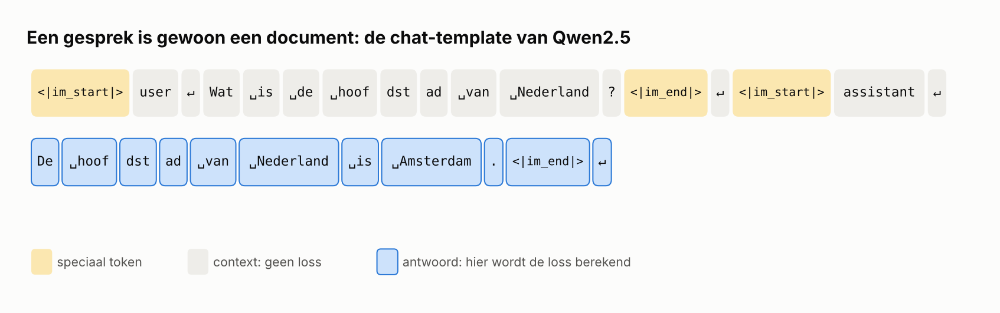
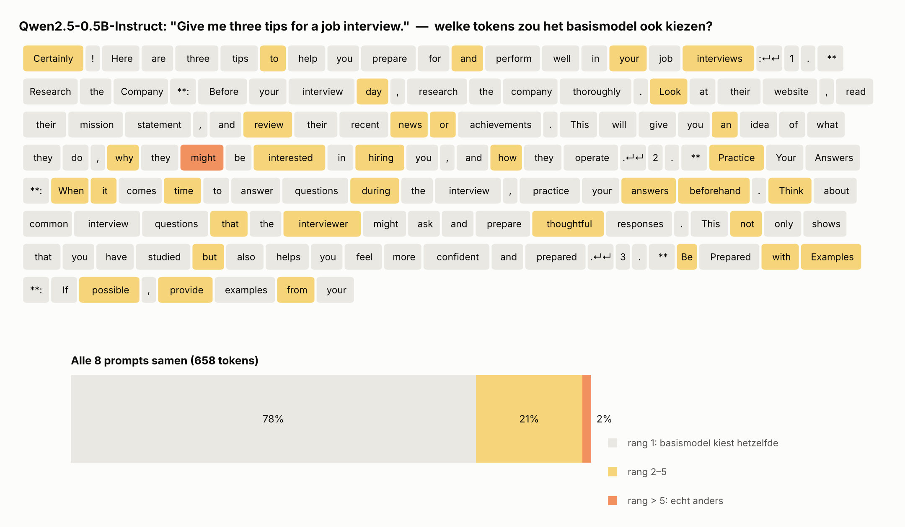

# 2.3 Supervised fine-tuning: een gesprek is ook een document

*Module 2: Van tekstvoorspeller naar assistent* · ⏱️ ~50 min · ▶ speeltuin: [Basismodel vs assistent](https://jeroenderuijter2002.github.io/Self-learning-AI/interactief/basis-vs-assistent.html)

> **Waar we naartoe werken.** Na pretraining heb je een model dat veel weet, maar alleen documenten afmaakt. Hoe maak je daar iets van dat vragen beantwoordt? Het verrassende antwoord: je verandert het model nauwelijks. Je leert het één nieuw *soort* document, namelijk een gesprek tussen een gebruiker en een behulpzame assistent. In dit hoofdstuk zie je hoe dat document eruitziet, waarom een paar duizend goede voorbeelden al genoeg zijn, en meet je hoe weinig er in het model echt verandert. Aan het eind snap je ook waar deze aanpak ophoudt, en waarom er een 2.4 nodig is.

---

## De truc: verpak de vraag als een document

Uit 2.1 weet je: een basismodel beantwoordt alleen de vraag *"hoe gaat dit document verder?"* Dan ligt een slim idee voor de hand. Als je een antwoord wilt, maak dan een document waarin het antwoord **het meest waarschijnlijke vervolg** is.

Dat kan zonder enige training, met een prompt. Zet bovenaan een korte uitleg ("Hieronder volgen gesprekken tussen een mens en een behulpzame, eerlijke AI-assistent") en een paar voorbeeldgesprekken in een vast format. Zet daaronder jouw vraag in hetzelfde format, en laat het model verder schrijven. Het model herkent het patroon en schrijft een antwoord in de stijl van de voorbeelden.

Deze truc heeft een naam gekregen: **URIAL**, uit het paper [*The Unlocking Spell on Base LLMs*](https://arxiv.org/abs/2312.01552) (Lin et al., 2023). Met drie vaste voorbeelden en een systeemprompt haalden ze uit een basismodel antwoorden die in hun evaluatie in de buurt kwamen van, en soms beter waren dan, de officieel getrainde chatversie van hetzelfde model.

> ▶ **Probeer het zelf:** in de **[speeltuin](https://jeroenderuijter2002.github.io/Self-learning-AI/interactief/basis-vs-assistent.html)** heeft elke prompt een kolom "basis + URIAL-prompt". Dat is het basismodel Qwen2.5-0.5B, zonder enige extra training, met twee voorbeeldgesprekken in de prompt. Vergelijk die kolom met de Instruct-kolom. Bij *"Write a Python function that checks whether a number is prime"* geeft het basismodel met URIAL-prompt keurige, kale code, en het Instruct-model hetzelfde met een vriendelijke inleiding ("Certainly! …"). Het verschil zit vooral in de verpakking.

Maar een prompt heeft nadelen. Hij kost bij elke aanroep tokens, het model valt bij lange gesprekken terug in zijn oude gedrag, en je kunt er geen gedrag mee aanleren dat niet al in de voorbeelden staat. Daarom bakken we het gesprek-format in het model zelf.

---

## Supervised fine-tuning: hetzelfde trainen, ander document

**Supervised fine-tuning** (SFT, ook *instruction tuning*) is verrassend weinig nieuws. Je neemt het basismodel en traint het verder met precies dezelfde loss als in pretraining: volgende-token-voorspelling met cross-entropy. Het enige verschil is de data. In plaats van webpagina's krijgt het model **gesprekken**: een vraag van een gebruiker en een voorbeeldantwoord van een goede assistent.

### Een gesprek als document: de chat-template

Een gesprek moet wel tekst worden, want het model kent alleen tokens. Daarvoor heeft elk model een **chat-template**: een vast format met speciale tokens die aangeven wie er praat.

*Figuur 2.7. Een kort gesprek in de chat-template van Qwen2.5, getokeniseerd met de echte tokenizer. Geel zijn speciale tokens die in pretraining nooit (of zelden) voorkwamen. Grijs is context: de vraag en de rolaanduidingen. Blauw is het antwoord van de assistent. Alleen op de blauwe tokens wordt de loss berekend. (De standaard-systeemprompt van Qwen is weggelaten om de figuur leesbaar te houden.)*

Kijk naar drie details in deze figuur.

**De rollen zijn gewoon tokens.** `<|im_start|>user` en `<|im_start|>assistant` zijn voor het model niets meer dan een herkenbaar patroon in een document. Na `<|im_start|>assistant` + een nieuwe regel komt het antwoord. Wat het model leert is dus: *"in dit soort documenten volgt na deze tokens een behulpzaam antwoord"*.

**Er is een stop-token.** Het antwoord eindigt met `<|im_end|>`. Weet je nog dat een basismodel niet weet wanneer het moet stoppen? Hier leert het dat wel. Zodra het model `<|im_end|>` voorspelt, stopt de generatie-lus uit [1.4](../../01-transformers/notes/1.4-van-model-naar-tekst.md) (het is het `EOS`-token uit de code daar). Het lijkt een detail, maar zonder dit token zou elk antwoord doorlopen in een verzonnen vervolgvraag van de "gebruiker".

**De loss telt alleen op het antwoord.** De tokens van de vraag krijgen een **loss-masker**: ze gaan wel door het model als context, maar fouten op die posities worden niet bestraft. Je wilt het model leren *antwoorden*, niet leren hoe gebruikers vragen stellen.

$$\mathcal{L}_{\text{SFT}} = -\frac{1}{|\mathcal{A}|}\sum_{t \in \mathcal{A}} \log p_\theta(x_t \mid x_{<t})$$

met $\mathcal{A}$ de posities van de assistent-tokens. Dat is letterlijk de pretraining-loss met een masker. In [opdracht O3](../opdrachten/O3-sft-met-lora.md) bouw je dit masker zelf.

> 💡 **Een praktische valkuil.** Elke modelfamilie heeft zijn eigen template (Llama, Qwen, Mistral en Gemma verschillen allemaal). Gebruik je de verkeerde, dan ziet het model een documentsoort die het nooit heeft gezien, en wordt het merkbaar slechter. Gebruik daarom altijd `tokenizer.apply_chat_template(...)` in plaats van zelf strings te plakken. En als je een **basismodel** finetunet: de speciale tokens van de template heeft het in pretraining (bijna) nooit gezien, dus hun embeddings zijn ongetraind. In [O3](../opdrachten/O3-sft-met-lora.md) zie je wat er dan misgaat: het model leert het format, maar stopt nooit.

---

## Hoeveel data heb je nodig?

### De oorspronkelijke aanpak: mensen schrijven voorbeelden

Voor InstructGPT ([Ouyang et al., 2022](https://arxiv.org/abs/2203.02155)) huurde OpenAI een team van ongeveer 40 labelaars in. Ze schreven ideale antwoorden op ongeveer 13.000 prompts, deels zelf bedacht, deels uit echte API-verzoeken. Dat is duur en traag werk: een goed antwoord op een moeilijke vraag schrijven kost een expert gemakkelijk een half uur.

### Minder is meer

In 2023 kwamen twee resultaten die lieten zien dat het veel goedkoper kon.

**LIMA** ([Zhou et al., 2023](https://arxiv.org/abs/2305.11206)) trainde een basismodel van 65 miljard parameters op slechts **1.000** zorgvuldig gekozen voorbeelden: goede vragen en antwoorden van StackExchange en wikiHow, aangevuld met zelfgeschreven voorbeelden. Geen RLHF, geen voorkeursdata. In een vergelijking door mensen kon het model zich verrassend goed meten met de commerciële modellen van dat moment. De auteurs formuleerden daarop de **Superficial Alignment Hypothesis**: bijna alle kennis en vaardigheden komen uit pretraining, en alignment leert het model vooral *welk format en welke stijl* het moet gebruiken.

**Alpaca** ([Stanford, maart 2023](https://crfm.stanford.edu/2023/03/13/alpaca.html)) liet zien dat je de voorbeelden niet eens zelf hoeft te schrijven. Ze begonnen met 175 voorbeelden van mensen, en lieten een bestaand model van OpenAI daar 52.000 nieuwe instructies plus antwoorden bij verzinnen. Daarmee finetunden ze LLaMA-7B. De data kostte minder dan 500 dollar, de training minder dan 100 dollar.

Dat is nu de standaard: SFT-data is grotendeels **synthetisch**, gemaakt door sterkere modellen en daarna gefilterd. De instructversie van SmolLM2, het kleine model dat je in de opdrachten gebruikt, is bijvoorbeeld getraind op [smol-smoltalk](https://huggingface.co/datasets/HuggingFaceTB/smol-smoltalk), een grotendeels door modellen gegenereerde dataset. (Let wel: de voorwaarden van sommige API's verbieden het trainen van concurrerende modellen op hun uitvoer. Voor een klant is dat een juridische vraag, geen technische.)

---

## Wat verandert er eigenlijk in het model?

Als SFT vooral stijl aanleert, zou je dat moeten kunnen zien in de voorspellingen. Lin et al. bedachten daarvoor een mooie meting, en die kun je met een laptop nadoen:

1. Laat het **instructmodel** een antwoord genereren.
2. Geef precies dezelfde tekst aan het **basismodel**, en kijk bij elk token van het antwoord: op welke **plek** (rang) staat dit token in de voorspelling van het basismodel?

Rang 1 betekent: het basismodel had op die plek precies hetzelfde gekozen. Een hoge rang betekent: hier heeft de fine-tuning echt iets veranderd.

*Figuur 2.8. Boven: een antwoord van Qwen2.5-0.5B-Instruct, waarbij elk token is gekleurd naar zijn rang onder het basismodel Qwen2.5-0.5B. Grijs: rang 1 (het basismodel kiest hetzelfde). Geel: rang 2–5. Oranje: hoger. Onder: hetzelfde over alle acht prompts uit de speeltuin samen. Gemeten met [`tools/m2_experiments.py`](../../../tools/m2_experiments.py) (`sftdiff`). Het antwoord is greedy gegenereerd en afgekapt op 150 tokens.*

Over alle acht prompts samen kiest het basismodel op **78%** van de posities precies hetzelfde token als het Instruct-model. Op nog eens 21% staat het token van het Instruct-model in de top-5 van het basismodel. Maar **2%** van de tokens is echt anders. Lin et al. vonden met Llama-2 en andere modellen hetzelfde beeld.

Kijk ook *waar* de gele en oranje tokens zitten. Het allereerste token, "Certainly", is geel: het basismodel had iets anders gekozen. Dat past bij een tweede bevinding van Lin et al.: de verschillen zitten vooral **vroeg** in het antwoord, in de toon en de opbouw. Is het antwoord eenmaal op gang, dan schrijft het basismodel grotendeels hetzelfde.

Een eerlijke kanttekening: het Qwen-basismodel is een moeilijk geval om dit mee te meten, omdat het al opvallend veel op een assistent lijkt. In de speeltuin zie je het basismodel zelfs zinnen schrijven als *"You are a helpful assistant"*. Moderne pretraining-data bevat kennelijk veel vraag-en-antwoordtekst, en mogelijk ook door andere chatbots gegenereerde tekst. De grens tussen "basismodel" en "assistent" is bij recente modellen dus minder scherp dan bij GPT-2.

> 🔁 **Weet je nog?** De logit lens uit [1.3](../../01-transformers/notes/1.3-transformer-block.md) liet zien dat een voorspelling laag voor laag ontstaat in de residual stream. Je zou SFT kunnen zien als een kleine bijsturing die op een paar plekken de laatste lagen een andere kant op duwt, terwijl de kennis in de MLP's daaronder blijft staan. Of dat letterlijk zo werkt, is een vraag voor module 7.

---

## Goedkoop finetunen: LoRA

Volledige fine-tuning past alle gewichten aan. Voor een model van 7 miljard parameters betekent dat: de gewichten, de gradiënten en de twee AdamW-momenten in het geheugen, al snel meer dan 100 GB. En je eindigt met een complete kopie van het model per klant.

Er is een slimmer idee, gebaseerd op een observatie die past bij de Superficial Alignment Hypothesis: als fine-tuning maar weinig verandert, is de **verandering** van de gewichten misschien ook "klein", in de zin van **lage rang**.

> 🔁 **Weet je nog?** Een $d \times d$-matrix met rang $r$ kun je schrijven als het product van een $d \times r$- en een $r \times d$-matrix. Dat is het idee achter PCA en de SVD: als de echte informatie in een paar richtingen zit, heb je maar een paar richtingen nodig.

**LoRA** ([Hu et al., 2021](https://arxiv.org/abs/2106.09685)) bevriest de originele gewichten $W$ en leert alleen een correctie van lage rang:

$$W' = W + \frac{\alpha}{r} \cdot B A, \qquad A \in \mathbb{R}^{r \times d_{\text{in}}}, \quad B \in \mathbb{R}^{d_{\text{out}} \times r}$$

Met $d = 4096$ en $r = 16$ train je per matrix $2 \cdot 4096 \cdot 16 \approx 131$ duizend getallen in plaats van $4096^2 \approx 16{,}8$ miljoen, een factor 128 minder. $B$ begint op nul, zodat het model bij de start precies het basismodel is. Op GPT-3 175B haalde LoRA volgens het paper een vergelijkbare kwaliteit als volledige fine-tuning, met 10.000 keer minder trainbare parameters en een drie keer kleiner geheugengebruik. En de correctie $BA$ is een bestandje van een paar megabyte, dat je per klant kunt wisselen terwijl het grote model hetzelfde blijft.

In [opdracht O3](../opdrachten/O3-sft-met-lora.md) schrijf je zelf een `LoRALinear`-laag en finetune je SmolLM2-135M. In module 4 komt LoRA terug, samen met quantization (QLoRA).

---

## Waar SFT ophoudt

SFT is krachtig, maar het heeft drie grenzen die de rest van deze module motiveren.

**1. Het plafond is de leraar.** SFT is imitatie: het model leert de voorbeeldantwoorden na te doen. Het wordt dus hooguit zo goed als die voorbeelden. Voor veel taken is het makkelijker om te zeggen *welk* van twee antwoorden beter is, dan om zelf het perfecte antwoord te schrijven. Denk aan een gedicht, een samenvatting, of een moeilijke afweging. Die ongelijkheid is precies wat RLHF (2.4) uitbuit.

**2. Het model leert niet wat het niet moet doen.** SFT laat alleen goede voorbeelden zien. Het model ziet nooit een slecht antwoord met de boodschap "zo niet". Het leert dus ook niet waaróm een antwoord goed is, alleen hoe goede antwoorden eruitzien.

**3. Je kunt het model leren verzinnen.** Stel dat een voorbeeldantwoord een feit bevat dat het basismodel niet kent. Dan leert het model daar iets wat je niet wilt: *"op dit soort vragen geef je zelfverzekerd een antwoord, ook als je het niet weet"*. [Gekhman et al. (2024)](https://arxiv.org/abs/2405.05904) maten dit: modellen leren nieuwe feiten via fine-tuning maar langzaam, en naarmate ze die voorbeelden toch gaan onthouden, neemt de neiging tot hallucineren over hun bestaande kennis toe. Hun conclusie: fine-tuning is vooral geschikt om bestaande kennis beter te laten gebruiken, niet om nieuwe kennis toe te voegen.

> 💡 **Voor de consultant.** Dit laatste punt is goud waard in een klantgesprek. "Kunnen we ons model finetunen op onze productcatalogus, zodat het die kent?" Meestal is het antwoord: gebruik daarvoor RAG (module 3) en gebruik fine-tuning voor de **toon en het format**. Dat is ook precies de vraag in de praktijkopdracht van deze module.

---

## Samenvatting: wat je nu weet

1. Een basismodel kun je al een assistent laten spelen door de vraag in een **gesprek-document** te verpakken (URIAL). SFT bakt dat gedrag in het model.
2. **SFT** is gewone volgende-token-training op gesprekken in een **chat-template**, met een **loss-masker** zodat alleen de antwoorden tellen. Het stop-token leert het model wanneer het klaar is.
3. Weinig data volstaat (LIMA: 1.000 voorbeelden). Moderne SFT-data is grotendeels **synthetisch**.
4. SFT verandert vooral **stijltokens**; op de meeste posities kiest het basismodel hetzelfde. Dat ondersteunt de **Superficial Alignment Hypothesis**.
5. **LoRA** traint alleen een correctie van lage rang, wat fine-tuning goedkoop en wisselbaar maakt.
6. SFT heeft een **plafond** (imitatie), leert geen "zo niet", en kan **hallucinatie** aanleren als je nieuwe feiten traint.

---

### ✏️ Denkvragen
1. Waarom zou je de loss op de gebruikersvraag níet willen meetellen? Bedenk een concreet ongewenst gedrag dat het model anders zou leren.
2. Je traint per ongeluk zonder het `<|im_end|>`-token aan het eind van de antwoorden. Wat gebeurt er als je het model daarna gebruikt?
3. LoRA met rang $r$ op een $d \times d$-matrix: hoeveel parameters? Voor welke $r$ is LoRA niet meer goedkoper dan de hele matrix trainen?
4. Een klant wil een model dat juridische vragen beantwoordt "in onze huisstijl, en met kennis van onze 3.000 interne adviezen". Welk deel los je op met SFT, en welk deel niet? Waarom?

**Volgende:** [2.4 RLHF](2.4-rlhf.md)
