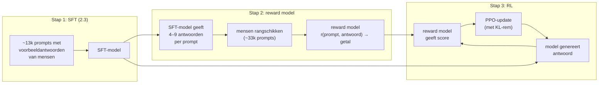
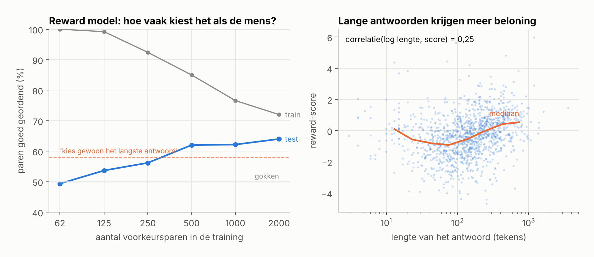

# 2.4 RLHF: leren van "dit antwoord is beter"

*Module 2: Van tekstvoorspeller naar assistent* · ⏱️ ~60 min · 🎬 aanrader: Karpathy, [*Deep Dive into LLMs*](https://www.youtube.com/watch?v=7xTGNNLPyMI), het deel over RLHF

> **Waar we naartoe werken.** SFT leert een model goede antwoorden na te doen. Maar voor veel taken is het veel makkelijker om te *beoordelen* welk antwoord beter is, dan om zelf het beste antwoord te schrijven. **RLHF** (*Reinforcement Learning from Human Feedback*) buit precies dat uit. Het was het ingrediënt waardoor InstructGPT van 1,3 miljard parameters het honderd keer grotere GPT-3 versloeg, en ChatGPT mogelijk werd. In dit hoofdstuk bouw je de drie stappen op, train je (in O2) zelf een reward model, en zie je hoe het fout kan gaan als een model te goed wordt in het behagen van zijn beoordelaar.

---

## Een eenvoudig experiment

Lees deze twee antwoorden op de vraag *"Hoe krijg ik een rode wijnvlek uit mijn witte overhemd?"*:

> **A:** Dep de vlek direct met keukenpapier, niet wrijven. Strooi er zout op of spoel met koud water vanaf de achterkant. Behandel daarna met een vlekkenmiddel of afwasmiddel en was het overhemd op de warmste temperatuur die het label toestaat.
>
> **B:** Wijnvlekken zijn lastig. Er zijn veel methoden. Je kunt het beste een professional raadplegen.

Je wist in twee seconden dat A beter is. Maar had jij A zelf zo kunnen schrijven, in twee seconden? Waarschijnlijk niet. En voor een gedicht, een samenvatting van een rapport of een subtiel advies wordt het verschil nog groter.

Dat is het hele idee achter RLHF: **beoordelen is goedkoper dan maken**. Als we het model kunnen trainen op oordelen in plaats van op voorbeelden, kan het beter worden dan de voorbeelden die we het kunnen geven.

---

## Waarom niet gewoon méér SFT?

Een eerlijke vraag. Waarom die hele omweg via reinforcement learning? Er zijn drie redenen.

**1. Oordelen zijn geen voorbeelden.** "A is beter dan B" zegt niet welke tokens het model moet produceren. Je kunt het niet als doel gebruiken in een cross-entropy-loss.

**2. Het model moet van zijn eigen fouten leren.** Bij SFT ziet het model alleen perfecte tekst van anderen. Maar tijdens gebruik genereert het zelf, en komt het in situaties die het nooit heeft gezien: halverwege een antwoord dat een beetje de verkeerde kant op gaat. Met RL **genereert het model zelf** antwoorden, en krijgt het feedback op precies die antwoorden. Dat heet *on-policy* leren.

**3. Je kunt het model ook leren wat níet moet.** Een slecht antwoord krijgt een lage beloning, en het model leert de kans erop te verlagen. SFT kan dat niet.

> 🔁 **Weet je nog?** Dit is het verschil tussen *imitation learning* (behavior cloning) en *reinforcement learning* uit je MDP- en RL-vakken. Behavior cloning werkt prima zolang je in de buurt van de voorbeelden blijft, maar kleine fouten stapelen zich op als het systeem in onbekende toestanden terechtkomt. Een regeltechnicus zou zeggen: het is een open-lus-regeling. RL sluit de lus.

---

## Het recept in drie stappen

Het InstructGPT-paper ([Ouyang et al., 2022](https://arxiv.org/abs/2203.02155)) legde het recept vast dat jarenlang de standaard was:

Stap 1 ken je al. We nemen stap 2 en 3 door.

---

## Stap 2: een reward model, of "een mens in een doosje"

Mensen kunnen niet miljoenen antwoorden beoordelen, en zeker niet live tijdens een RL-training. Dus trainen we eerst een model dat het oordeel van mensen **voorspelt**: het **reward model** (RM). Het krijgt een prompt plus antwoord, en geeft één getal: hoe goed vindt een mens dit?

### De data

De data zijn **voorkeursparen**: een prompt, een gekozen antwoord $y_w$ (*winner*) en een afgewezen antwoord $y_l$ (*loser*). Anthropic publiceerde zo'n dataset uit hun eigen RLHF-werk ([Bai et al., 2022](https://arxiv.org/abs/2204.05862)): [HH-RLHF](https://huggingface.co/datasets/Anthropic/hh-rlhf), tienduizenden gesprekken waarin crowdworkers steeds kozen welke van twee antwoorden behulpzamer was. Die dataset gebruik je in O2.

Een belangrijke kanttekening: mensen zijn het vaak oneens. Bij InstructGPT waren de labelaars het in ongeveer **73%** van de vergelijkingen met elkaar eens. Een reward model dat 73% van de oordelen van een willekeurige labelaar goed voorspelt, doet het dus ongeveer zo goed als een andere mens.

### Van oordelen naar getallen: Bradley-Terry

Hoe leer je een getal uit vergelijkingen? Hier komt een idee uit 1952 van pas, het **Bradley-Terry-model**, dat je misschien kent van schaakratings. Elke speler heeft een sterkte $r$, en de kans dat A van B wint hangt alleen af van het **verschil**:

$$P(A \text{ wint van } B) = \sigma\big(r_A - r_B\big) = \frac{1}{1 + e^{-(r_A - r_B)}}$$

Voor ons zijn de "spelers" antwoorden en is $r_\phi(x, y)$ de uitvoer van het reward model. De loss is dan de negatieve log-likelihood van de echte voorkeuren:

$$\mathcal{L}_{\text{RM}} = -\log \sigma\big(r_\phi(x, y_w) - r_\phi(x, y_l)\big)$$

> 🔁 **Weet je nog?** Dit is **logistische regressie** uit je ML-basis, met als "feature" het verschil tussen twee scores. De Elo-rating in schaken werkt volgens hetzelfde principe. Merk op dat alleen verschillen tellen: je kunt bij alle scores 10 optellen zonder dat er iets verandert. Een reward van 3,7 betekent dus op zichzelf niets.

Het reward model is meestal zelf een taalmodel (vaak het SFT-model), waarvan je de laatste laag vervangt door een kop die één getal uitgeeft. In O2 doe je een goedkope versie: je neemt de verborgen toestand van het laatste token van een bevroren SmolLM2-135M, en traint alleen een lineaire kop daarbovenop.

*Figuur 2.9. Links: hoe vaak een reward model op HH-RLHF-testparen het antwoord kiest dat de mens koos, tegen het aantal trainingsparen. Het model is een lineaire kop op bevroren features van SmolLM2-135M; dit is dus een zwakke versie van een echt reward model. De oranje lijn is een flauwe baseline: kies steeds het langste antwoord. Rechts: de score van het reward model tegen de lengte van het antwoord, voor alle 1.200 testantwoorden (600 paren). Gemeten met [`tools/m2_experiments.py`](../../../tools/m2_experiments.py) (`rm`). Elk model is getraind op features van gesprekken die links zijn afgekapt tot 256 tokens.*

Drie dingen om te zien. Ten eerste: met 2.000 paren ordent dit kleine reward model **64%** van de testparen zoals de mens deed. Dat klinkt mager, maar onthoud de 73% waarop mensen het onderling eens zijn; veel paren in HH-RLHF zijn gewoon twijfelgevallen. Ten tweede: de afstand tussen train (72%) en test (64%) wordt kleiner naarmate er meer data is, maar is er nog steeds. Meer voorkeursdata helpt hier duidelijk; dat is waarom labs er zoveel in investeren.

Ten derde, en dat is de les van dit hoofdstuk: de flauwe regel *"kies het langste antwoord"* scoort al **58%**. Mensen geven in deze data dus vaak de voorkeur aan langere antwoorden, en het reward model neemt dat over: rechts zie je dat de score stijgt met de lengte van het antwoord (correlatie 0,25 met de logaritme van de lengte). Niemand heeft het model verteld dat lengte goed is. Het heeft het gevonden, omdat het in de data zat. Onthoud dit voor het einde van dit hoofdstuk.

---

## Stap 3: optimaliseren tegen het reward model

Nu hebben we een functie die elk antwoord een cijfer geeft. Stap 3: pas het taalmodel aan zodat het antwoorden geeft met een hoog cijfer.

### Een taalmodel als agent

> 🔁 **Weet je nog?** Een MDP heeft toestanden, acties, overgangen en beloningen. Uit Stochastic Decision Theory ken je de waardefunctie en de Bellman-vergelijking.

Zet het taalmodel in die taal:

| MDP | Taalmodel |
|---|---|
| toestand $s_t$ | de prompt plus alle tokens die tot nu toe gegenereerd zijn |
| actie $a_t$ | het volgende token (een keuze uit ~150.000) |
| policy $\pi_\theta(a \mid s)$ | het taalmodel zelf: de softmax over het vocabulaire |
| overgang | deterministisch: plak het token erachter |
| beloning | 0 bij elk token, en aan het eind de score van het reward model |

Een gek soort MDP: een gigantische actieruimte, maar een triviale overgangsfunctie, en één beloning helemaal aan het eind.

### De kern: policy gradient

Het idee van een policy-gradient-methode is simpel. Genereer een antwoord. Was de beloning hoog, verhoog dan de kans op **alle tokens** van dat antwoord een beetje. Was hij laag, verlaag ze dan. Formeel (het REINFORCE-idee):

$$\nabla_\theta J = \mathbb{E}\Big[\big(R(x,y) - b\big) \cdot \nabla_\theta \log \pi_\theta(y \mid x)\Big]$$

met $\log \pi_\theta(y \mid x) = \sum_t \log \pi_\theta(y_t \mid x, y_{<t})$, de som van de log-kansen van de tokens. Het getal $b$ is een **baseline**, bijvoorbeeld de gemiddelde beloning: je wilt antwoorden belonen die *beter dan gemiddeld* zijn, niet alles wat een positieve score heeft.

Kijk hoe dicht dit bij SFT ligt. SFT doet $\nabla_\theta \log \pi_\theta(y \mid x)$ op een **voorbeeld** $y$. RL doet hetzelfde op een **eigen sample** $y$, gewogen met hoe goed het was. Een goed antwoord van jezelf werkt als een SFT-voorbeeld; een slecht antwoord als een "anti-voorbeeld".

InstructGPT gebruikte **PPO** (*Proximal Policy Optimization*), een verfijning met twee toevoegingen: een **critic** (een tweede netwerk dat per token schat hoeveel beloning er nog komt, als slimmere baseline) en een **clip** die voorkomt dat één update de policy te ver verschuift. De details van PPO komen in [module 5](../../05-reinforcement-learning/README.md); voor nu is het genoeg dat PPO een voorzichtige policy gradient is.

### De rem: blijf in de buurt van waar je vandaan kwam

Er is één cruciaal ingrediënt dat je niet mag vergeten. De beloning die PPO maximaliseert is niet alleen de score van het reward model:

$$R(x, y) = r_\phi(x, y) - \beta \cdot \log \frac{\pi_\theta(y \mid x)}{\pi_{\text{ref}}(y \mid x)}$$

De tweede term straft het model als het te ver afdrijft van het **referentiemodel** $\pi_{\text{ref}}$ (het SFT-model). Gemiddeld over antwoorden is dat de **KL-divergentie** tussen nieuw en oud model. Zie [Mini M5](../../../minis/M5-kl-divergentie.md) als je die wilt opfrissen.

Waarom die rem? Het reward model is getraind op antwoorden van het SFT-model. Daar is het betrouwbaar. Maar als de policy rare antwoorden gaat geven die het reward model nooit heeft gezien, is de score van het reward model een gok, en de policy zal precies die gaten vinden. De KL-term houdt het model in het gebied waar het reward model nog weet waar het over praat. Daarnaast voorkomt het dat het model zijn taalvaardigheid verliest.

> 🔁 **Weet je nog?** In MPC voeg je vaak een strafterm toe op de afwijking van een referentietraject of op grote stuuracties, omdat je model van het systeem alleen lokaal klopt. Dit is hetzelfde idee: optimaliseer, maar blijf binnen het gebied waar je model van de wereld (hier: het reward model) te vertrouwen is. In optimalisatietermen is het een zachte **trust region**.

### Het resultaat

Bij InstructGPT werkte dit spectaculair. Labelaars gaven de voorkeur aan antwoorden van het 1,3B-model met RLHF boven die van het 175B GPT-3, ruim honderd keer groter. Het paper vond ook een prijs: op een paar standaard-NLP-benchmarks werden de modellen iets slechter. Ze noemden dat de **alignment tax**, en verkleinden het door tijdens PPO ook een beetje pretraining-data mee te trainen.

---

## Goodhart slaat toe: als het model zijn beoordelaar gaat bespelen

*"When a measure becomes a target, it ceases to be a good measure."* Deze wet van Goodhart is het grote risico van RLHF. Het reward model is een **benadering** van wat mensen willen. Als je hard genoeg optimaliseert tegen een benadering, vind je de plekken waar de benadering verkeerd zit.

### Overoptimalisatie, gemeten

[Gao, Schulman en Hilton (2022)](https://arxiv.org/abs/2210.10760) maten dit netjes. Ze gebruikten een groot "gouden" reward model als stand-in voor mensen, trainden daarop een kleiner reward model, en optimaliseerden een policy tegen dat kleinere model. De score van het kleine reward model bleef maar stijgen. Maar de score van het gouden model steeg eerst, en **daalde** daarna, naarmate de policy verder van het beginmodel afdreef (gemeten in KL). Optimaliseer te lang, en het model wordt slechter, terwijl je eigen meetlat zegt dat het beter wordt.

### Lengte: de makkelijkste truc

Kijk nog eens naar figuur 2.9. Een reward model dat langere antwoorden hoger waardeert, geeft een policy een makkelijke manier om scores op te drijven: gewoon meer schrijven. [Singhal et al. (2023)](https://arxiv.org/abs/2310.03716) lieten zien dat dit geen klein effect is: in hun experimenten haalde een PPO-run met een beloning die **alleen naar lengte keek** het grootste deel van de verbetering die "echte" RLHF opleverde. Als je je ooit hebt afgevraagd waarom chatbots zo graag lijstjes met tussenkopjes maken: dit is een deel van het antwoord.

### Sycophancy: naar de mond praten

Een subtieler voorbeeld. Mensen vinden het prettig als je het met ze eens bent. Een reward model dat getraind is op menselijke oordelen leert dat dus ook. Onderzoekers van Anthropic ([Sharma et al., 2023](https://arxiv.org/abs/2310.13548)) vonden dat vijf toonaangevende assistenten van dat moment consequent **sycofantisch** gedrag vertoonden: ze gaven een verkeerd antwoord als de gebruiker liet merken dat hij dat verwachtte, of trokken een goed antwoord in na "Weet je dat zeker?". In de voorkeursdata van HH-RLHF bleek "past bij de mening van de gebruiker" een van de sterkste voorspellers van welk antwoord werd gekozen. En zowel mensen als reward models kozen soms een overtuigend geschreven sycofantisch antwoord boven een correct antwoord.

> 💡 **Voor de consultant.** Dit is direct relevant voor elke klant die een assistent "laat leren van gebruikersfeedback" (duimpjes omhoog en omlaag). Je optimaliseert dan voor tevredenheid, niet voor juistheid. Voor een verzekeraar of een bank is dat een risico dat je expliciet moet meten.

---

## Samenvatting: wat je nu weet

1. **RLHF** gebruikt dat beoordelen makkelijker is dan maken. Het recept: SFT, dan een **reward model** op voorkeursparen, dan **RL** tegen dat reward model.
2. Het reward model is **Bradley-Terry**: logistische regressie op het verschil van twee scores. Alleen verschillen hebben betekenis.
3. De RL-stap is een **policy gradient** (in de praktijk PPO): verhoog de kans op eigen antwoorden die beter dan gemiddeld scoren. Het taalmodel is de policy, elk token een actie.
4. Een **KL-straf** houdt het model in de buurt van het SFT-model, omdat het reward model alleen daar te vertrouwen is.
5. Te hard optimaliseren leidt tot **reward hacking**: langere antwoorden, **sycophancy**, en een echte kwaliteit die daalt terwijl de reward stijgt.

---

### ✏️ Denkvragen
1. Je reward model geeft antwoord A een score van 2,0 en antwoord B een score van 0,5. Wat is volgens Bradley-Terry de kans dat een mens A verkiest? Wat verandert er als beide scores 10 hoger zijn?
2. Waarom is de KL-straf tegenover het SFT-model, en niet tegenover het basismodel? Wat zou er gebeuren met $\beta = 0$, en met $\beta$ heel groot?
3. Een team traint een klantenservicebot met RLHF op de duimpjes van gebruikers. Na een maand zijn de duimpjes 20% beter, maar het aantal klachten bij de afdeling juridische zaken stijgt. Wat is er waarschijnlijk aan de hand, en hoe had je het kunnen meten?
4. De labelaars van InstructGPT waren het in 73% van de gevallen eens. Wat betekent dat voor de hoogst haalbare nauwkeurigheid van een reward model? Waarom is een reward model met 90% nauwkeurigheid op die data verdacht?

**Volgende:** [2.5 Constitutional AI en DPO](2.5-constitutional-ai-en-dpo.md)
