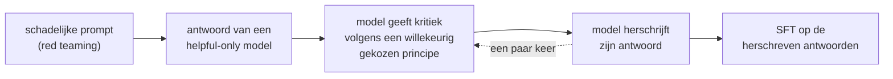
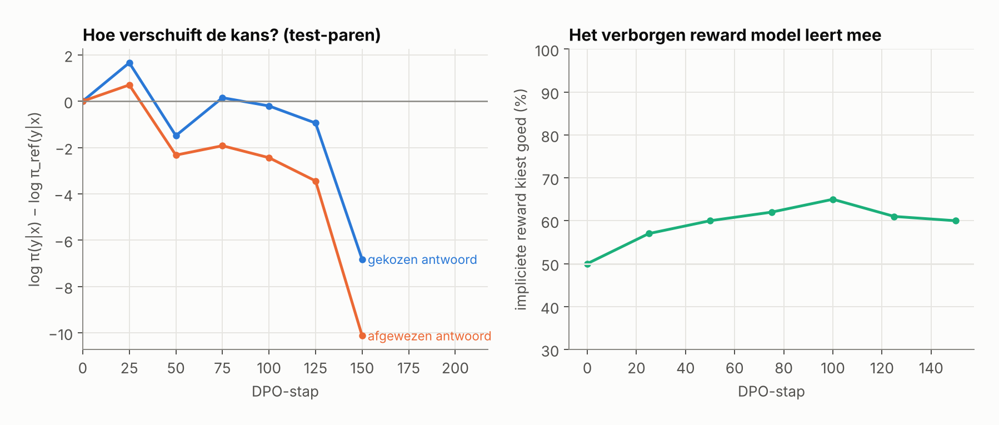

# 2.5 Constitutional AI en DPO: minder mensen, minder RL

*Module 2: Van tekstvoorspeller naar assistent* · ⏱️ ~50 min

> **Waar we naartoe werken.** RLHF werkt, maar het is duur en lastig. Je hebt tienduizenden menselijke oordelen nodig, en tijdens de RL-stap heb je vier modellen tegelijk in het geheugen (de policy, het referentiemodel, het reward model en de critic), met een training die gemakkelijk ontspoort. In dit hoofdstuk zie je twee ideeën die elk een stuk van dat probleem oplossen. **Constitutional AI** (Anthropic, 2022) vervangt een groot deel van de menselijke oordelen door oordelen van het model zelf, gestuurd door een lijst principes. **DPO** (Stanford, 2023) laat zien dat je de hele RL-stap kunt vervangen door één nette loss-functie. Het tweede idee is een van de mooiste afleidingen in dit vak, en je kunt hem met je optimalisatie-achtergrond volledig volgen.

---

## Deel A: Constitutional AI

### Het probleem met menselijke oordelen over schade

Neem het "harmless"-deel van RLHF: het model moet leren schadelijke verzoeken goed af te handelen. Daarvoor moeten mensen duizenden gesprekken lezen waarin iemand om iets schadelijks vraagt, en kiezen welk antwoord het minst schadelijk is. Dat heeft drie nadelen. Het is belastend werk voor de labelaars. Het is moeilijk consistent te houden: wat de een te ver vindt gaan, vindt de ander prima. En het leidde in de praktijk tot **ontwijkende** modellen: het "veiligste" antwoord volgens labelaars was vaak een kale weigering, ook bij vragen die prima te beantwoorden waren.

Er is ook een dieper probleem. Hoe capabeler modellen worden, hoe moeilijker het voor mensen wordt om hun antwoorden goed te beoordelen. Wie checkt een bewijs van tien pagina's, of duizend regels code? Op termijn heb je AI nodig om AI te helpen beoordelen. Constitutional AI was een eerste stap in die richting.

### Het idee: schrijf de principes op, en laat het model zichzelf beoordelen

In [*Constitutional AI: Harmlessness from AI Feedback*](https://arxiv.org/abs/2212.08073) (Bai et al., december 2022) vervangt Anthropic de menselijke schade-oordelen door een korte lijst **principes in gewone taal**: de *constitutie*. Bijvoorbeeld: *"Kies het antwoord dat het minst schadelijk is, en dat het meest lijkt op wat een wijs, ethisch persoon zou zeggen."* De enige menselijke inbreng voor het harmless-deel is die lijst. De methode heeft twee fasen.

**Fase 1: kritiek en herschrijven (supervised).**

Je neemt een model dat alleen op behulpzaamheid is getraind (en dus ook schadelijke verzoeken gewoon uitvoert). Je laat het een schadelijke prompt beantwoorden. Dan vraag je hetzelfde model om **kritiek** op dat antwoord, volgens een principe uit de constitutie. Daarna vraag je het antwoord te **herschrijven** op basis van die kritiek. De herschreven antwoorden worden SFT-data (2.3).

**Fase 2: AI-feedback in plaats van menselijke feedback (RLAIF).** Laat het model van fase 1 twee antwoorden genereren. Vraag een model welke van de twee beter past bij een principe. Die AI-oordelen worden de voorkeursparen waarop het reward model wordt getraind, precies zoals in 2.4. Daarna volgt de gewone RL-stap. Omdat de feedback van een AI komt, heet dit **RLAIF**: *Reinforcement Learning from AI Feedback*.

Het resultaat, volgens het paper: een assistent die **harmless maar niet ontwijkend** is. Hij gaat in op een schadelijke vraag door uit te leggen waarom hij er niet aan meewerkt, in plaats van alleen te weigeren. En het gedrag is bijstuurbaar door de tekst van de constitutie aan te passen, in plaats van nieuwe labels te verzamelen.

> 🔁 **Weet je nog?** In 2.1 zag je dat een AI-model de kwaliteitslabels voor FineWeb-Edu maakte. Hier zie je hetzelfde patroon in post-training: een model helpt de data voor het volgende model te maken. Dat patroon is nu overal; SFT-data is grotendeels synthetisch (2.3), en "LLM-as-a-judge" is een standaardmanier om modellen te evalueren (module 3).

### Van lijst naar document: de constitutie van Claude

Anthropic publiceerde in mei 2023 de principes die het voor Claude gebruikte, deels ontleend aan bronnen als de Universele Verklaring van de Rechten van de Mens. In januari 2026 volgde een [volledig nieuwe constitutie](https://www.anthropic.com/news/claude-new-constitution), en die laat zien hoe de aanpak is veranderd. In plaats van een lijst losse regels is het een lang document dat vooral **uitlegt waarom**: het idee is dat een model dat de redenen begrijpt, beter generaliseert naar situaties die niemand heeft voorzien. Voor een klein aantal gevallen met grote risico's blijven er harde grenzen (*hard constraints*).

Het document noemt vier kerneigenschappen, met een volgorde voor als ze botsen: **breed veilig** (geen ondermijning van passend menselijk toezicht op AI in deze fase), **breed ethisch**, **in lijn met de specifiekere richtlijnen van Anthropic**, en **echt behulpzaam**. Volgens Anthropic gebruikt Claude de constitutie ook zelf om synthetische trainingsdata te maken: gesprekken, antwoorden en rangschikkingen van antwoorden. Dat is Constitutional AI, verder ontwikkeld. De volledige tekst staat onder een CC0-licentie online.

> 💡 **Voor de consultant.** Voor een klant is de les van Constitutional AI niet "train je eigen model zo". Het is: **schrijf je gewenste gedrag op als principes met uitleg**, en gebruik die tekst overal: in de systeemprompt, in de richtlijnen voor wie data labelt, en als rubric voor een LLM-judge die je assistent evalueert. In de praktijkopdracht doe je precies dat met de regel "nooit een dekking toezeggen die niet in de polis staat".

---

## Deel B: DPO, of "je taalmodel is stiekem een reward model"

### Het probleem met de RL-stap

De RL-stap uit 2.4 is het lastigste deel van RLHF. Je moet tijdens de training steeds nieuwe antwoorden genereren (traag), je hebt vier modellen nodig, en PPO heeft veel hyperparameters waar de training gevoelig voor is. Kan het eenvoudiger?

In 2023 lieten Rafailov, Sharma, Mitchell en collega's van Stanford zien dat het kan, met een paper met een titel die precies zegt wat het idee is: [*Direct Preference Optimization: Your Language Model is Secretly a Reward Model*](https://arxiv.org/abs/2305.18290) (NeurIPS 2023). De afleiding is kort en elegant. We lopen hem door.

### Stap 1: het RLHF-doel heeft een exacte oplossing

Het doel van de RL-stap uit 2.4 is: maximaliseer de beloning, maar blijf dicht bij het referentiemodel:

$$\max_{\pi} \; \mathbb{E}_{y \sim \pi(\cdot \mid x)}\big[r(x, y)\big] - \beta \cdot \mathrm{KL}\big(\pi(\cdot \mid x) \Vert \pi_{\text{ref}}(\cdot \mid x)\big)$$

Dit is een optimalisatieprobleem over kansverdelingen, en het heeft een gesloten oplossing:

$$\pi^*(y \mid x) = \frac{1}{Z(x)} \; \pi_{\text{ref}}(y \mid x) \cdot \exp\!\left(\frac{r(x, y)}{\beta}\right)$$

met $Z(x)$ een normalisatieconstante zodat alles optelt tot 1.

> 🔁 **Weet je nog?** Kijk goed: dit is een **softmax**. Neem het referentiemodel als prior en geef elk antwoord een extra gewicht $e^{r/\beta}$. En $\beta$ speelt precies de rol van de **temperatuur** uit [Mini M1](../../../minis/M1-softmax-en-temperatuur.md). Kleine $\beta$: het model gaat vol voor het antwoord met de hoogste beloning. Grote $\beta$: het blijft bijna het referentiemodel. (Wie statistische fysica kent: het is een Boltzmannverdeling.) Je kunt de oplossing zelf afleiden met een Lagrange-multiplicator voor de restrictie dat de kansen optellen tot 1; dat is denkvraag 1.

Dat lijkt nutteloos. We kunnen $\pi^*$ niet uitrekenen, want $Z(x)$ is een som over **alle mogelijke antwoorden**, en dat zijn er astronomisch veel.

### Stap 2: draai de formule om

Hier komt de truc. Schrijf de formule om, zodat de beloning aan de linkerkant staat:

$$r(x, y) = \beta \log \frac{\pi^*(y \mid x)}{\pi_{\text{ref}}(y \mid x)} + \beta \log Z(x)$$

Lees wat hier staat. **Elke policy definieert een beloning.** Als je een taalmodel $\pi$ hebt, dan is de beloning waarvoor dat model optimaal zou zijn: $\beta$ keer de log-verhouding tussen het model en het referentiemodel. Antwoorden die het model waarschijnlijker vindt dan het referentiemodel, krijgen een hoge impliciete beloning. Dit is "je taalmodel is stiekem een reward model".

### Stap 3: stop het in Bradley-Terry, en de lastige term valt weg

Uit 2.4 weten we dat voorkeuren alleen afhangen van het **verschil** in beloning: $P(y_w \succ y_l) = \sigma\big(r(x, y_w) - r(x, y_l)\big)$. Vul de impliciete beloning in. Bij het verschil valt $\beta \log Z(x)$ precies weg, want het hangt alleen van de prompt af, niet van het antwoord. Wat overblijft:

$$\mathcal{L}_{\text{DPO}} = -\log \sigma\left(\beta \log \frac{\pi_\theta(y_w \mid x)}{\pi_{\text{ref}}(y_w \mid x)} \;-\; \beta \log \frac{\pi_\theta(y_l \mid x)}{\pi_{\text{ref}}(y_l \mid x)}\right)$$

Dat is alles. Geen reward model, geen sampling, geen PPO, geen critic. Alleen het model dat je traint, een bevroren kopie als referentie, en een dataset met voorkeursparen. Je berekent voor beide antwoorden de som van de log-kansen van de tokens (net als bij SFT), onder beide modellen, en vult de formule in. In [opdracht O2](../opdrachten/O2-reward-model-en-dpo.md) implementeer je deze loss zelf.

### Wat doet de gradiënt?

Leid de gradiënt af, en je krijgt (met $\hat r_\theta = \beta \log \pi_\theta / \pi_{\text{ref}}$ de impliciete beloning):

$$\nabla_\theta \mathcal{L}_{\text{DPO}} = -\beta \cdot \underbrace{\sigma\big(\hat r_\theta(x, y_l) - \hat r_\theta(x, y_w)\big)}_{\text{hoe fout zit het model nu?}} \cdot \Big[\nabla_\theta \log \pi_\theta(y_w \mid x) - \nabla_\theta \log \pi_\theta(y_l \mid x)\Big]$$

Lees het als een verhaal: **duw de kans op het gekozen antwoord omhoog, en die op het afgewezen antwoord omlaag**. En doe dat harder naarmate het model het paar nu nog verkeerd ordent. Paren die het model al goed heeft, dragen bijna niets meer bij. Dat gewicht voorkomt dat het model eindeloos doorduwt op paren die al goed zitten.

### Een echte (kleine) DPO-run

Ik heb DPO gedraaid op SmolLM2-135M-Instruct, met LoRA, op voorkeursparen uit HH-RLHF, met $\beta = 0{,}1$. Elke 25 stappen meet ik op 100 testparen hoe de log-kansen zijn verschoven ten opzichte van het referentiemodel, en hoe vaak de impliciete beloning het gekozen antwoord hoger zet.

*Figuur 2.10. Een kleine DPO-run (SmolLM2-135M-Instruct + LoRA, 150 stappen van 4 paren, HH-RLHF helpful-base). Links: de verschuiving van de log-kans op het gekozen en het afgewezen antwoord, gemiddeld over 100 testparen. Rechts: het percentage testparen waarop de impliciete beloning het gekozen antwoord hoger zet. Gemeten met [`tools/m2_experiments.py`](../../../tools/m2_experiments.py) (`dpo`). Bij stap 0 is het model gelijk aan het referentiemodel; alle marges zijn dan precies nul ("half goed", 50%).*

Rechts zie je dat het werkt, met mate: na 100 stappen zet de impliciete beloning 65% van de testparen in de goede volgorde, tegen 50% bij de start. Voor een model van 135 miljoen parameters, 600 trainingsparen en ruisige menselijke labels is dat een redelijk resultaat; daarna zakt het iets terug naar 60%, een eerste teken van overfitting.

Links zie je iets wat veel mensen verrast, en wat ook in grote DPO-runs is waargenomen. DPO duwt het **verschil** tussen gekozen en afgewezen omhoog, maar niets in de loss zegt dat de kans op het gekozen antwoord zelf moet stijgen. In het begin stijgen ze allebei. Daarna dalen ze allebei, het afgewezen antwoord alleen sneller: na 150 stappen is de log-kans van het gekozen antwoord 6,8 lager dan bij het referentiemodel, die van het afgewezen antwoord 10,1. De marge groeit, maar het model geeft beide antwoorden een veel kleinere kans dan voorheen. Waar gaat die kansmassa naartoe? Naar andere antwoorden, die in de dataset niet voorkomen en dus door niemand zijn beoordeeld. Dat is precies het "offline"-risico waar de volgende alinea over gaat, en de reden dat in de praktijk vaak een kleine SFT-term aan de DPO-loss wordt toegevoegd (Llama 3 deed dat bijvoorbeeld).

### DPO in de praktijk

DPO werd snel populair, juist omdat het zo eenvoudig is. SmolLM2-Instruct, het model uit de opdrachten, kreeg na SFT een [DPO-stap op UltraFeedback](https://huggingface.co/HuggingFaceTB/SmolLM2-135M-Instruct). Meta beschrijft voor Llama 3 een post-training van SFT, rejection sampling en DPO. Ze probeerden ook PPO, maar schrijven dat DPO op hun schaal minder rekenwerk vroeg en beter presteerde, vooral op het volgen van instructies; ze gebruikten dezelfde $\beta = 0{,}1$ als hierboven ([paper](https://arxiv.org/abs/2407.21783), sectie 4.1).

Is DPO dan altijd beter? Nee. DPO is **offline**: het leert alleen van vaste paren en verkent nooit zelf. Er is onderzoek dat laat zien dat een goed afgestelde PPO het op sommige taken beter doet (bijvoorbeeld [Xu et al., 2024](https://arxiv.org/abs/2404.10719)), en voor de nieuwste generatie redeneermodellen (2.6) is **online RL**, waarin het model zelf antwoorden genereert en daarop beoordeeld wordt, juist weer helemaal terug. De eerlijke samenvatting: DPO is de goedkope, stabiele standaard voor voorkeuren en stijl; online RL is de krachtige, dure keuze als je wilt dat het model iets nieuws ontdekt.

---

## Samenvatting: wat je nu weet

1. **Constitutional AI** vervangt menselijke schade-oordelen door AI-oordelen volgens een geschreven **constitutie**: eerst kritiek en herschrijven (SFT), dan **RLAIF**. Het resultaat is harmless zonder ontwijkend te zijn, en bijstuurbaar via tekst.
2. Claude's **constitutie van 2026** legt waarden uit in plaats van regels op te sommen, met een volgorde: veilig, ethisch, richtlijnen, behulpzaam. Claude gebruikt hem zelf om trainingsdata te maken.
3. Het KL-geregulariseerde RLHF-doel heeft een gesloten oplossing (een softmax met $\beta$ als temperatuur). Omgedraaid definieert **elke policy een impliciete beloning**.
4. In Bradley-Terry valt de onberekenbare normalisatie weg, en blijft de **DPO-loss** over: een classificatieverlies op voorkeursparen, zonder reward model of RL.
5. DPO is stabiel en goedkoop maar **offline**; online RL blijft belangrijk voor taken waarin het model zelf moet ontdekken.

---

### ✏️ Denkvragen
1. Leid de oplossing $\pi^* \propto \pi_{\text{ref}} \exp(r/\beta)$ af. Schrijf het doel als een som over antwoorden $y$, voeg een Lagrange-multiplicator toe voor $\sum_y \pi(y) = 1$, en zet de afgeleide naar $\pi(y)$ op nul.
2. Wat gebeurt er met de DPO-loss als $\pi_\theta = \pi_{\text{ref}}$ (aan het begin van de training)? Wat is de waarde van de loss, en wat is de grootte van het gewicht in de gradiënt?
3. In figuur 2.10 kan de kans op het gekozen antwoord dalen terwijl de nauwkeurigheid stijgt. Hoe kan dat? Waarom is dat potentieel een probleem?
4. Een klant wil zijn klantenservicebot "veiliger" maken. Schrijf drie principes in de stijl van een constitutie, elk met één zin uitleg waarom. Hoe zou je met die principes een LLM-judge maken?

**Volgende:** [2.6 Reasoning-modellen](2.6-reasoning-modellen.md)
