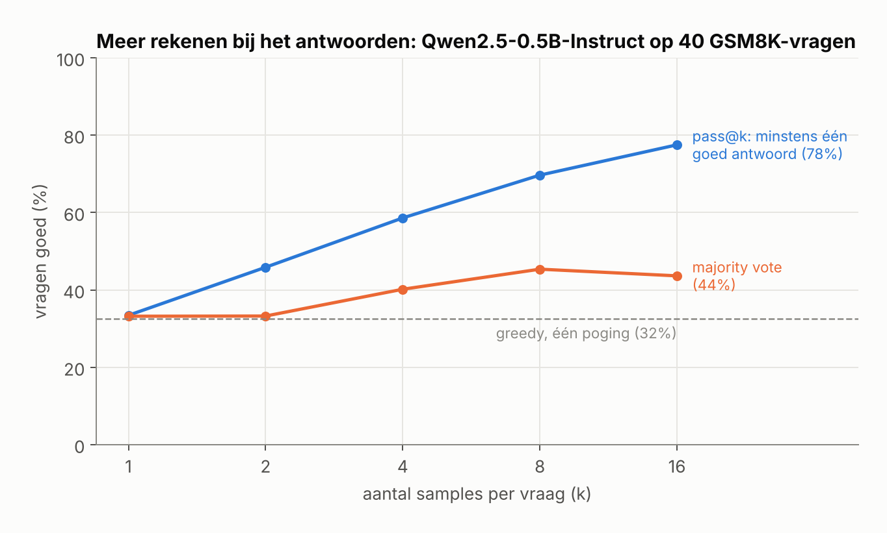
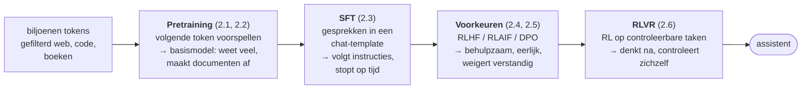

# 2.6 Reasoning-modellen: leren nadenken met verifieerbare beloningen

*Module 2: Van tekstvoorspeller naar assistent* · ⏱️ ~55 min

> **Waar we naartoe werken.** Sinds eind 2024 hebben de sterkste modellen een nieuwe knop: ze kunnen **nadenken** voordat ze antwoorden, soms minutenlang. Ze schrijven een lange gedachtegang, controleren zichzelf, beginnen opnieuw, en geven dan pas een antwoord. In wiskunde en programmeren maakte dat een sprong die met schaal alleen niet was gelukt. In dit laatste hoofdstuk zie je waarom "meer tokens" letterlijk "meer nadenken" is, meet je zelf wat extra rekenwerk tijdens het antwoorden oplevert, en zie je hoe RL met **verifieerbare beloningen** modellen leert om dat rekenwerk goed te gebruiken. Aan het eind heb je het complete antwoord op de vraag van deze module.

---

## Een puzzel om mee te beginnen

Beantwoord deze vraag zo snel als je kunt:

> *Een racket en een bal kosten samen € 1,10. Het racket kost € 1,00 meer dan de bal. Hoeveel kost de bal?*

Als je eerste ingeving "10 cent" was, ben je in goed gezelschap. Het juiste antwoord is 5 cent (dan kost het racket € 1,05, samen € 1,10). Wie even de tijd neemt en het uitschrijft, vindt het makkelijk. Wie in één keer antwoordt, gaat vaak mis.

Een taalmodel heeft precies dit probleem, maar dan structureel.

> 🔁 **Weet je nog?** In module 1 zag je dat het model per token een **vaste** hoeveelheid rekenwerk doet: één keer door alle lagen, van onder naar boven (1.3), en dan het volgende token (1.4). Er is geen lus die langer doordenkt als de vraag moeilijker is. Een GPT-2 heeft per token 12 lagen, punt.

Als het model direct "5 cent" moet zeggen, moet de hele berekening passen in de lagen die bij dat ene token horen. Maar als het model eerst schrijft *"Noem de prijs van de bal x. Dan kost het racket x + 1,00. Samen 2x + 1,00 = 1,10, dus x = …"*, dan heeft het voor elk van die tussenstappen een volledige ronde door het model gehad. De tekst die het schrijft wordt zijn **kladpapier**: elke volgende stap kan, via attention, alles teruglezen wat het al heeft uitgerekend. **Meer tokens is letterlijk meer rekenwerk.**

---

## Chain-of-thought: denken door te schrijven

Dat inzicht werd in 2022 zichtbaar. [Wei et al.](https://arxiv.org/abs/2201.11903) lieten zien dat je grote modellen veel beter laat rekenen door in de voorbeelden van je prompt niet alleen het antwoord te geven, maar ook de tussenstappen: **chain-of-thought prompting**. Een paar maanden later ontdekten [Kojima et al.](https://arxiv.org/abs/2205.11916) dat je niet eens voorbeelden nodig hebt. De zin *"Let's think step by step"* aan het eind van een vraag was al genoeg om de score op rekensommen flink te verhogen.

Dat een basismodel dit kan, is geen wonder als je terugdenkt aan 2.1. Op internet staan talloze uitgewerkte sommen, bewijzen en debugsessies. "Laten we dit stap voor stap doen" is het begin van een document waarin de stappen volgen.

### Meer samples, meer kans

Er is nog een tweede manier om meer rekenwerk in een antwoord te stoppen: laat het model het **meerdere keren** proberen. [Wang et al. (2022)](https://arxiv.org/abs/2203.11171) noemden dit **self-consistency**: trek een paar gedachtegangen (met temperatuur > 0, zie [1.4](../../01-transformers/notes/1.4-van-model-naar-tekst.md)), en neem het antwoord dat het vaakst voorkomt. Het idee: er zijn veel manieren om het goed te doen, en ze komen allemaal uit bij hetzelfde antwoord; foute redeneringen gaan alle kanten op.

Dat kun je zelf meten. Ik heb Qwen2.5-0.5B-Instruct (een klein model, half miljard parameters) rekenvragen uit [GSM8K](https://huggingface.co/datasets/openai/gsm8k) laten oplossen, de standaardbenchmark met rekenvraagstukken op basisschoolniveau. Per vraag één keer greedy, en 16 keer met sampling.

*Figuur 2.11. Qwen2.5-0.5B-Instruct op willekeurig gekozen GSM8K-vragen, met de standaardprompt "reason step by step". Grijs: één greedy antwoord. Oranje: **majority vote** over $k$ samples (temperatuur 0,7). Blauw: **pass@k**, de kans dat minstens één van de $k$ samples goed is. Gemeten met [`tools/m2_experiments.py`](../../../tools/m2_experiments.py) (`gsm8k`). Maximaal 320 nieuwe tokens per antwoord.*

Met één greedy antwoord haalt dit kleine model 32,5% van de 40 vragen. Laat je het 16 keer samplen en stemmen, dan stijgt dat naar ongeveer 44%. Maar kijk naar de blauwe lijn: bij **78%** van de vragen zat er onder de 16 samples minstens één goed antwoord.

Een eerlijke kanttekening bij deze getallen. In 38% van de samples liep de gedachtegang tegen de grens van 320 tokens aan en werd hij afgekapt, en een afgekapt antwoord telt als fout. Met meer ruimte en een andere prompt komen andere metingen voor dit model hoger uit. Dat is op zichzelf al een les over test-time compute: de **maximale lengte** van een gedachtegang is een knop die de score direct beïnvloedt. Probeer het in O4 met 512 tokens.

> 🔁 **Weet je nog?** pass@k bereken je niet door $k$ keer opnieuw te samplen, maar met een zuivere schatter uit $n$ samples waarvan er $c$ goed zijn: $\text{pass@}k = 1 - \binom{n-c}{k} / \binom{n}{k}$. Dat is gewone combinatoriek: de kans dat een willekeurige greep van $k$ uit $n$ alleen foute samples bevat. Je implementeert hem in [opdracht O4](../opdrachten/O4-test-time-compute.md).

Kijk vooral naar het **gat tussen blauw en oranje**. Voor veel vragen zit het goede antwoord er dus wel tussen, maar kiest de meerderheid het verkeerde. Als je zou weten *welk* sample goed is, zou je veel beter scoren. Daarvoor heb je een **verifier** nodig. En bij wiskunde en code heb je die vaak gewoon: je kunt het antwoord narekenen, of de tests draaien.

---

## Van prompt naar training: RL met verifieerbare beloningen

Hier komen de lijnen van deze module samen. In 2.4 zag je RLHF: RL tegen een **reward model**, een geleerde benadering van wat mensen goed vinden. Het grote probleem was reward hacking: het model leerde het reward model te bespelen.

Maar voor een rekensom heb je geen reward model nodig. Het antwoord is goed of fout. Dat geeft een simpel recept, dat **RLVR** heet (*Reinforcement Learning with Verifiable Rewards*):

1. Geef het model een opgave met een controleerbaar antwoord (een wiskundevraag, een programmeeropgave met tests).
2. Laat het een gedachtegang plus antwoord genereren.
3. Beloning 1 als het antwoord klopt, 0 als het niet klopt. Eventueel een kleine beloning voor het juiste format.
4. Policy-gradient-update (2.4): versterk de gedachtegangen die tot een goed antwoord leidden.

Het verschil met de prompt-truc is groot. Met RLVR leert het model niet alleen *dat* het stap voor stap moet werken, maar ook *welke* manier van nadenken werkt: wanneer het moet terugkijken, wanneer het een aanpak moet opgeven, wanneer het zichzelf moet controleren. Niemand schrijft die strategieën voor. Ze worden beloond omdat ze vaker tot het goede antwoord leiden.

### OpenAI o1: twee scaling-assen

In september 2024 kondigde OpenAI [o1](https://openai.com/index/learning-to-reason-with-llms/) aan, het eerste model dat op deze manier breed werd uitgerold. Het blog liet twee grafieken zien die het idee samenvatten: de score op wiskundewedstrijdvragen (AIME) steeg gestaag met meer **train-time compute** (meer RL) én met meer **test-time compute** (langer laten nadenken). OpenAI rapporteerde dat o1 met één sample per vraag gemiddeld 74% van de AIME-2024-opgaven oploste, tegen 12% voor GPT-4o. Met een meerderheidsstem over 64 samples werd dat 83%.

Dat is het belangrijke inzicht: naast de drie assen uit 2.2 (parameters, data, trainings-compute) is er een **vierde**: hoeveel rekenwerk je per vraag besteedt. En die kun je per vraag kiezen. Een makkelijke vraag krijgt een kort antwoord, een moeilijke een lange denkfase.

### DeepSeek-R1: het recept in de openbaarheid

OpenAI publiceerde geen details. Dat deed DeepSeek wel, in januari 2025, met [DeepSeek-R1](https://arxiv.org/abs/2501.12948). Later dat jaar verscheen het werk ook, na peer review, in [*Nature*](https://doi.org/10.1038/s41586-025-09422-z). Het paper beschrijft twee modellen.

**DeepSeek-R1-Zero** is het radicaalste experiment. Ze namen hun basismodel en sloegen SFT volledig over. Alleen RL, met twee regelgebaseerde beloningen: is het antwoord goed, en staat de gedachtegang tussen `<think>`-tags. Tijdens de training steeg de score op AIME 2024 van 15,6% naar 71,0% (pass@1), en naar 86,7% met een meerderheidsstem. Daarbij gebeurde iets wat niemand had geprogrammeerd: de antwoorden werden steeds **langer**, en het model begon zichzelf te controleren en eerdere stappen te herzien. De auteurs beschreven een "aha-moment" waarop een tussenversie van het model midden in een berekening opschreef dat het opnieuw moest kijken. R1-Zero had ook problemen: de gedachtegangen waren soms slecht leesbaar en wisselden tussen talen.

**DeepSeek-R1** loste dat op met een iets conventioneler recept: eerst een kleine hoeveelheid SFT op voorbeelden van goede, leesbare gedachtegangen (*cold start*), dan RLVR, dan nog een ronde SFT en RL voor algemene behulpzaamheid. Het resultaat haalde op redeneertaken het niveau van OpenAI's o1. En de gedachtegangen van R1 werden vervolgens gebruikt als SFT-data om **kleine** modellen (1,5 tot 70 miljard parameters, op basis van Qwen en Llama) te distilleren tot verrassend goede redeneerders. Weet je nog uit 2.3: SFT leert vooral het format. Hier blijkt "denk lang en controleer jezelf" een format dat je kunt overdragen.

### GRPO: RL zonder critic

DeepSeek gebruikte niet PPO, maar **GRPO** (*Group Relative Policy Optimization*, uit [DeepSeekMath](https://arxiv.org/abs/2402.03300)). Het idee is mooi eenvoudig, en je hebt de ingrediënten al gezien.

> 🔁 **Weet je nog?** In 2.4 had de policy gradient een **baseline** $b$ nodig, zodat je antwoorden beloont die beter zijn dan gemiddeld. PPO leert daarvoor een apart netwerk, de critic.

GRPO slaat de critic over. Genereer voor elke vraag een **groep** van $G$ antwoorden (bijvoorbeeld 16), en gebruik het groepsgemiddelde als baseline:

$$A_i = \frac{r_i - \text{gemiddelde}(r_1, \dots, r_G)}{\text{std}(r_1, \dots, r_G)}$$

Een antwoord dat goed is terwijl de meeste in de groep fout zijn, krijgt een groot positief voordeel. Een antwoord dat fout is terwijl de rest goed is, een groot negatief. Zijn ze allemaal goed (of allemaal fout), dan leert het model van die vraag niets: te makkelijk, of te moeilijk. Dat scheelt een heel netwerk in het geheugen, en het past perfect bij de 16 samples per vraag die je in figuur 2.11 al trok.

---

## Kanttekeningen

Reasoning-modellen zijn een echte stap, maar er zijn drie dingen die je als engineer moet weten.

**Leert RL nieuwe vaardigheden, of maakt het bestaande betrouwbaarder?** [Yue et al. (2025)](https://arxiv.org/abs/2504.13837) vergeleken modellen vóór en na RLVR met pass@k voor grote $k$. Bij $k = 1$ wint het RL-model ruim. Maar bij grote $k$ haalt het **basismodel** een even hoge of zelfs hogere score: de goede redeneringen zaten al in zijn verdeling, ze waren alleen zeldzaam. Hun conclusie: de huidige RLVR maakt vooral bestaande redeneerpaden waarschijnlijker, en breidt de grens van wat het model kan minder uit dan gedacht. Vergelijk dat met het gat tussen pass@k en majority vote in figuur 2.11: RL is een manier om het blauwe getal naar het oranje (en het grijze) te trekken. Dit is een actief onderzoeksdebat; latere werk met langere en grotere RL-runs nuanceert het beeld weer.

**De gedachtegang is niet per se de echte gedachtegang.** Het zou mooi zijn als je in de gedachtegang van een model kon lezen waarom het iets doet. Onderzoekers van Anthropic testten dat ([*Reasoning models don't always say what they think*](https://www.anthropic.com/research/reasoning-models-dont-say-think), 2025). Ze stopten een hint naar het antwoord in de prompt, en keken of het model in zijn gedachtegang toegaf dat het die hint gebruikte, in de gevallen dat het dat aantoonbaar deed. Claude 3.7 Sonnet noemde de hint gemiddeld in 25% van die gevallen, DeepSeek-R1 in 39%. De gedachtegang is dus nuttig, maar geen betrouwbaar logboek. Daar gaat module 7 verder op in.

**Nadenken kost tokens, en tokens kosten geld.** Een antwoord met een denkfase van 5.000 tokens kost (bij de API-prijzen per token uit module 1) vele malen meer dan een direct antwoord, en duurt langer. Daarom laten moderne modellen je het denkbudget kiezen. [Claude 3.7 Sonnet](https://www.anthropic.com/news/claude-3-7-sonnet) (februari 2025) was volgens Anthropic het eerste "hybride" redeneermodel: één model dat direct kan antwoorden of eerst uitgebreid nadenkt, waarbij je via de API instelt hoe lang.

> 💡 **Voor de consultant.** Voor een klant is de vraag niet "reasoning-model of niet", maar: *welke vragen verdienen een denkbudget?* Een FAQ-bot heeft er niets aan. Een agent die een schadeclaim beoordeelt aan de hand van een polis van veertig pagina's waarschijnlijk wel. Meet het: kwaliteit, kosten en wachttijd naast elkaar.

---

## Het complete plaatje: van tekstvoorspeller naar assistent

Je kunt nu de vraag beantwoorden waarmee module 1 eindigde.

> *"GPT-2 en Claude hebben grofweg dezelfde architectuur. Het verschil zit in de training. Pretraining op een enorme hoeveelheid tekst geeft een model dat veel weet, maar alleen documenten afmaakt. Supervised fine-tuning leert het één nieuw soort document: een gesprek met een behulpzame assistent, met een duidelijk einde. Training op voorkeuren, van mensen (RLHF) of van een AI met een geschreven constitutie (RLAIF), leert het welke antwoorden beter zijn dan andere, inclusief wanneer het moet weigeren. En RL met verifieerbare beloningen leert het om lang na te denken en zichzelf te controleren voordat het antwoordt. De architectuur doet het rekenwerk; de training bepaalt wat er wordt uitgerekend."*

In de praktijk lopen die stappen door elkaar en worden ze herhaald (Llama 3 deed meerdere rondes SFT en DPO, R1 wisselde SFT en RL af), en de exacte recepten van gesloten modellen zoals Claude zijn niet openbaar. Maar de bouwstenen zijn deze. Je kent ze nu allemaal.

---

## Samenvatting: wat je nu weet

1. Een model doet per token een vaste hoeveelheid rekenwerk. **Meer tokens = meer rekenwerk**: een gedachtegang is kladpapier.
2. **Chain-of-thought** (prompten) en **self-consistency** (meerdere samples, meerderheid) verbeteren rekenvaardigheid zonder training. Het gat tussen pass@k en majority vote laat zien hoeveel een goede verifier waard is.
3. **RLVR** traint met beloningen die je kunt controleren (goed/fout, tests slagen). Dat vermijdt een reward model om te bespelen, en leert het model zelf strategieën als terugkijken en controleren.
4. **o1** en **DeepSeek-R1** lieten zien dat prestaties schalen met train-time én **test-time compute**. **GRPO** gebruikt het gemiddelde van een groep samples als baseline, zonder critic.
5. Kanttekeningen: RL maakt vooral bestaande redeneringen waarschijnlijker, gedachtegangen zijn niet altijd **getrouw**, en nadenken kost tokens.

---

### ✏️ Denkvragen
1. Waarom helpt "Let's think step by step" een groot model wel en een heel klein model nauwelijks? Gebruik wat je in 2.2 over emergentie las.
2. Bij GRPO krijgt een vraag waarop alle 16 samples goed zijn geen leersignaal. Is dat een bug of een feature? Wat betekent het voor hoe je de trainingsvragen kiest?
3. Bedenk een taak uit je eigen vakgebied (OR, regeltechniek, planning) waarvoor je een verifieerbare beloning kunt maken. En een taak waarvoor dat niet kan. Wat betekent dat voor waar reasoning-modellen het eerst goed in worden?
4. Een model mag 16 keer samplen. Je hebt een perfecte verifier. Welke score haal je dan in figuur 2.11? En zonder verifier, met majority vote? Wat kost elk, vergeleken met één greedy antwoord?

**Volgende:** [Opdracht O4: Test-time compute](../opdrachten/O4-test-time-compute.md) → [Zelftoets](../zelftoets.md)
